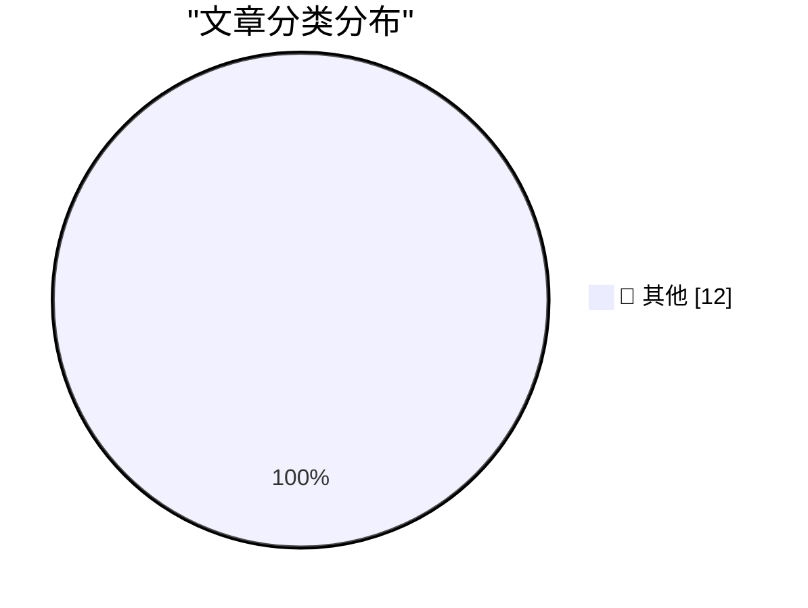

# 📰 AI 博客每日精选 — 2026-10-13

> 来自 Karpathy 推荐的 92 个顶级技术博客，AI 精选 Top 12

## 🏆 今日必读

🥇 **Hello Python 3.15, goodbye 3.10, and now I can use 3.11**

[Hello Python 3.15, goodbye 3.10, and now I can use 3.11](https://simonwillison.net/2026/Oct/12/python-3-15/) — simonwillison.net · 4 小时前 · 📝 其他

> Hello Python 3.15, goodbye 3.10, and now I can use 3.11

🥈 **datasette-ports 0.4**

[datasette-ports 0.4](https://simonwillison.net/2026/Oct/12/datasette-ports/) — simonwillison.net · 17 小时前 · 📝 其他

> datasette-ports 0.4

🥉 **Software engineers don't get to be Luddites about AI**

[Software engineers don't get to be Luddites about AI](https://seangoedecke.com/software-engineers-dont-get-to-be-luddites-about-ai/) — seangoedecke.com · 22 小时前 · 📝 其他

> Software engineers don't get to be Luddites about AI

---

## 📊 数据概览

| 扫描源 | 抓取文章 | 时间范围 | 精选 |
|:---:|:---:|:---:|:---:|
| 83/92 | 2537 篇 → 12 篇 | 24h | **12 篇** |

### 分类分布

---

## 📝 其他

### 1. Hello Python 3.15, goodbye 3.10, and now I can use 3.11

[Hello Python 3.15, goodbye 3.10, and now I can use 3.11](https://simonwillison.net/2026/Oct/12/python-3-15/) — **simonwillison.net** · 4 小时前 · ⭐ 15/30

> Hello Python 3.15, goodbye 3.10, and now I can use 3.11

---

### 2. datasette-ports 0.4

[datasette-ports 0.4](https://simonwillison.net/2026/Oct/12/datasette-ports/) — **simonwillison.net** · 17 小时前 · ⭐ 15/30

> datasette-ports 0.4

---

### 3. Software engineers don't get to be Luddites about AI

[Software engineers don't get to be Luddites about AI](https://seangoedecke.com/software-engineers-dont-get-to-be-luddites-about-ai/) — **seangoedecke.com** · 22 小时前 · ⭐ 15/30

> Software engineers don't get to be Luddites about AI

---

### 4. Mark Stephens, a.k.a. Robert X. Cringely, Died at 73

[Mark Stephens, a.k.a. Robert X. Cringely, Died at 73](https://www.facebook.com/story.php?story_fbid=pfbid0YbCLrAJfBirAWuPBy4a7pauaQ6gHkAPUwtbzyg2wAjeMcruFC7dWUZKQJKkNChP9l&amp;id=536506060&amp;_rdr) — **daringfireball.net** · 6 小时前 · ⭐ 15/30

> Mark Stephens, a.k.a. Robert X. Cringely, Died at 73

---

### 5. Pluralistic: How labor rights rescued Ultima from a monopolist (12 Oct 2026)

[Pluralistic: How labor rights rescued Ultima from a monopolist (12 Oct 2026)](https://pluralistic.net/2026/10/12/termination-of-transfer/) — **pluralistic.net** · 11 小时前 · ⭐ 15/30

> Pluralistic: How labor rights rescued Ultima from a monopolist (12 Oct 2026)

---

### 6. Categorical models of logics

[Categorical models of logics](https://www.johndcook.com/blog/2026/10/12/categorical-models-of-logics/) — **johndcook.com** · 9 小时前 · ⭐ 15/30

> Categorical models of logics

---

### 7. Just say no to OpenAI and Anthropic

[Just say no to OpenAI and Anthropic](https://micahflee.com/just-say-no-to-openai-and-anthropic/) — **micahflee.com** · 23 小时前 · ⭐ 15/30

> Just say no to OpenAI and Anthropic

---

### 8. Now That’s What I Call Technical Debt!

[Now That’s What I Call Technical Debt!](https://nesbitt.io/2026/10/12/now-thats-what-i-call-technical-debt.html) — **nesbitt.io** · 13 小时前 · ⭐ 15/30

> Now That’s What I Call Technical Debt!

---

### 9. The X is Off-Target

[The X is Off-Target](https://feed.tedium.co/link/15204/17494770/x-social-media-monoliths-critique) — **tedium.co** · 6 小时前 · ⭐ 15/30

> The X is Off-Target

---

### 10. Nvidia’s first GPU: GeForce 256

[Nvidia’s first GPU: GeForce 256](https://dfarq.homeip.net/nvidias-first-gpu-geforce-256/?utm_source=rss&#038;utm_medium=rss&#038;utm_campaign=nvidias-first-gpu-geforce-256) — **dfarq.homeip.net** · 11 小时前 · ⭐ 15/30

> Nvidia’s first GPU: GeForce 256

---

### 11. Refurb weekend II: Alpha Micro Eagle 300 and friends

[Refurb weekend II: Alpha Micro Eagle 300 and friends](https://oldvcr.blogspot.com/feeds/3996311687258717625/comments/default) — **oldvcr.blogspot.com** · 21 小时前 · ⭐ 15/30

> Refurb weekend II: Alpha Micro Eagle 300 and friends

---

### 12. from plesiochronous to synchronous

[from plesiochronous to synchronous](https://computer.rip/2026-10-12-plesiochronous.html) — **computer.rip** · 22 小时前 · ⭐ 15/30

> from plesiochronous to synchronous

---

*生成于 2026-10-13 06:51 (Asia/Shanghai) | 扫描 83 源 → 获取 2537 篇 → 精选 12 篇*
*基于 [Hacker News Popularity Contest 2025](https://refactoringenglish.com/tools/hn-popularity/) RSS 源列表，由 [Andrej Karpathy](https://x.com/karpathy) 推荐*
*由「懂点儿AI」制作，欢迎关注同名微信公众号获取更多 AI 实用技巧 💡*
