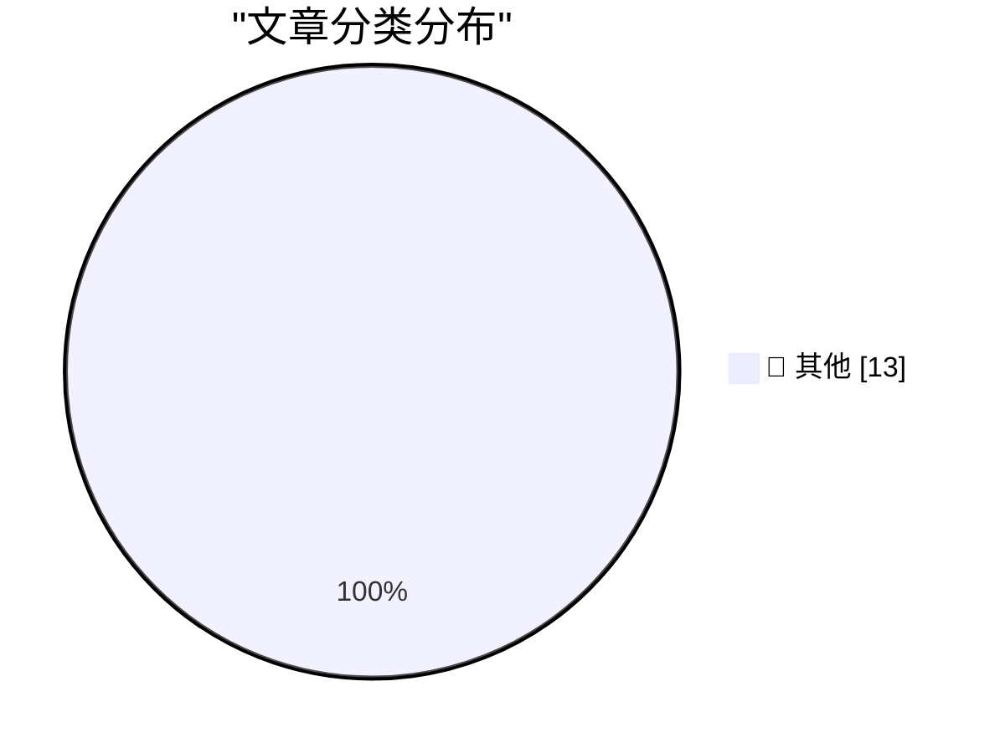

# 📰 AI 博客每日精选 — 2026-10-14

> 来自 Karpathy 推荐的 92 个顶级技术博客，AI 精选 Top 13

## 🏆 今日必读

🥇 **Quoting Geoffrey Huntley**

[Quoting Geoffrey Huntley](https://simonwillison.net/2026/Oct/13/geoffrey-huntley/) — simonwillison.net · 7 小时前 · 📝 其他

> Quoting Geoffrey Huntley

🥈 **Apple HomeView**

[Apple HomeView](https://www.apple.com/newsroom/2026/10/meet-apple-homeview-a-new-way-to-enjoy-entertainment-and-manage-the-home/) — daringfireball.net · 6 小时前 · 📝 其他

> Apple HomeView

🥉 **The Last Answer**

[The Last Answer](https://idiallo.com/blog/the-last-answer) — idiallo.com · 11 小时前 · 📝 其他

> The Last Answer

---

## 📊 数据概览

| 扫描源 | 抓取文章 | 时间范围 | 精选 |
|:---:|:---:|:---:|:---:|
| 83/92 | 2537 篇 → 13 篇 | 24h | **13 篇** |

### 分类分布

---

## 📝 其他

### 1. Quoting Geoffrey Huntley

[Quoting Geoffrey Huntley](https://simonwillison.net/2026/Oct/13/geoffrey-huntley/) — **simonwillison.net** · 7 小时前 · ⭐ 15/30

> Quoting Geoffrey Huntley

---

### 2. Apple HomeView

[Apple HomeView](https://www.apple.com/newsroom/2026/10/meet-apple-homeview-a-new-way-to-enjoy-entertainment-and-manage-the-home/) — **daringfireball.net** · 6 小时前 · ⭐ 15/30

> Apple HomeView

---

### 3. The Last Answer

[The Last Answer](https://idiallo.com/blog/the-last-answer) — **idiallo.com** · 11 小时前 · ⭐ 15/30

> The Last Answer

---

### 4. Pluralistic: Bundestrojaner (13 Oct 2026)

[Pluralistic: Bundestrojaner (13 Oct 2026)](https://pluralistic.net/2026/10/13/petards-r-us/) — **pluralistic.net** · 9 小时前 · ⭐ 15/30

> Pluralistic: Bundestrojaner (13 Oct 2026)

---

### 5. Book Review: The Thousand Deaths of Romeo and Juliet - Caroline Finch ★★★★★

[Book Review: The Thousand Deaths of Romeo and Juliet - Caroline Finch ★★★★★](https://shkspr.mobi/blog/2026/10/book-review-the-thousand-deaths-of-romeo-and-juliet-caroline-finch/) — **shkspr.mobi** · 9 小时前 · ⭐ 15/30

> Book Review: The Thousand Deaths of Romeo and Juliet - Caroline Finch ★★★★★

---

### 6. C++ futures part 2: The mental model for std::promise, std::packaged_task

[C++ futures part 2: The mental model for std::promise, std::packaged_task](https://devblogs.microsoft.com/oldnewthing/20261013-00/?p=112769/) — **devblogs.microsoft.com/oldnewthing** · 7 小时前 · ⭐ 15/30

> C++ futures part 2: The mental model for std::promise, std::packaged_task

---

### 7. Harmonic triangle

[Harmonic triangle](https://www.johndcook.com/blog/2026/10/13/harmonic-triangle/) — **johndcook.com** · 7 小时前 · ⭐ 15/30

> Harmonic triangle

---

### 8. The geometric model of maintenance

[The geometric model of maintenance](https://entropicthoughts.com/geometric-model-of-maintenance) — **entropicthoughts.com** · 23 小时前 · ⭐ 15/30

> The geometric model of maintenance

---

### 9. Annualized Enron Rate

[Annualized Enron Rate](https://www.wheresyoured.at/annualized-enron-rate/) — **wheresyoured.at** · 5 小时前 · ⭐ 15/30

> Annualized Enron Rate

---

### 10. What happened to Ashton-Tate and dBase

[What happened to Ashton-Tate and dBase](https://dfarq.homeip.net/what-happened-to-ashton-tate-and-dbase/?utm_source=rss&#038;utm_medium=rss&#038;utm_campaign=what-happened-to-ashton-tate-and-dbase) — **dfarq.homeip.net** · 10 小时前 · ⭐ 15/30

> What happened to Ashton-Tate and dBase

---

### 11. Subterranean Warfare – An Urgent DoW Need Without An Owner

[Subterranean Warfare – An Urgent DoW Need Without An Owner](https://steveblank.com/2026/10/13/subterranean-warfare-an-urgent-dow-need-without-an-owner/) — **steveblank.com** · 8 小时前 · ⭐ 15/30

> Subterranean Warfare – An Urgent DoW Need Without An Owner

---

### 12. Weekly Update 525: AI Data Breach Hyperbole

[Weekly Update 525: AI Data Breach Hyperbole](https://www.troyhunt.com/weekly-update-525/) — **troyhunt.com** · 10 小时前 · ⭐ 15/30

> Weekly Update 525: AI Data Breach Hyperbole

---

### 13. Claude, don’t touch my lump

[Claude, don’t touch my lump](https://www.experimental-history.com/p/claude-dont-touch-my-lump) — **experimental-history.com** · 4 分钟前 · ⭐ 15/30

> Claude, don’t touch my lump

---

*生成于 2026-10-14 05:08 (Asia/Shanghai) | 扫描 83 源 → 获取 2537 篇 → 精选 13 篇*
*基于 [Hacker News Popularity Contest 2025](https://refactoringenglish.com/tools/hn-popularity/) RSS 源列表，由 [Andrej Karpathy](https://x.com/karpathy) 推荐*
*由「懂点儿AI」制作，欢迎关注同名微信公众号获取更多 AI 实用技巧 💡*
