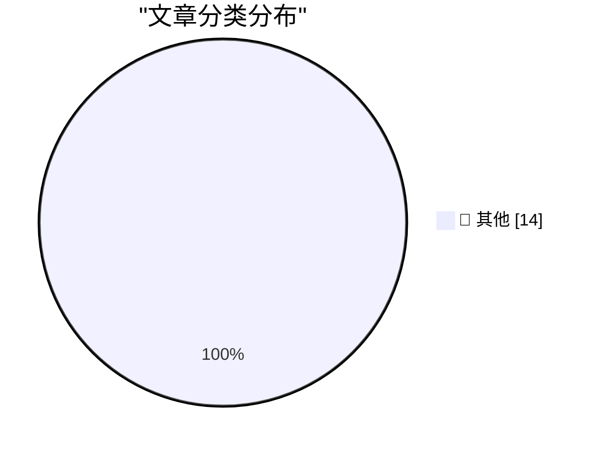

# 📰 AI 博客每日精选 — 2026-10-15

> 来自 Karpathy 推荐的 92 个顶级技术博客，AI 精选 Top 14

## 🏆 今日必读

🥇 **AI is mass decompiling games. That's both awesome and scary.**

[AI is mass decompiling games. That's both awesome and scary.](https://simonwillison.net/2026/Oct/14/ai-is-mass-decompiling-games/) — simonwillison.net · 3 小时前 · 📝 其他

> AI is mass decompiling games. That's both awesome and scary.

🥈 **Redesigning source control at Anthropic**

[Redesigning source control at Anthropic](https://simonwillison.net/2026/Oct/13/redesigning-source-control-at-anthropic/) — simonwillison.net · 21 小时前 · 📝 其他

> Redesigning source control at Anthropic

🥉 **llm-gemini 0.35**

[llm-gemini 0.35](https://simonwillison.net/2026/Oct/13/llm-gemini/) — simonwillison.net · 21 小时前 · 📝 其他

> llm-gemini 0.35

---

## 📊 数据概览

| 扫描源 | 抓取文章 | 时间范围 | 精选 |
|:---:|:---:|:---:|:---:|
| 83/92 | 2533 篇 → 14 篇 | 24h | **14 篇** |

### 分类分布

---

## 📝 其他

### 1. AI is mass decompiling games. That's both awesome and scary.

[AI is mass decompiling games. That's both awesome and scary.](https://simonwillison.net/2026/Oct/14/ai-is-mass-decompiling-games/) — **simonwillison.net** · 3 小时前 · ⭐ 15/30

> AI is mass decompiling games. That's both awesome and scary.

---

### 2. Redesigning source control at Anthropic

[Redesigning source control at Anthropic](https://simonwillison.net/2026/Oct/13/redesigning-source-control-at-anthropic/) — **simonwillison.net** · 21 小时前 · ⭐ 15/30

> Redesigning source control at Anthropic

---

### 3. llm-gemini 0.35

[llm-gemini 0.35](https://simonwillison.net/2026/Oct/13/llm-gemini/) — **simonwillison.net** · 21 小时前 · ⭐ 15/30

> llm-gemini 0.35

---

### 4. Formlabs dropped the Raspberry Pi on the way to a $699 SLA printer

[Formlabs dropped the Raspberry Pi on the way to a $699 SLA printer](https://www.jeffgeerling.com/blog/2026/formlabs-form-studio-1-resin-printer/) — **jeffgeerling.com** · 7 小时前 · ⭐ 15/30

> Formlabs dropped the Raspberry Pi on the way to a $699 SLA printer

---

### 5. U.K. Sanctions Cryptomus for RU Money Laundering

[U.K. Sanctions Cryptomus for RU Money Laundering](https://krebsonsecurity.com/2026/10/u-k-sanctions-cryptomus-for-ru-money-laundering/) — **krebsonsecurity.com** · 5 小时前 · ⭐ 15/30

> U.K. Sanctions Cryptomus for RU Money Laundering

---

### 6. Microsoft Patches More Than 1,400 Security Flaws

[Microsoft Patches More Than 1,400 Security Flaws](https://krebsonsecurity.com/2026/10/microsoft-patches-more-than-1400-security-flaws/) — **krebsonsecurity.com** · 20 小时前 · ⭐ 15/30

> Microsoft Patches More Than 1,400 Security Flaws

---

### 7. The Internet of Very Cheap Things

[The Internet of Very Cheap Things](https://shkspr.mobi/blog/2026/10/the-internet-of-very-cheap-things/) — **shkspr.mobi** · 8 小时前 · ⭐ 15/30

> The Internet of Very Cheap Things

---

### 8. "No way to prevent this" say users of only language where this regularly happens

["No way to prevent this" say users of only language where this regularly happens](https://xeiaso.net/shitposts/no-way-to-prevent-this/memory-safety/CVE-2026-92392/) — **xeiaso.net** · 20 小时前 · ⭐ 15/30

> "No way to prevent this" say users of only language where this regularly happens

---

### 9. LaTeX package for Pascal-like triangles

[LaTeX package for Pascal-like triangles](https://www.johndcook.com/blog/2026/10/14/latex-package-for-pascal-like-triangles/) — **johndcook.com** · 2 小时前 · ⭐ 15/30

> LaTeX package for Pascal-like triangles

---

### 10. A generalization of the Pythagorean theorem

[A generalization of the Pythagorean theorem](https://www.johndcook.com/blog/2026/10/14/pythagorean-variation/) — **johndcook.com** · 8 小时前 · ⭐ 15/30

> A generalization of the Pythagorean theorem

---

### 11. Poe, Bessel, and Drones

[Poe, Bessel, and Drones](https://www.johndcook.com/blog/2026/10/14/poe-bessel-and-drones/) — **johndcook.com** · 10 小时前 · ⭐ 15/30

> Poe, Bessel, and Drones

---

### 12. When SCO fired Darl McBride

[When SCO fired Darl McBride](https://dfarq.homeip.net/when-sco-fired-darl-mcbride/?utm_source=rss&#038;utm_medium=rss&#038;utm_campaign=when-sco-fired-darl-mcbride) — **dfarq.homeip.net** · 9 小时前 · ⭐ 15/30

> When SCO fired Darl McBride

---

### 13. The still unregulated solar power clouds: notes from 9th E.DSO – EE-ISAC - ENCS – ENISA Cybersecurity Forum

[The still unregulated solar power clouds: notes from 9th E.DSO – EE-ISAC - ENCS – ENISA Cybersecurity Forum](https://berthub.eu/articles/posts/solar-nightmare-at-the-conference/) — **berthub.eu** · 6 小时前 · ⭐ 15/30

> The still unregulated solar power clouds: notes from 9th E.DSO – EE-ISAC - ENCS – ENISA Cybersecurity Forum

---

### 14. Claude, don’t touch my lump

[Claude, don’t touch my lump](https://www.experimental-history.com/p/claude-dont-touch-my-lump) — **experimental-history.com** · 23 小时前 · ⭐ 15/30

> Claude, don’t touch my lump

---

*生成于 2026-10-15 04:07 (Asia/Shanghai) | 扫描 83 源 → 获取 2533 篇 → 精选 14 篇*
*基于 [Hacker News Popularity Contest 2025](https://refactoringenglish.com/tools/hn-popularity/) RSS 源列表，由 [Andrej Karpathy](https://x.com/karpathy) 推荐*
*由「懂点儿AI」制作，欢迎关注同名微信公众号获取更多 AI 实用技巧 💡*
