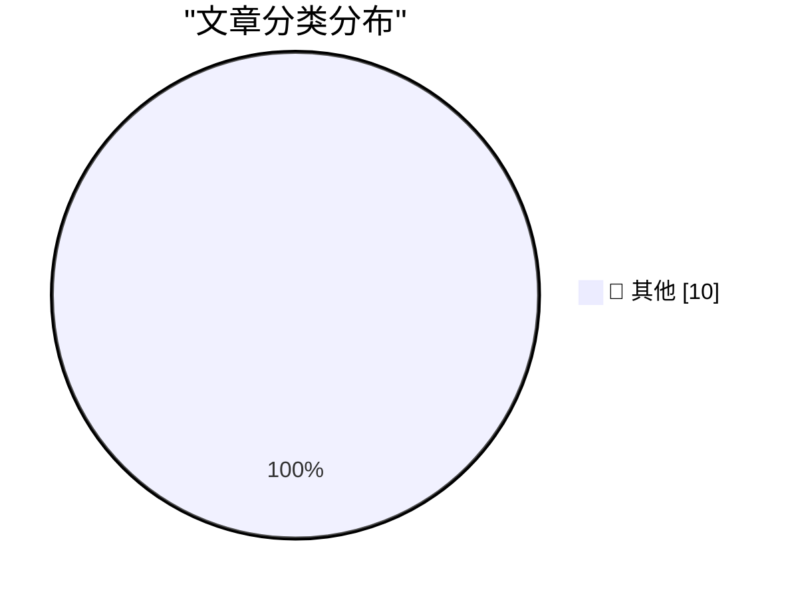

# 📰 AI 博客每日精选 — 2026-10-16

> 来自 Karpathy 推荐的 92 个顶级技术博客，AI 精选 Top 10

## 🏆 今日必读

🥇 **Anthropic tells investors quarterly revenue up nearly 50% to $16.8bn ahead of IPO**

[Anthropic tells investors quarterly revenue up nearly 50% to $16.8bn ahead of IPO](https://simonwillison.net/2026/Oct/15/anthropic-tells-investors/) — simonwillison.net · 6 小时前 · 📝 其他

> Anthropic tells investors quarterly revenue up nearly 50% to $16.8bn ahead of IPO

🥈 **Tree Appreciator**

[Tree Appreciator](https://simonwillison.net/2026/Oct/14/tree-appreciator/) — simonwillison.net · 22 小时前 · 📝 其他

> Tree Appreciator

🥉 **Secret Documents Reveal Donors Behind $330 Million for Trump’s Ballroom — Apple and Nvidia Top the List at $25 Million Each**

[Secret Documents Reveal Donors Behind $330 Million for Trump’s Ballroom — Apple and Nvidia Top the List at $25 Million Each](https://www.washingtonpost.com/investigations/2026/10/15/secret-documents-reveal-donors-behind-330-million-trumps-ballroom/) — daringfireball.net · 3 小时前 · 📝 其他

> Secret Documents Reveal Donors Behind $330 Million for Trump’s Ballroom — Apple and Nvidia Top the List at $25 Million Each

---

## 📊 数据概览

| 扫描源 | 抓取文章 | 时间范围 | 精选 |
|:---:|:---:|:---:|:---:|
| 83/92 | 2533 篇 → 10 篇 | 24h | **10 篇** |

### 分类分布

---

## 📝 其他

### 1. Anthropic tells investors quarterly revenue up nearly 50% to $16.8bn ahead of IPO

[Anthropic tells investors quarterly revenue up nearly 50% to $16.8bn ahead of IPO](https://simonwillison.net/2026/Oct/15/anthropic-tells-investors/) — **simonwillison.net** · 6 小时前 · ⭐ 15/30

> Anthropic tells investors quarterly revenue up nearly 50% to $16.8bn ahead of IPO

---

### 2. Tree Appreciator

[Tree Appreciator](https://simonwillison.net/2026/Oct/14/tree-appreciator/) — **simonwillison.net** · 22 小时前 · ⭐ 15/30

> Tree Appreciator

---

### 3. Secret Documents Reveal Donors Behind $330 Million for Trump’s Ballroom — Apple and Nvidia Top the List at $25 Million Each

[Secret Documents Reveal Donors Behind $330 Million for Trump’s Ballroom — Apple and Nvidia Top the List at $25 Million Each](https://www.washingtonpost.com/investigations/2026/10/15/secret-documents-reveal-donors-behind-330-million-trumps-ballroom/) — **daringfireball.net** · 3 小时前 · ⭐ 15/30

> Secret Documents Reveal Donors Behind $330 Million for Trump’s Ballroom — Apple and Nvidia Top the List at $25 Million Each

---

### 4. [Sponsor] WorkOS AuthKit: Auth for Your App, Free Up to 1M Monthly Active Users

[[Sponsor] WorkOS AuthKit: Auth for Your App, Free Up to 1M Monthly Active Users](https://workos.com/?utm_source=daringfireball&amp;utm_medium=newsletter&amp;utm_campaign=q42026) — **daringfireball.net** · 22 小时前 · ⭐ 15/30

> [Sponsor] WorkOS AuthKit: Auth for Your App, Free Up to 1M Monthly Active Users

---

### 5. The FBI Arrested a Saudi National OpenAI Employee for Planting a Recording Device in the Company’s Executive Conference Room

[The FBI Arrested a Saudi National OpenAI Employee for Planting a Recording Device in the Company’s Executive Conference Room](https://www.justice.gov/opa/pr/saudi-national-arrested-installing-surreptitious-audio-recording-device-openai) — **daringfireball.net** · 22 小时前 · ⭐ 15/30

> The FBI Arrested a Saudi National OpenAI Employee for Planting a Recording Device in the Company’s Executive Conference Room

---

### 6. Pluralistic: Expedia amazoned hotel rooms (15 Oct 2026)

[Pluralistic: Expedia amazoned hotel rooms (15 Oct 2026)](https://pluralistic.net/2026/10/15/enshittipedia/) — **pluralistic.net** · 8 小时前 · ⭐ 15/30

> Pluralistic: Expedia amazoned hotel rooms (15 Oct 2026)

---

### 7. C++ futures part 4: What if I want an immediate on-thread std::async?

[C++ futures part 4: What if I want an immediate on-thread std::async?](https://devblogs.microsoft.com/oldnewthing/20261015-00/?p=112776/) — **devblogs.microsoft.com/oldnewthing** · 5 小时前 · ⭐ 15/30

> C++ futures part 4: What if I want an immediate on-thread std::async?

---

### 8. How to Train Your Robot

[How to Train Your Robot](https://www.construction-physics.com/p/how-to-train-your-robot) — **construction-physics.com** · 5 小时前 · ⭐ 15/30

> How to Train Your Robot

---

### 9. We Need All the Disciplines

[We Need All the Disciplines](https://blog.jim-nielsen.com/2026/we-need-all-disciplines/) — **blog.jim-nielsen.com** · 49 分钟前 · ⭐ 15/30

> We Need All the Disciplines

---

### 10. What was a Token Ring network?

[What was a Token Ring network?](https://dfarq.homeip.net/what-was-a-token-ring-network/?utm_source=rss&#038;utm_medium=rss&#038;utm_campaign=what-was-a-token-ring-network) — **dfarq.homeip.net** · 8 小时前 · ⭐ 15/30

> What was a Token Ring network?

---

*生成于 2026-10-16 03:49 (Asia/Shanghai) | 扫描 83 源 → 获取 2533 篇 → 精选 10 篇*
*基于 [Hacker News Popularity Contest 2025](https://refactoringenglish.com/tools/hn-popularity/) RSS 源列表，由 [Andrej Karpathy](https://x.com/karpathy) 推荐*
*由「懂点儿AI」制作，欢迎关注同名微信公众号获取更多 AI 实用技巧 💡*
