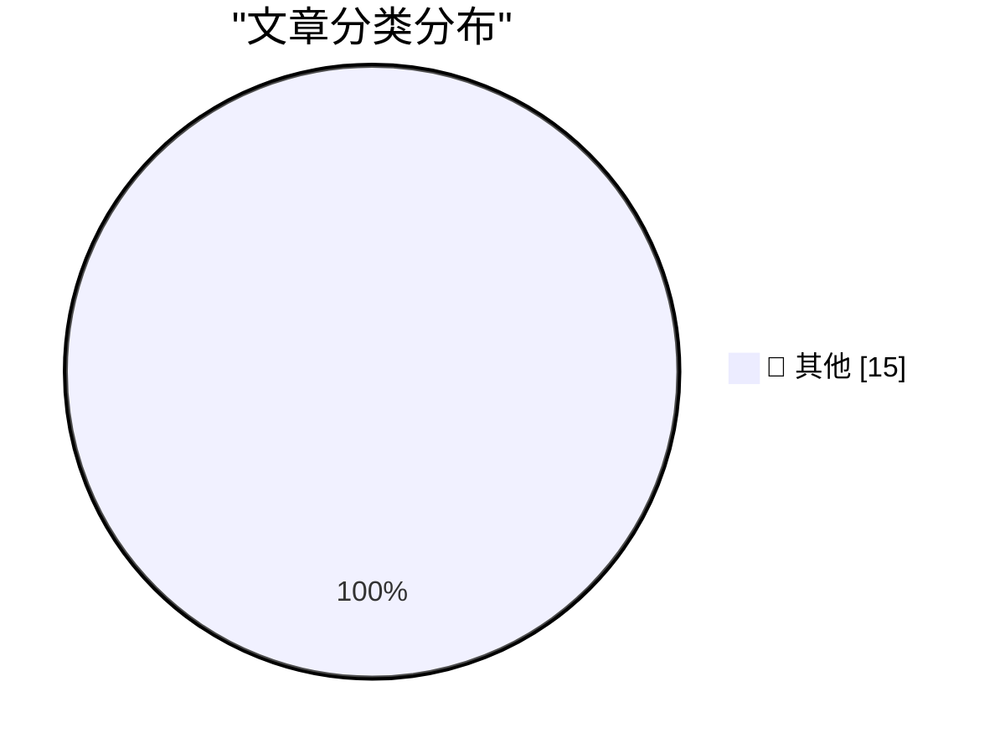

# 📰 AI 博客每日精选 — 2026-10-18

> 来自 Karpathy 推荐的 92 个顶级技术博客，AI 精选 Top 15

## 🏆 今日必读

🥇 **Quoting Addy Osmani, Morgan Westlee Lunt, and Qing Wang**

[Quoting Addy Osmani, Morgan Westlee Lunt, and Qing Wang](https://simonwillison.net/2026/Oct/16/code-review/) — simonwillison.net · 20 小时前 · 📝 其他

> Quoting Addy Osmani, Morgan Westlee Lunt, and Qing Wang

🥈 **★ HomeView Thoughts and Observations**

[★ HomeView Thoughts and Observations](https://daringfireball.net/2026/10/homeview_thoughts_and_observations) — daringfireball.net · 56 分钟前 · 📝 其他

> ★ HomeView Thoughts and Observations

🥉 **Apple TV Price History, Charted**

[Apple TV Price History, Charted](https://glog.glennf.com/blog/2026/10/17/apple-tv-price-history/) — daringfireball.net · 4 小时前 · 📝 其他

> Apple TV Price History, Charted

---

## 📊 数据概览

| 扫描源 | 抓取文章 | 时间范围 | 精选 |
|:---:|:---:|:---:|:---:|
| 82/92 | 2506 篇 → 15 篇 | 24h | **15 篇** |

### 分类分布

---

## 📝 其他

### 1. Quoting Addy Osmani, Morgan Westlee Lunt, and Qing Wang

[Quoting Addy Osmani, Morgan Westlee Lunt, and Qing Wang](https://simonwillison.net/2026/Oct/16/code-review/) — **simonwillison.net** · 20 小时前 · ⭐ 15/30

> Quoting Addy Osmani, Morgan Westlee Lunt, and Qing Wang

---

### 2. ★ HomeView Thoughts and Observations

[★ HomeView Thoughts and Observations](https://daringfireball.net/2026/10/homeview_thoughts_and_observations) — **daringfireball.net** · 56 分钟前 · ⭐ 15/30

> ★ HomeView Thoughts and Observations

---

### 3. Apple TV Price History, Charted

[Apple TV Price History, Charted](https://glog.glennf.com/blog/2026/10/17/apple-tv-price-history/) — **daringfireball.net** · 4 小时前 · ⭐ 15/30

> Apple TV Price History, Charted

---

### 4. The Late Charlie Munger on Elon Musk and Tesla

[The Late Charlie Munger on Elon Musk and Tesla](https://www.cnbc.com/make-it/2020/02/14/charlie-munger-shares-opinion-of-tesla-ceo-elon-musk.html) — **daringfireball.net** · 16 小时前 · ⭐ 15/30

> The Late Charlie Munger on Elon Musk and Tesla

---

### 5. Apple: ‘Strengthening App Review Guidelines Against Nonconsensual Intimate Imagery and Bait-And-Switch Apps’

[Apple: ‘Strengthening App Review Guidelines Against Nonconsensual Intimate Imagery and Bait-And-Switch Apps’](https://developer.apple.com/news/?id=vvzx6cul) — **daringfireball.net** · 17 小时前 · ⭐ 15/30

> Apple: ‘Strengthening App Review Guidelines Against Nonconsensual Intimate Imagery and Bait-And-Switch Apps’

---

### 6. Apple TV Started at $69 in 2015

[Apple TV Started at $69 in 2015](https://www.macrumors.com/2015/03/09/tim-cook-apple-tv-now-costs-69/) — **daringfireball.net** · 17 小时前 · ⭐ 15/30

> Apple TV Started at $69 in 2015

---

### 7. Strange Times Make for Strange Bedfellows

[Strange Times Make for Strange Bedfellows](https://x.com/finkd/status/2110778025629347999) — **daringfireball.net** · 18 小时前 · ⭐ 15/30

> Strange Times Make for Strange Bedfellows

---

### 8. How They Got Duo Support in NetNewsWire

[How They Got Duo Support in NetNewsWire](https://netnewswire.blog/2026/10/16/how-we-got-duo-support.html) — **daringfireball.net** · 21 小时前 · ⭐ 15/30

> How They Got Duo Support in NetNewsWire

---

### 9. ★ Real Artists Ship, Tesla Edition

[★ Real Artists Ship, Tesla Edition](https://daringfireball.net/2026/10/real_artists_ship_tesla_edition) — **daringfireball.net** · 22 小时前 · ⭐ 15/30

> ★ Real Artists Ship, Tesla Edition

---

### 10. Pluralistic: Israeli ad-tech company was a delivery system for "mercenary spyware" (17 Oct 2026)

[Pluralistic: Israeli ad-tech company was a delivery system for "mercenary spyware" (17 Oct 2026)](https://pluralistic.net/2026/10/17/mercenary-spyware/) — **pluralistic.net** · 7 小时前 · ⭐ 15/30

> Pluralistic: Israeli ad-tech company was a delivery system for "mercenary spyware" (17 Oct 2026)

---

### 11. Book Review: Are You *Really* The Doctor? by Matthew Hutchinson ★★★⯪☆

[Book Review: Are You *Really* The Doctor? by Matthew Hutchinson ★★★⯪☆](https://shkspr.mobi/blog/2026/10/book-review-are-you-really-the-doctor-by-matthew-hutchinson/) — **shkspr.mobi** · 6 小时前 · ⭐ 15/30

> Book Review: Are You *Really* The Doctor? by Matthew Hutchinson ★★★⯪☆

---

### 12. Cloud of suspicion lifted from NIST curves

[Cloud of suspicion lifted from NIST curves](https://www.johndcook.com/blog/2026/10/17/nist-curves-exonorated/) — **johndcook.com** · 2 小时前 · ⭐ 15/30

> Cloud of suspicion lifted from NIST curves

---

### 13. This Week in Package Management: 17 October 2026

[This Week in Package Management: 17 October 2026](https://nesbitt.io/2026/10/17/this-week-in-package-management.html) — **nesbitt.io** · 8 小时前 · ⭐ 15/30

> This Week in Package Management: 17 October 2026

---

### 14. Reading List 10/17/26

[Reading List 10/17/26](https://www.construction-physics.com/p/reading-list-101726) — **construction-physics.com** · 6 小时前 · ⭐ 15/30

> Reading List 10/17/26

---

### 15. Intel 386 released October 17, 1985

[Intel 386 released October 17, 1985](https://dfarq.homeip.net/intel-386-released-october-17-1985/?utm_source=rss&#038;utm_medium=rss&#038;utm_campaign=intel-386-released-october-17-1985) — **dfarq.homeip.net** · 7 小时前 · ⭐ 15/30

> Intel 386 released October 17, 1985

---

*生成于 2026-10-18 02:21 (Asia/Shanghai) | 扫描 82 源 → 获取 2506 篇 → 精选 15 篇*
*基于 [Hacker News Popularity Contest 2025](https://refactoringenglish.com/tools/hn-popularity/) RSS 源列表，由 [Andrej Karpathy](https://x.com/karpathy) 推荐*
*由「懂点儿AI」制作，欢迎关注同名微信公众号获取更多 AI 实用技巧 💡*
