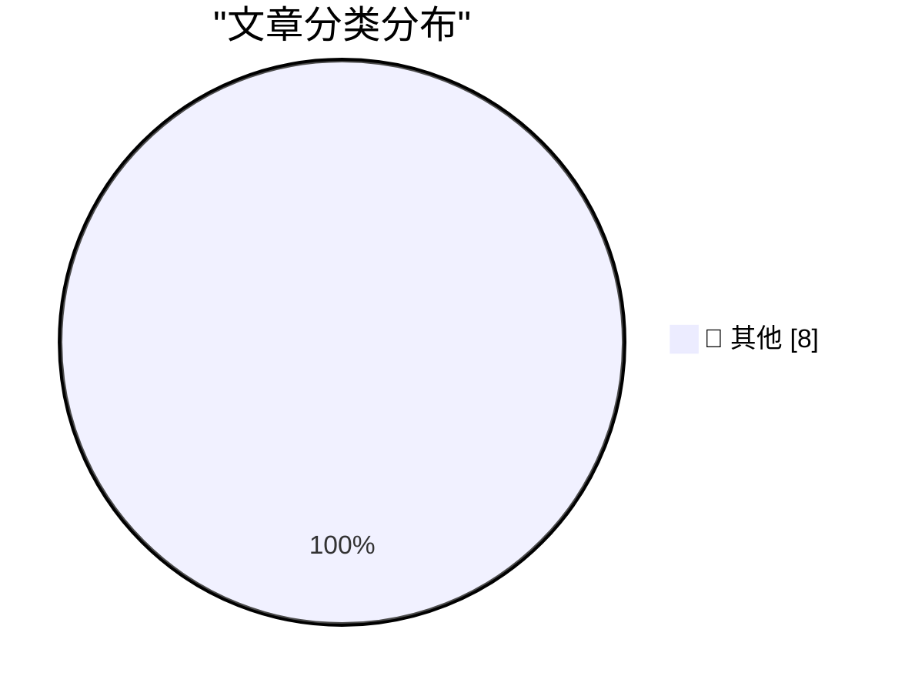

# 📰 AI 博客每日精选 — 2026-10-19

> 来自 Karpathy 推荐的 92 个顶级技术博客，AI 精选 Top 8

## 🏆 今日必读

🥇 **Inline rendering with document​.currentScript**

[Inline rendering with document​.currentScript](https://simonwillison.net/2026/Oct/17/document-currentscript/) — simonwillison.net · 21 小时前 · 📝 其他

> Inline rendering with document​.currentScript

🥈 **Writing is no longer proof of work**

[Writing is no longer proof of work](https://seangoedecke.com/writing-is-no-longer-proof-of-work/) — seangoedecke.com · 18 小时前 · 📝 其他

> Writing is no longer proof of work

🥉 **Whatever You Say Bounces Off Me and Sticks to You**

[Whatever You Say Bounces Off Me and Sticks to You](https://www.reuters.com/business/retail-consumer/openai-employee-who-left-apple-took-files-about-unreleased-device-openai-alleges-2026-10-14/) — daringfireball.net · 17 小时前 · 📝 其他

> Whatever You Say Bounces Off Me and Sticks to You

---

## 📊 数据概览

| 扫描源 | 抓取文章 | 时间范围 | 精选 |
|:---:|:---:|:---:|:---:|
| 81/92 | 2482 篇 → 8 篇 | 24h | **8 篇** |

### 分类分布

---

## 📝 其他

### 1. Inline rendering with document​.currentScript

[Inline rendering with document​.currentScript](https://simonwillison.net/2026/Oct/17/document-currentscript/) — **simonwillison.net** · 21 小时前 · ⭐ 15/30

> Inline rendering with document​.currentScript

---

### 2. Writing is no longer proof of work

[Writing is no longer proof of work](https://seangoedecke.com/writing-is-no-longer-proof-of-work/) — **seangoedecke.com** · 18 小时前 · ⭐ 15/30

> Writing is no longer proof of work

---

### 3. Whatever You Say Bounces Off Me and Sticks to You

[Whatever You Say Bounces Off Me and Sticks to You](https://www.reuters.com/business/retail-consumer/openai-employee-who-left-apple-took-files-about-unreleased-device-openai-alleges-2026-10-14/) — **daringfireball.net** · 17 小时前 · ⭐ 15/30

> Whatever You Say Bounces Off Me and Sticks to You

---

### 4. Una Watch TOTP - MFA on your wrist!

[Una Watch TOTP - MFA on your wrist!](https://shkspr.mobi/blog/2026/10/una-watch-totp-mfa-on-your-wrist/) — **shkspr.mobi** · 6 小时前 · ⭐ 15/30

> Una Watch TOTP - MFA on your wrist!

---

### 5. Inside the Intel 8087 chip: floating-point addition and subtraction

[Inside the Intel 8087 chip: floating-point addition and subtraction](http://www.righto.com/feeds/4354998070789191613/comments/default) — **righto.com** · 2 小时前 · ⭐ 15/30

> Inside the Intel 8087 chip: floating-point addition and subtraction

---

### 6. How many VICmodems Commodore sold

[How many VICmodems Commodore sold](https://dfarq.homeip.net/how-many-vicmodems-commodore-sold/?utm_source=rss&#038;utm_medium=rss&#038;utm_campaign=how-many-vicmodems-commodore-sold) — **dfarq.homeip.net** · 7 小时前 · ⭐ 15/30

> How many VICmodems Commodore sold

---

### 7. Notes on the complex roots of unity

[Notes on the complex roots of unity](https://eli.thegreenplace.net/2026/notes-on-the-complex-roots-of-unity/) — **eli.thegreenplace.net** · 17 小时前 · ⭐ 15/30

> Notes on the complex roots of unity

---

### 8. How the AI boom might really end: 5 scenarios

[How the AI boom might really end: 5 scenarios](https://martinalderson.com/posts/how-the-ai-boom-might-really-end/?utm_source=rss&amp;utm_medium=rss&amp;utm_campaign=feed) — **martinalderson.com** · 18 小时前 · ⭐ 15/30

> How the AI boom might really end: 5 scenarios

---

*生成于 2026-10-19 02:34 (Asia/Shanghai) | 扫描 81 源 → 获取 2482 篇 → 精选 8 篇*
*基于 [Hacker News Popularity Contest 2025](https://refactoringenglish.com/tools/hn-popularity/) RSS 源列表，由 [Andrej Karpathy](https://x.com/karpathy) 推荐*
*由「懂点儿AI」制作，欢迎关注同名微信公众号获取更多 AI 实用技巧 💡*
