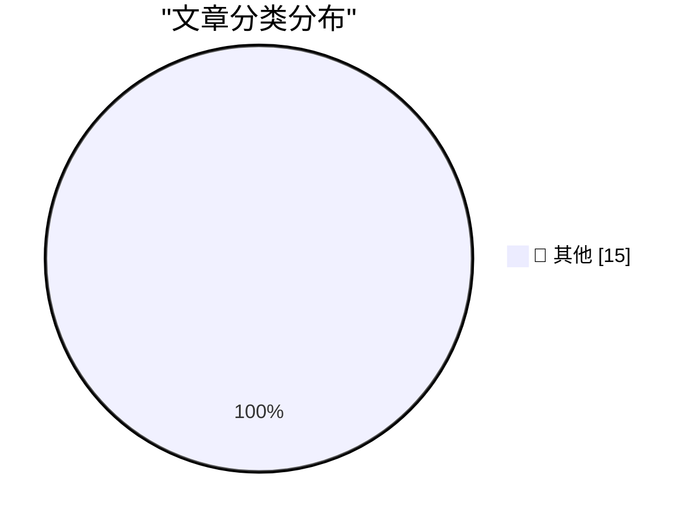

# 📰 AI 博客每日精选 — 2026-10-22

> 来自 Karpathy 推荐的 92 个顶级技术博客，AI 精选 Top 15

## 🏆 今日必读

🥇 **Today's PHP Security Release, and How We're Strengthening PHP Security**

[Today's PHP Security Release, and How We're Strengthening PHP Security](https://simonwillison.net/2026/Oct/21/php-security-release/) — simonwillison.net · 1 小时前 · 📝 其他

> Today's PHP Security Release, and How We're Strengthening PHP Security

🥈 **Panache — RTS Belle Époque pour mobile**

[Panache — RTS Belle Époque pour mobile](https://simonwillison.net/2026/Oct/21/panache/) — simonwillison.net · 3 小时前 · 📝 其他

> Panache — RTS Belle Époque pour mobile

🥉 **eMudhra Intermediate CA Compromise**

[eMudhra Intermediate CA Compromise](https://simonwillison.net/2026/Oct/20/emudhra-certificates/) — simonwillison.net · 20 小时前 · 📝 其他

> eMudhra Intermediate CA Compromise

---

## 📊 数据概览

| 扫描源 | 抓取文章 | 时间范围 | 精选 |
|:---:|:---:|:---:|:---:|
| 83/92 | 2537 篇 → 16 篇 | 24h | **15 篇** |

### 分类分布

---

## 📝 其他

### 1. Today's PHP Security Release, and How We're Strengthening PHP Security

[Today's PHP Security Release, and How We're Strengthening PHP Security](https://simonwillison.net/2026/Oct/21/php-security-release/) — **simonwillison.net** · 1 小时前 · ⭐ 15/30

> Today's PHP Security Release, and How We're Strengthening PHP Security

---

### 2. Panache — RTS Belle Époque pour mobile

[Panache — RTS Belle Époque pour mobile](https://simonwillison.net/2026/Oct/21/panache/) — **simonwillison.net** · 3 小时前 · ⭐ 15/30

> Panache — RTS Belle Époque pour mobile

---

### 3. eMudhra Intermediate CA Compromise

[eMudhra Intermediate CA Compromise](https://simonwillison.net/2026/Oct/20/emudhra-certificates/) — **simonwillison.net** · 20 小时前 · ⭐ 15/30

> eMudhra Intermediate CA Compromise

---

### 4. Upgrade your PHP installs immediately to protect against php2shell

[Upgrade your PHP installs immediately to protect against php2shell](https://www.jeffgeerling.com/blog/2026/php-vulnerability-php2shell/) — **jeffgeerling.com** · 5 小时前 · ⭐ 15/30

> Upgrade your PHP installs immediately to protect against php2shell

---

### 5. Widespread PHP Flaw May Cause Many Site Outages Today

[Widespread PHP Flaw May Cause Many Site Outages Today](https://krebsonsecurity.com/2026/10/widespread-php-flaw-may-cause-many-site-outages-today/) — **krebsonsecurity.com** · 4 小时前 · ⭐ 15/30

> Widespread PHP Flaw May Cause Many Site Outages Today

---

### 6. Can they write a function?

[Can they write a function?](https://idiallo.com/blog/can-they-write-a-function) — **idiallo.com** · 1 小时前 · ⭐ 15/30

> Can they write a function?

---

### 7. "No way to prevent this" say users of only language where this regularly happens

["No way to prevent this" say users of only language where this regularly happens](https://xeiaso.net/shitposts/no-way-to-prevent-this/memory-safety/CVE-2026-111497/) — **xeiaso.net** · 20 小时前 · ⭐ 15/30

> "No way to prevent this" say users of only language where this regularly happens

---

### 8. "No way to prevent this" say users of only language where this regularly happens

["No way to prevent this" say users of only language where this regularly happens](https://xeiaso.net/shitposts/no-way-to-prevent-this/memory-safety/CVE-2026-107891/) — **xeiaso.net** · 20 小时前 · ⭐ 15/30

> "No way to prevent this" say users of only language where this regularly happens

---

### 9. Jesus Christ patch your shit now

[Jesus Christ patch your shit now](https://xeiaso.net/shitposts/no-way-to-prevent-this/memory-safety/CVE-2026-109618/) — **xeiaso.net** · 20 小时前 · ⭐ 15/30

> Jesus Christ patch your shit now

---

### 10. Why didn’t we use Ro­Register­For­Apartment­Shutdown to clean up the unmarshalable delegate?

[Why didn’t we use Ro­Register­For­Apartment­Shutdown to clean up the unmarshalable delegate?](https://devblogs.microsoft.com/oldnewthing/20261021-00/?p=112786/) — **devblogs.microsoft.com/oldnewthing** · 6 小时前 · ⭐ 15/30

> Why didn’t we use Ro­Register­For­Apartment­Shutdown to clean up the unmarshalable delegate?

---

### 11. Backdoors, Incompetence, and Elliptic Curves

[Backdoors, Incompetence, and Elliptic Curves](https://www.johndcook.com/blog/2026/10/21/emudhra/) — **johndcook.com** · 4 小时前 · ⭐ 15/30

> Backdoors, Incompetence, and Elliptic Curves

---

### 12. Deliberate imperfection

[Deliberate imperfection](https://www.johndcook.com/blog/2026/10/21/deliberate-imperfection/) — **johndcook.com** · 7 小时前 · ⭐ 15/30

> Deliberate imperfection

---

### 13. Trust Stores Are Dependencies Too

[Trust Stores Are Dependencies Too](https://nesbitt.io/2026/10/21/trust-stores-are-dependencies-too.html) — **nesbitt.io** · 4 小时前 · ⭐ 15/30

> Trust Stores Are Dependencies Too

---

### 14. No Need for Retirement When Utopia Is Around the Corner

[No Need for Retirement When Utopia Is Around the Corner](https://blog.jim-nielsen.com/2026/skip-retirement-for-utopia/) — **blog.jim-nielsen.com** · 1 小时前 · ⭐ 15/30

> No Need for Retirement When Utopia Is Around the Corner

---

### 15. Creative Computing launched October 1974

[Creative Computing launched October 1974](https://dfarq.homeip.net/creative-computing-launched-october-1974/?utm_source=rss&#038;utm_medium=rss&#038;utm_campaign=creative-computing-launched-october-1974) — **dfarq.homeip.net** · 9 小时前 · ⭐ 15/30

> Creative Computing launched October 1974

---

*生成于 2026-10-22 04:02 (Asia/Shanghai) | 扫描 83 源 → 获取 2537 篇 → 精选 15 篇*
*基于 [Hacker News Popularity Contest 2025](https://refactoringenglish.com/tools/hn-popularity/) RSS 源列表，由 [Andrej Karpathy](https://x.com/karpathy) 推荐*
*由「懂点儿AI」制作，欢迎关注同名微信公众号获取更多 AI 实用技巧 💡*
