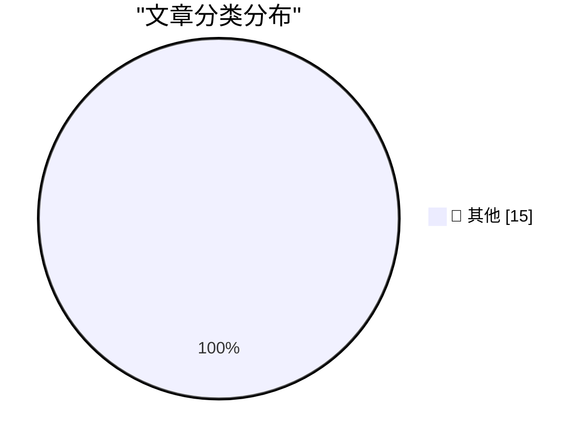

# 📰 AI 博客每日精选 — 2026-10-23

> 来自 Karpathy 推荐的 92 个顶级技术博客，AI 精选 Top 15

## 🏆 今日必读

🥇 **DE STAAT - FREEDOM (Official Music Video)**

[DE STAAT - FREEDOM (Official Music Video)](https://simonwillison.net/2026/Oct/22/de-staat-freedom/) — simonwillison.net · 14 分钟前 · 📝 其他

> DE STAAT - FREEDOM (Official Music Video)

🥈 **Donating Agent Skills to the Agentic AI Foundation**

[Donating Agent Skills to the Agentic AI Foundation](https://simonwillison.net/2026/Oct/22/donating-agent-skills/) — simonwillison.net · 1 小时前 · 📝 其他

> Donating Agent Skills to the Agentic AI Foundation

🥉 **Quoting Armin Ronacher**

[Quoting Armin Ronacher](https://simonwillison.net/2026/Oct/22/armin-ronacher/) — simonwillison.net · 4 小时前 · 📝 其他

> Quoting Armin Ronacher

---

## 📊 数据概览

| 扫描源 | 抓取文章 | 时间范围 | 精选 |
|:---:|:---:|:---:|:---:|
| 82/92 | 2507 篇 → 19 篇 | 24h | **15 篇** |

### 分类分布

---

## 📝 其他

### 1. DE STAAT - FREEDOM (Official Music Video)

[DE STAAT - FREEDOM (Official Music Video)](https://simonwillison.net/2026/Oct/22/de-staat-freedom/) — **simonwillison.net** · 14 分钟前 · ⭐ 15/30

> DE STAAT - FREEDOM (Official Music Video)

---

### 2. Donating Agent Skills to the Agentic AI Foundation

[Donating Agent Skills to the Agentic AI Foundation](https://simonwillison.net/2026/Oct/22/donating-agent-skills/) — **simonwillison.net** · 1 小时前 · ⭐ 15/30

> Donating Agent Skills to the Agentic AI Foundation

---

### 3. Quoting Armin Ronacher

[Quoting Armin Ronacher](https://simonwillison.net/2026/Oct/22/armin-ronacher/) — **simonwillison.net** · 4 小时前 · ⭐ 15/30

> Quoting Armin Ronacher

---

### 4. Apple Highlights 50+ iPhone Apps That Have Already Been Optimized for the Duo

[Apple Highlights 50+ iPhone Apps That Have Already Been Optimized for the Duo](https://www.apple.com/newsroom/2026/10/developers-bring-incredible-new-app-experiences-to-iphone-duo/) — **daringfireball.net** · 46 分钟前 · ⭐ 15/30

> Apple Highlights 50+ iPhone Apps That Have Already Been Optimized for the Duo

---

### 5. Updates to My iPhone Duo Review

[Updates to My iPhone Duo Review](https://daringfireball.net/2026/10/the_iphone_duo) — **daringfireball.net** · 1 小时前 · ⭐ 15/30

> Updates to My iPhone Duo Review

---

### 6. ★ The iPhone Duo

[★ The iPhone Duo](https://daringfireball.net/2026/10/the_iphone_duo) — **daringfireball.net** · 20 小时前 · ⭐ 15/30

> ★ The iPhone Duo

---

### 7. Productivity

[Productivity](https://idiallo.com/byte-size/productivity-video) — **idiallo.com** · 3 小时前 · ⭐ 15/30

> Productivity

---

### 8. Pluralistic: Adversarial interoperability is a team sport (21 Oct 2026)

[Pluralistic: Adversarial interoperability is a team sport (21 Oct 2026)](https://pluralistic.net/2026/10/21/brittle-individualism/) — **pluralistic.net** · 23 小时前 · ⭐ 15/30

> Pluralistic: Adversarial interoperability is a team sport (21 Oct 2026)

---

### 9. Gadget Review: Mokin 17 Port USB-C Tower ★★☆☆☆

[Gadget Review: Mokin 17 Port USB-C Tower ★★☆☆☆](https://shkspr.mobi/blog/2026/10/gadget-review-mokin-17-port-usb-c-tower/) — **shkspr.mobi** · 8 小时前 · ⭐ 15/30

> Gadget Review: Mokin 17 Port USB-C Tower ★★☆☆☆

---

### 10. "No way to prevent this" say users of only language where this regularly happens

["No way to prevent this" say users of only language where this regularly happens](https://xeiaso.net/shitposts/no-way-to-prevent-this/memory-safety/CVE-2026-93479/) — **xeiaso.net** · 19 小时前 · ⭐ 15/30

> "No way to prevent this" say users of only language where this regularly happens

---

### 11. Working around a strange Python problem

[Working around a strange Python problem](https://www.johndcook.com/blog/2026/10/22/pep-723/) — **johndcook.com** · 4 小时前 · ⭐ 15/30

> Working around a strange Python problem

---

### 12. How the eMudrha certificate debacle might have happened

[How the eMudrha certificate debacle might have happened](https://www.johndcook.com/blog/2026/10/22/certificate-debacle/) — **johndcook.com** · 5 小时前 · ⭐ 15/30

> How the eMudrha certificate debacle might have happened

---

### 13. The number of points on an elliptic curve

[The number of points on an elliptic curve](https://www.johndcook.com/blog/2026/10/22/the-number-of-points-on-an-elliptic-curve/) — **johndcook.com** · 8 小时前 · ⭐ 15/30

> The number of points on an elliptic curve

---

### 14. Script dependencies with Nix

[Script dependencies with Nix](https://entropicthoughts.com/python-dependencies-with-nix) — **entropicthoughts.com** · 21 小时前 · ⭐ 15/30

> Script dependencies with Nix

---

### 15. NYC, New Webinar, Differential Testing

[NYC, New Webinar, Differential Testing](https://buttondown.com/hillelwayne/archive/nyc-new-webinar-differential-testing/) — **buttondown.com/hillelwayne** · 4 小时前 · ⭐ 15/30

> NYC, New Webinar, Differential Testing

---

*生成于 2026-10-23 03:56 (Asia/Shanghai) | 扫描 82 源 → 获取 2507 篇 → 精选 15 篇*
*基于 [Hacker News Popularity Contest 2025](https://refactoringenglish.com/tools/hn-popularity/) RSS 源列表，由 [Andrej Karpathy](https://x.com/karpathy) 推荐*
*由「懂点儿AI」制作，欢迎关注同名微信公众号获取更多 AI 实用技巧 💡*
