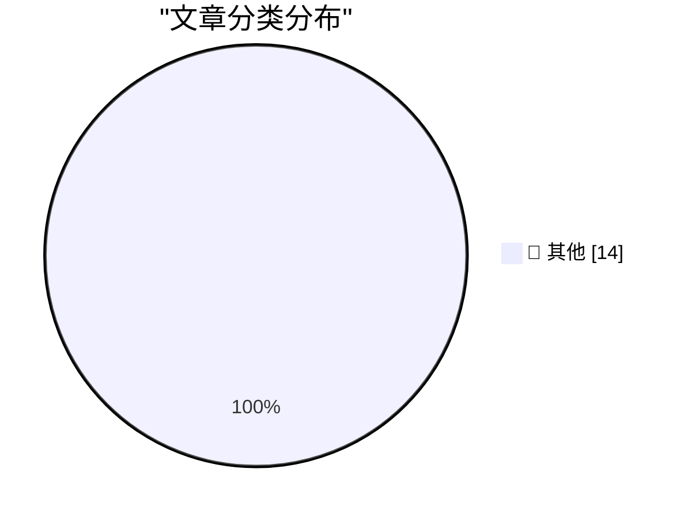

# 📰 AI 博客每日精选 — 2026-10-25

> 来自 Karpathy 推荐的 92 个顶级技术博客，AI 精选 Top 14

## 🏆 今日必读

🥇 **battledrones v14: Compass Rose, a four player map**

[battledrones v14: Compass Rose, a four player map](https://simonwillison.net/2026/Oct/24/battledrones/) — simonwillison.net · 14 小时前 · 📝 其他

> battledrones v14: Compass Rose, a four player map

🥈 **Quick Study**

[Quick Study](https://simonwillison.net/2026/Oct/23/quick-study-painter/) — simonwillison.net · 21 小时前 · 📝 其他

> Quick Study

🥉 **Introducing Kimi K3.1 Pro**

[Introducing Kimi K3.1 Pro](https://simonwillison.net/2026/Oct/23/kimi-k31-pro/) — simonwillison.net · 23 小时前 · 📝 其他

> Introducing Kimi K3.1 Pro

---

## 📊 数据概览

| 扫描源 | 抓取文章 | 时间范围 | 精选 |
|:---:|:---:|:---:|:---:|
| 83/92 | 2535 篇 → 14 篇 | 24h | **14 篇** |

### 分类分布

---

## 📝 其他

### 1. battledrones v14: Compass Rose, a four player map

[battledrones v14: Compass Rose, a four player map](https://simonwillison.net/2026/Oct/24/battledrones/) — **simonwillison.net** · 14 小时前 · ⭐ 15/30

> battledrones v14: Compass Rose, a four player map

---

### 2. Quick Study

[Quick Study](https://simonwillison.net/2026/Oct/23/quick-study-painter/) — **simonwillison.net** · 21 小时前 · ⭐ 15/30

> Quick Study

---

### 3. Introducing Kimi K3.1 Pro

[Introducing Kimi K3.1 Pro](https://simonwillison.net/2026/Oct/23/kimi-k31-pro/) — **simonwillison.net** · 23 小时前 · ⭐ 15/30

> Introducing Kimi K3.1 Pro

---

### 4. Apple Built a Photo-Realistic Functional Original iPod for Apple Music’s 404 Page

[Apple Built a Photo-Realistic Functional Original iPod for Apple Music’s 404 Page](https://music.apple.com/404) — **daringfireball.net** · 2 小时前 · ⭐ 15/30

> Apple Built a Photo-Realistic Functional Original iPod for Apple Music’s 404 Page

---

### 5. Chan Karunamuni on the Duo’s Open/Close Translucent Transition

[Chan Karunamuni on the Duo’s Open/Close Translucent Transition](https://x.com/chan_k/status/2113622379050246243) — **daringfireball.net** · 3 小时前 · ⭐ 15/30

> Chan Karunamuni on the Duo’s Open/Close Translucent Transition

---

### 6. Pluralistic: Critique and writing (23 Oct 2026)

[Pluralistic: Critique and writing (23 Oct 2026)](https://pluralistic.net/2026/10/23/better-to-give/) — **pluralistic.net** · 21 小时前 · ⭐ 15/30

> Pluralistic: Critique and writing (23 Oct 2026)

---

### 7. Book Review: Get Ahead of Being Dead by Evie King ★★★★☆

[Book Review: Get Ahead of Being Dead by Evie King ★★★★☆](https://shkspr.mobi/blog/2026/10/book-review-get-ahead-of-being-dead-by-evie-king/) — **shkspr.mobi** · 7 小时前 · ⭐ 15/30

> Book Review: Get Ahead of Being Dead by Evie King ★★★★☆

---

### 8. List of Vim forks

[List of Vim forks](https://evanhahn.com/list-of-vim-forks/) — **evanhahn.com** · 1 小时前 · ⭐ 15/30

> List of Vim forks

---

### 9. This Week in Package Management: 24 October 2026

[This Week in Package Management: 24 October 2026](https://nesbitt.io/2026/10/24/this-week-in-package-management.html) — **nesbitt.io** · 8 小时前 · ⭐ 15/30

> This Week in Package Management: 24 October 2026

---

### 10. Reading List 10/24/26

[Reading List 10/24/26](https://www.construction-physics.com/p/reading-list-102426) — **construction-physics.com** · 6 小时前 · ⭐ 15/30

> Reading List 10/24/26

---

### 11. Commodore 1600 VICmodem

[Commodore 1600 VICmodem](https://dfarq.homeip.net/commodore-1600-vicmodem/?utm_source=rss&#038;utm_medium=rss&#038;utm_campaign=commodore-1600-vicmodem) — **dfarq.homeip.net** · 7 小时前 · ⭐ 15/30

> Commodore 1600 VICmodem

---

### 12. Elon Musk Just Gave Europe a Reason to Replace American Technology

[Elon Musk Just Gave Europe a Reason to Replace American Technology](https://steveblank.com/2026/10/24/europe-gets-a-wake-up-call/) — **steveblank.com** · 5 小时前 · ⭐ 15/30

> Elon Musk Just Gave Europe a Reason to Replace American Technology

---

### 13. Interesting systemd features you may not know about

[Interesting systemd features you may not know about](https://martinalderson.com/posts/interesting-systemd-features/?utm_source=rss&amp;utm_medium=rss&amp;utm_campaign=feed) — **martinalderson.com** · 18 小时前 · ⭐ 15/30

> Interesting systemd features you may not know about

---

### 14. How to install an app on your Commodore 64

[How to install an app on your Commodore 64](https://anildash.com/2026/10/08/install-an-app-commodore-64/) — **anildash.com** · 21 小时前 · ⭐ 15/30

> How to install an app on your Commodore 64

---

*生成于 2026-10-25 02:43 (Asia/Shanghai) | 扫描 83 源 → 获取 2535 篇 → 精选 14 篇*
*基于 [Hacker News Popularity Contest 2025](https://refactoringenglish.com/tools/hn-popularity/) RSS 源列表，由 [Andrej Karpathy](https://x.com/karpathy) 推荐*
*由「懂点儿AI」制作，欢迎关注同名微信公众号获取更多 AI 实用技巧 💡*
