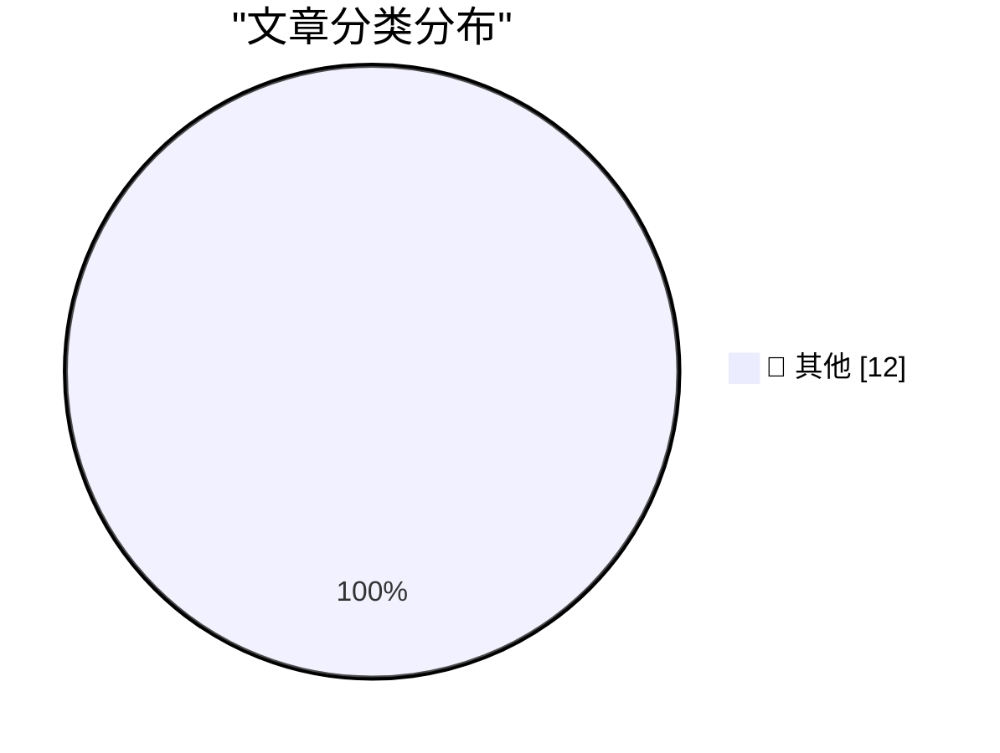

# 📰 AI 博客每日精选 — 2026-10-26

> 来自 Karpathy 推荐的 92 个顶级技术博客，AI 精选 Top 12

## 🏆 今日必读

🥇 **Don't anthropomorphize big tech companies**

[Don't anthropomorphize big tech companies](https://seangoedecke.com/dont-anthropomorphize-big-tech-companies/) — seangoedecke.com · 18 小时前 · 📝 其他

> Don't anthropomorphize big tech companies

🥈 **iPhone Portrait Mode, 10 Years In**

[iPhone Portrait Mode, 10 Years In](https://x.com/johnnie/status/2114007844605612167) — daringfireball.net · 43 分钟前 · 📝 其他

> iPhone Portrait Mode, 10 Years In

🥉 **Nicole Nguyen’s Duo Review for the WSJ**

[Nicole Nguyen’s Duo Review for the WSJ](https://www.wsj.com/tech/personal-tech/iphone-duo-review-cafcbbe7?st=GaYVMf) — daringfireball.net · 20 小时前 · 📝 其他

> Nicole Nguyen’s Duo Review for the WSJ

---

## 📊 数据概览

| 扫描源 | 抓取文章 | 时间范围 | 精选 |
|:---:|:---:|:---:|:---:|
| 84/92 | 2566 篇 → 12 篇 | 24h | **12 篇** |

### 分类分布

---

## 📝 其他

### 1. Don't anthropomorphize big tech companies

[Don't anthropomorphize big tech companies](https://seangoedecke.com/dont-anthropomorphize-big-tech-companies/) — **seangoedecke.com** · 18 小时前 · ⭐ 15/30

> Don't anthropomorphize big tech companies

---

### 2. iPhone Portrait Mode, 10 Years In

[iPhone Portrait Mode, 10 Years In](https://x.com/johnnie/status/2114007844605612167) — **daringfireball.net** · 43 分钟前 · ⭐ 15/30

> iPhone Portrait Mode, 10 Years In

---

### 3. Nicole Nguyen’s Duo Review for the WSJ

[Nicole Nguyen’s Duo Review for the WSJ](https://www.wsj.com/tech/personal-tech/iphone-duo-review-cafcbbe7?st=GaYVMf) — **daringfireball.net** · 20 小时前 · ⭐ 15/30

> Nicole Nguyen’s Duo Review for the WSJ

---

### 4. Reuters and the WSJ on the Duo Launch

[Reuters and the WSJ on the Duo Launch](https://www.reuters.com/business/retail-consumer/apple-bets-iphone-duo-can-remake-foldable-market-sales-begin-2026-10-22/) — **daringfireball.net** · 20 小时前 · ⭐ 15/30

> Reuters and the WSJ on the Duo Launch

---

### 5. Marion Barry Meets the iPhone Duo

[Marion Barry Meets the iPhone Duo](https://www.theverge.com/tech/1017623/iphone-duo-broken-cracked-screen) — **daringfireball.net** · 21 小时前 · ⭐ 15/30

> Marion Barry Meets the iPhone Duo

---

### 6. MKBHD’s Duo Review

[MKBHD’s Duo Review](https://youtu.be/ESABTN4VtrA) — **daringfireball.net** · 22 小时前 · ⭐ 15/30

> MKBHD’s Duo Review

---

### 7. Tim Pan’s iPhone Duo Review

[Tim Pan’s iPhone Duo Review](https://www.youtube.com/watch?v=8pCccpKjjos) — **daringfireball.net** · 23 小时前 · ⭐ 15/30

> Tim Pan’s iPhone Duo Review

---

### 8. Gadget Review: LiberNovo Omni - the USB-C powered office chair ★★★★⯪

[Gadget Review: LiberNovo Omni - the USB-C powered office chair ★★★★⯪](https://shkspr.mobi/blog/2026/10/gadget-review-libernovo-omni-chair/) — **shkspr.mobi** · 6 小时前 · ⭐ 15/30

> Gadget Review: LiberNovo Omni - the USB-C powered office chair ★★★★⯪

---

### 9. Computing polar triangles with linear algebra

[Computing polar triangles with linear algebra](https://www.johndcook.com/blog/2026/10/24/computing-polar-triangles/) — **johndcook.com** · 17 小时前 · ⭐ 15/30

> Computing polar triangles with linear algebra

---

### 10. Duality in spherical trigonometry

[Duality in spherical trigonometry](https://www.johndcook.com/blog/2026/10/24/polar-triangle/) — **johndcook.com** · 18 小时前 · ⭐ 15/30

> Duality in spherical trigonometry

---

### 11. How much you can make in an entry level cyber security job

[How much you can make in an entry level cyber security job](https://dfarq.homeip.net/how-much-you-can-make-in-an-entry-level-cyber-security-job/?utm_source=rss&#038;utm_medium=rss&#038;utm_campaign=how-much-you-can-make-in-an-entry-level-cyber-security-job) — **dfarq.homeip.net** · 7 小时前 · ⭐ 15/30

> How much you can make in an entry level cyber security job

---

### 12. MacOS Extensions pack for the Apple Network Server v1.0

[MacOS Extensions pack for the Apple Network Server v1.0](https://oldvcr.blogspot.com/feeds/6275078006024628345/comments/default) — **oldvcr.blogspot.com** · 17 小时前 · ⭐ 15/30

> MacOS Extensions pack for the Apple Network Server v1.0

---

*生成于 2026-10-26 02:52 (Asia/Shanghai) | 扫描 84 源 → 获取 2566 篇 → 精选 12 篇*
*基于 [Hacker News Popularity Contest 2025](https://refactoringenglish.com/tools/hn-popularity/) RSS 源列表，由 [Andrej Karpathy](https://x.com/karpathy) 推荐*
*由「懂点儿AI」制作，欢迎关注同名微信公众号获取更多 AI 实用技巧 💡*
