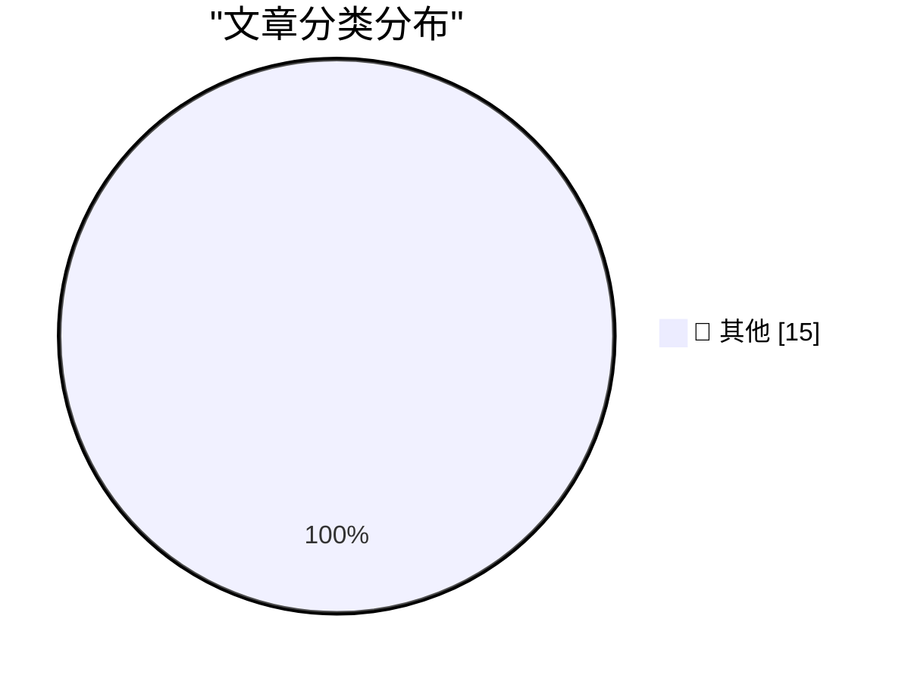

# 📰 AI 博客每日精选 — 2026-10-28

> 来自 Karpathy 推荐的 92 个顶级技术博客，AI 精选 Top 15

## 🏆 今日必读

🥇 **Game Boy Color on My Conference Badge**

[Game Boy Color on My Conference Badge](https://simonwillison.net/2026/Oct/27/game-boy-color-on-my-conference-badge/) — simonwillison.net · 1 小时前 · 📝 其他

> Game Boy Color on My Conference Badge

🥈 **GPT-6.1 Terra**

[GPT-6.1 Terra](https://simonwillison.net/2026/Oct/26/gpt-61-terra/) — simonwillison.net · 20 小时前 · 📝 其他

> GPT-6.1 Terra

🥉 **Noctua Fan Swap on a Calnex Rb/GPS Frequency Reference**

[Noctua Fan Swap on a Calnex Rb/GPS Frequency Reference](https://www.jeffgeerling.com/blog/2026/noctua-fan-swap-calnex-rb-gps-frequency-reference/) — jeffgeerling.com · 3 小时前 · 📝 其他

> Noctua Fan Swap on a Calnex Rb/GPS Frequency Reference

---

## 📊 数据概览

| 扫描源 | 抓取文章 | 时间范围 | 精选 |
|:---:|:---:|:---:|:---:|
| 84/92 | 2564 篇 → 18 篇 | 24h | **15 篇** |

### 分类分布

---

## 📝 其他

### 1. Game Boy Color on My Conference Badge

[Game Boy Color on My Conference Badge](https://simonwillison.net/2026/Oct/27/game-boy-color-on-my-conference-badge/) — **simonwillison.net** · 1 小时前 · ⭐ 15/30

> Game Boy Color on My Conference Badge

---

### 2. GPT-6.1 Terra

[GPT-6.1 Terra](https://simonwillison.net/2026/Oct/26/gpt-61-terra/) — **simonwillison.net** · 20 小时前 · ⭐ 15/30

> GPT-6.1 Terra

---

### 3. Noctua Fan Swap on a Calnex Rb/GPS Frequency Reference

[Noctua Fan Swap on a Calnex Rb/GPS Frequency Reference](https://www.jeffgeerling.com/blog/2026/noctua-fan-swap-calnex-rb-gps-frequency-reference/) — **jeffgeerling.com** · 3 小时前 · ⭐ 15/30

> Noctua Fan Swap on a Calnex Rb/GPS Frequency Reference

---

### 4. What’s Left for ‘Pro and Tell’ Week: Touch-Enabled OLED MacBooks

[What’s Left for ‘Pro and Tell’ Week: Touch-Enabled OLED MacBooks](https://www.macrumors.com/2026/10/27/macbook-pro-with-touchscreen-tomorrow/) — **daringfireball.net** · 2 小时前 · ⭐ 15/30

> What’s Left for ‘Pro and Tell’ Week: Touch-Enabled OLED MacBooks

---

### 5. Apple Also Announces iMac With M6

[Apple Also Announces iMac With M6](https://www.apple.com/newsroom/2026/10/apple-unveils-new-imac-with-m6/) — **daringfireball.net** · 3 小时前 · ⭐ 15/30

> Apple Also Announces iMac With M6

---

### 6. [Sponsor] WorkOS: Let Agents Sign Up for Your App Without a Browser

[[Sponsor] WorkOS: Let Agents Sign Up for Your App Without a Browser](https://workos.com/auth-md?utm_source=daringfireball&amp;utm_medium=newsletter&amp;utm_campaign=q42026) — **daringfireball.net** · 4 小时前 · ⭐ 15/30

> [Sponsor] WorkOS: Let Agents Sign Up for Your App Without a Browser

---

### 7. Apple Introduces New Base MacBook Pro With M6, 14-Inch-Only

[Apple Introduces New Base MacBook Pro With M6, 14-Inch-Only](https://www.apple.com/newsroom/2026/10/apple-introduces-the-new-14-inch-macbook-pro-with-m6/) — **daringfireball.net** · 4 小时前 · ⭐ 15/30

> Apple Introduces New Base MacBook Pro With M6, 14-Inch-Only

---

### 8. The NYT Seemingly Does Marissa Mayer Dirty

[The NYT Seemingly Does Marissa Mayer Dirty](https://www.nytimes.com/2026/10/25/style/marissa-mayer-ai-assistants-women.html?unlocked_article_code=1.L1E.xBwx.X_EjBGNsRNqr) — **daringfireball.net** · 20 小时前 · ⭐ 15/30

> The NYT Seemingly Does Marissa Mayer Dirty

---

### 9. Apple Issues Statement on iPhone Duo’s Crack Problem

[Apple Issues Statement on iPhone Duo’s Crack Problem](https://9to5mac.com/2026/10/26/apple-responds-to-reports-of-iphone-duos-inner-display-cracking/) — **daringfireball.net** · 20 小时前 · ⭐ 15/30

> Apple Issues Statement on iPhone Duo’s Crack Problem

---

### 10. Pluralistic: History is something you do (27 Oct 2026)

[Pluralistic: History is something you do (27 Oct 2026)](https://pluralistic.net/2026/10/27/tied-to-the-tracks/) — **pluralistic.net** · 11 小时前 · ⭐ 15/30

> Pluralistic: History is something you do (27 Oct 2026)

---

### 11. Book Review: You Could Do Something Amazing with Your Life [You Are Raoul Moat] - Andrew Hankinson ★★★★☆

[Book Review: You Could Do Something Amazing with Your Life [You Are Raoul Moat] - Andrew Hankinson ★★★★☆](https://shkspr.mobi/blog/2026/10/book-review-you-could-do-something-amazing-with-your-life-you-are-raoul-moat-andrew-hankinson/) — **shkspr.mobi** · 7 小时前 · ⭐ 15/30

> Book Review: You Could Do Something Amazing with Your Life [You Are Raoul Moat] - Andrew Hankinson ★★★★☆

---

### 12. The Exponential Time Hypothesis is False

[The Exponential Time Hypothesis is False](https://www.johndcook.com/blog/2026/10/27/eth-false/) — **johndcook.com** · 8 小时前 · ⭐ 15/30

> The Exponential Time Hypothesis is False

---

### 13. Inches & Miles

[Inches & Miles](https://feed.tedium.co/link/15204/17507724/ai-startups-sketchy-behavior) — **tedium.co** · 6 小时前 · ⭐ 15/30

> Inches & Miles

---

### 14. MTL-style circuit simulator

[MTL-style circuit simulator](https://entropicthoughts.com/mtl-style-circuit-simulator) — **entropicthoughts.com** · 21 小时前 · ⭐ 15/30

> MTL-style circuit simulator

---

### 15. IBM PC 5150 Revision A vs Revision B

[IBM PC 5150 Revision A vs Revision B](https://dfarq.homeip.net/ibm-pc-5150-revision-a-vs-revision-b/?utm_source=rss&#038;utm_medium=rss&#038;utm_campaign=ibm-pc-5150-revision-a-vs-revision-b) — **dfarq.homeip.net** · 9 小时前 · ⭐ 15/30

> IBM PC 5150 Revision A vs Revision B

---

*生成于 2026-10-28 04:34 (Asia/Shanghai) | 扫描 84 源 → 获取 2564 篇 → 精选 15 篇*
*基于 [Hacker News Popularity Contest 2025](https://refactoringenglish.com/tools/hn-popularity/) RSS 源列表，由 [Andrej Karpathy](https://x.com/karpathy) 推荐*
*由「懂点儿AI」制作，欢迎关注同名微信公众号获取更多 AI 实用技巧 💡*
