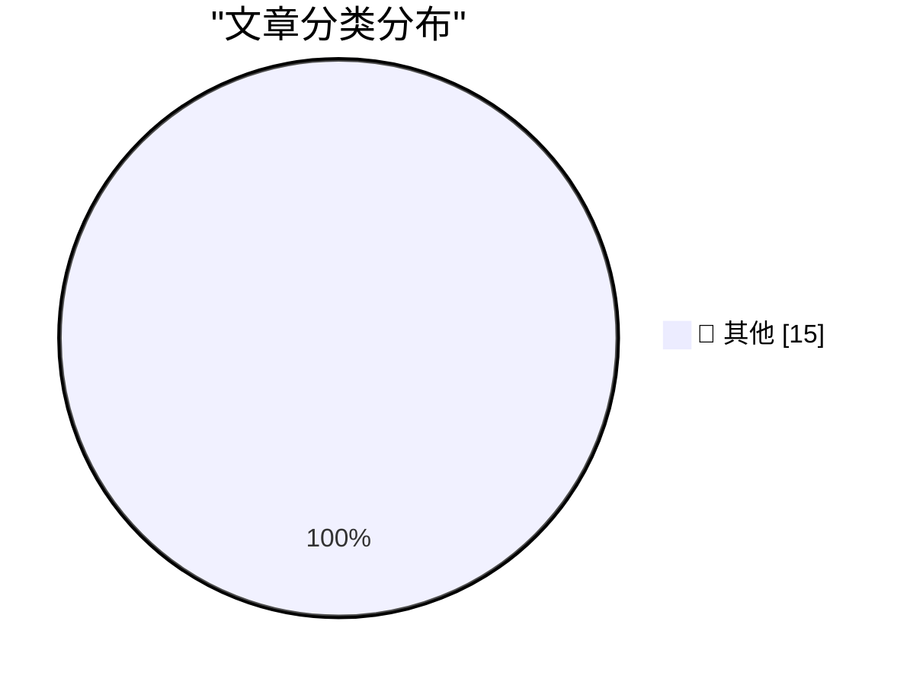

# 📰 AI 博客每日精选 — 2026-10-29

> 来自 Karpathy 推荐的 92 个顶级技术博客，AI 精选 Top 15

## 🏆 今日必读

🥇 **GitHub Octoverse 2026**

[GitHub Octoverse 2026](https://simonwillison.net/2026/Oct/28/github-octoverse-2026/) — simonwillison.net · 4 小时前 · 📝 其他

> GitHub Octoverse 2026

🥈 **The October inflection point for vibe game development**

[The October inflection point for vibe game development](https://simonwillison.net/2026/Oct/28/vibe-game-development/) — simonwillison.net · 7 小时前 · 📝 其他

> The October inflection point for vibe game development

🥉 **Quoting Terk Terkowitz**

[Quoting Terk Terkowitz](https://simonwillison.net/2026/Oct/28/terk-terkowitz/) — simonwillison.net · 10 小时前 · 📝 其他

> Quoting Terk Terkowitz

---

## 📊 数据概览

| 扫描源 | 抓取文章 | 时间范围 | 精选 |
|:---:|:---:|:---:|:---:|
| 83/92 | 2539 篇 → 17 篇 | 24h | **15 篇** |

### 分类分布

---

## 📝 其他

### 1. GitHub Octoverse 2026

[GitHub Octoverse 2026](https://simonwillison.net/2026/Oct/28/github-octoverse-2026/) — **simonwillison.net** · 4 小时前 · ⭐ 15/30

> GitHub Octoverse 2026

---

### 2. The October inflection point for vibe game development

[The October inflection point for vibe game development](https://simonwillison.net/2026/Oct/28/vibe-game-development/) — **simonwillison.net** · 7 小时前 · ⭐ 15/30

> The October inflection point for vibe game development

---

### 3. Quoting Terk Terkowitz

[Quoting Terk Terkowitz](https://simonwillison.net/2026/Oct/28/terk-terkowitz/) — **simonwillison.net** · 10 小时前 · ⭐ 15/30

> Quoting Terk Terkowitz

---

### 4. Getting good at AI takes time and practice

[Getting good at AI takes time and practice](https://seangoedecke.com/getting-good-at-ai-takes-time-and-practice/) — **seangoedecke.com** · 20 小时前 · ⭐ 15/30

> Getting good at AI takes time and practice

---

### 5. Guessing the Name: MacBook Studio?

[Guessing the Name: MacBook Studio?](https://www.macrumors.com/2026/10/28/macbook-studio/) — **daringfireball.net** · 5 小时前 · ⭐ 15/30

> Guessing the Name: MacBook Studio?

---

### 6. Siri AI Expands to More Languages in OS 27.2

[Siri AI Expands to More Languages in OS 27.2](https://nr.apple.com/Du9G9W8Nq1) — **daringfireball.net** · 22 小时前 · ⭐ 15/30

> Siri AI Expands to More Languages in OS 27.2

---

### 7. Apple Creator Studio Updated With a Slew of AI Features, Along With a New Open JSON File Format for Keynote

[Apple Creator Studio Updated With a Slew of AI Features, Along With a New Open JSON File Format for Keynote](https://www.apple.com/newsroom/2026/10/apple-creator-studio-adds-powerful-new-ai-features-and-even-more-creative-tools/) — **daringfireball.net** · 22 小时前 · ⭐ 15/30

> Apple Creator Studio Updated With a Slew of AI Features, Along With a New Open JSON File Format for Keynote

---

### 8. ★ Prestructured WYSIWYG

[★ Prestructured WYSIWYG](https://daringfireball.net/2026/10/prestructured_wysiwyg) — **daringfireball.net** · 23 小时前 · ⭐ 15/30

> ★ Prestructured WYSIWYG

---

### 9. Pluralistic: Agents vs ecommerce (28 Oct 2026)

[Pluralistic: Agents vs ecommerce (28 Oct 2026)](https://pluralistic.net/2026/10/28/principle-agent-problem/) — **pluralistic.net** · 10 小时前 · ⭐ 15/30

> Pluralistic: Agents vs ecommerce (28 Oct 2026)

---

### 10. Gadget Review: SoundPEATS CC3 Pro Bluetooth Headphones ★★★★⯪

[Gadget Review: SoundPEATS CC3 Pro Bluetooth Headphones ★★★★⯪](https://shkspr.mobi/blog/2026/10/gadget-review-soundpeats-cc3-pro-bluetooth-headphones/) — **shkspr.mobi** · 8 小时前 · ⭐ 15/30

> Gadget Review: SoundPEATS CC3 Pro Bluetooth Headphones ★★★★⯪

---

### 11. Psychometrics, vaccines, meat, Kowloon, luggage destruction

[Psychometrics, vaccines, meat, Kowloon, luggage destruction](https://dynomight.net/shorts-8/) — **dynomight.net** · 20 小时前 · ⭐ 15/30

> Psychometrics, vaccines, meat, Kowloon, luggage destruction

---

### 12. C++/WinRT overcorrection: Using make_self and immediately converting it to the projected interface

[C++/WinRT overcorrection: Using make_self and immediately converting it to the projected interface](https://devblogs.microsoft.com/oldnewthing/20261028-00/?p=112803/) — **devblogs.microsoft.com/oldnewthing** · 6 小时前 · ⭐ 15/30

> C++/WinRT overcorrection: Using make_self and immediately converting it to the projected interface

---

### 13. The Unbalanced Group Theorem

[The Unbalanced Group Theorem](https://www.johndcook.com/blog/2026/10/28/the-unbalanced-group-theorem/) — **johndcook.com** · 9 小时前 · ⭐ 15/30

> The Unbalanced Group Theorem

---

### 14. This Week in Source Control: 28 October 2026

[This Week in Source Control: 28 October 2026](https://nesbitt.io/2026/10/28/this-week-in-source-control.html) — **nesbitt.io** · 10 小时前 · ⭐ 15/30

> This Week in Source Control: 28 October 2026

---

### 15. Exit Liquidity

[Exit Liquidity](https://www.wheresyoured.at/exit-liquidity/) — **wheresyoured.at** · 3 小时前 · ⭐ 15/30

> Exit Liquidity

---

*生成于 2026-10-29 04:56 (Asia/Shanghai) | 扫描 83 源 → 获取 2539 篇 → 精选 15 篇*
*基于 [Hacker News Popularity Contest 2025](https://refactoringenglish.com/tools/hn-popularity/) RSS 源列表，由 [Andrej Karpathy](https://x.com/karpathy) 推荐*
*由「懂点儿AI」制作，欢迎关注同名微信公众号获取更多 AI 实用技巧 💡*
