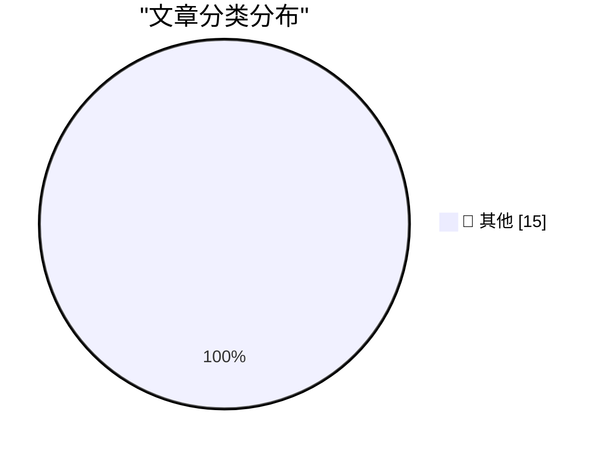

# 📰 AI 博客每日精选 — 2026-10-30

> 来自 Karpathy 推荐的 92 个顶级技术博客，AI 精选 Top 15

## 🏆 今日必读

🥇 **Building a multiplayer game world with autonomous Fable-class models**

[Building a multiplayer game world with autonomous Fable-class models](https://simonwillison.net/2026/Oct/29/how-i-built-the-most-ai-pilled-company-in-the-world/) — simonwillison.net · 3 小时前 · 📝 其他

> Building a multiplayer game world with autonomous Fable-class models

🥈 **Quoting Ben Hylak**

[Quoting Ben Hylak](https://simonwillison.net/2026/Oct/29/ben-hylak/) — simonwillison.net · 6 小时前 · 📝 其他

> Quoting Ben Hylak

🥉 **Quoting Ted Sanders**

[Quoting Ted Sanders](https://simonwillison.net/2026/Oct/28/ted-sanders/) — simonwillison.net · 21 小时前 · 📝 其他

> Quoting Ted Sanders

---

## 📊 数据概览

| 扫描源 | 抓取文章 | 时间范围 | 精选 |
|:---:|:---:|:---:|:---:|
| 83/92 | 2535 篇 → 16 篇 | 24h | **15 篇** |

### 分类分布

---

## 📝 其他

### 1. Building a multiplayer game world with autonomous Fable-class models

[Building a multiplayer game world with autonomous Fable-class models](https://simonwillison.net/2026/Oct/29/how-i-built-the-most-ai-pilled-company-in-the-world/) — **simonwillison.net** · 3 小时前 · ⭐ 15/30

> Building a multiplayer game world with autonomous Fable-class models

---

### 2. Quoting Ben Hylak

[Quoting Ben Hylak](https://simonwillison.net/2026/Oct/29/ben-hylak/) — **simonwillison.net** · 6 小时前 · ⭐ 15/30

> Quoting Ben Hylak

---

### 3. Quoting Ted Sanders

[Quoting Ted Sanders](https://simonwillison.net/2026/Oct/28/ted-sanders/) — **simonwillison.net** · 21 小时前 · ⭐ 15/30

> Quoting Ted Sanders

---

### 4. You can just ask AI to do things

[You can just ask AI to do things](https://seangoedecke.com/you-can-just-ask-ai-to-do-things/) — **seangoedecke.com** · 20 小时前 · ⭐ 15/30

> You can just ask AI to do things

---

### 5. A Health Update From Craig Hockenberry

[A Health Update From Craig Hockenberry](https://furbo.org/2026/10/28/a-health-update/) — **daringfireball.net** · 1 小时前 · ⭐ 15/30

> A Health Update From Craig Hockenberry

---

### 6. Rolfe Winkler at The WSJ: ‘The Beleaguered Chip Sellers Getting Their Revenge on Apple’

[Rolfe Winkler at The WSJ: ‘The Beleaguered Chip Sellers Getting Their Revenge on Apple’](https://www.wsj.com/tech/apple-iphone-memory-chips-ai-c0084cc9?st=FNAyaT) — **daringfireball.net** · 1 小时前 · ⭐ 15/30

> Rolfe Winkler at The WSJ: ‘The Beleaguered Chip Sellers Getting Their Revenge on Apple’

---

### 7. The Space Shuttle Discovery’s Starboard Side ‘s’ Is Upside Down

[The Space Shuttle Discovery’s Starboard Side ‘s’ Is Upside Down](https://www.theautopian.com/a-typography-geek-pointed-out-something-about-the-space-shuttle-discovery-and-now-i-cant-unsee-it/) — **daringfireball.net** · 5 小时前 · ⭐ 15/30

> The Space Shuttle Discovery’s Starboard Side ‘s’ Is Upside Down

---

### 8. Steven Levy on the New MacBook Pro, With, Yes, a Touchscreen

[Steven Levy on the New MacBook Pro, With, Yes, a Touchscreen](https://www.wired.com/story/the-inside-story-of-why-apple-finally-brought-a-touch-display-to-the-mac/) — **daringfireball.net** · 16 小时前 · ⭐ 15/30

> Steven Levy on the New MacBook Pro, With, Yes, a Touchscreen

---

### 9. Custom Voices With Qwen3-TTS

[Custom Voices With Qwen3-TTS](https://lucumr.pocoo.org/2026/10/29/qwen3-custom-voices/) — **lucumr.pocoo.org** · 20 小时前 · ⭐ 15/30

> Custom Voices With Qwen3-TTS

---

### 10. Avoid Public Functions Calling Other Public Functions

[Avoid Public Functions Calling Other Public Functions](https://matklad.github.io/2026/10/29/pub-calls-pub.html) — **matklad.github.io** · 20 小时前 · ⭐ 15/30

> Avoid Public Functions Calling Other Public Functions

---

### 11. A New Kind of Chemistry

[A New Kind of Chemistry](https://www.construction-physics.com/p/a-new-kind-of-chemistry) — **construction-physics.com** · 5 小时前 · ⭐ 15/30

> A New Kind of Chemistry

---

### 12. Extremely brief history of PDP computers

[Extremely brief history of PDP computers](https://entropicthoughts.com/history-of-pdp-computers) — **entropicthoughts.com** · 21 小时前 · ⭐ 15/30

> Extremely brief history of PDP computers

---

### 13. What I learned about power from LBJ and Robert Moses

[What I learned about power from LBJ and Robert Moses](https://www.dwarkesh.com/p/lessons-in-power) — **dwarkesh.com** · 4 小时前 · ⭐ 15/30

> What I learned about power from LBJ and Robert Moses

---

### 14. Celebrating SIM Cards

[Celebrating SIM Cards](https://blog.jim-nielsen.com/2026/celebrating-sim-cards/) — **blog.jim-nielsen.com** · 1 小时前 · ⭐ 15/30

> Celebrating SIM Cards

---

### 15. IBM’s 2018 Red Hat acquisition

[IBM’s 2018 Red Hat acquisition](https://dfarq.homeip.net/ibms-2018-red-hat-acquisition/?utm_source=rss&#038;utm_medium=rss&#038;utm_campaign=ibms-2018-red-hat-acquisition) — **dfarq.homeip.net** · 9 小时前 · ⭐ 15/30

> IBM’s 2018 Red Hat acquisition

---

*生成于 2026-10-30 04:59 (Asia/Shanghai) | 扫描 83 源 → 获取 2535 篇 → 精选 15 篇*
*基于 [Hacker News Popularity Contest 2025](https://refactoringenglish.com/tools/hn-popularity/) RSS 源列表，由 [Andrej Karpathy](https://x.com/karpathy) 推荐*
*由「懂点儿AI」制作，欢迎关注同名微信公众号获取更多 AI 实用技巧 💡*
