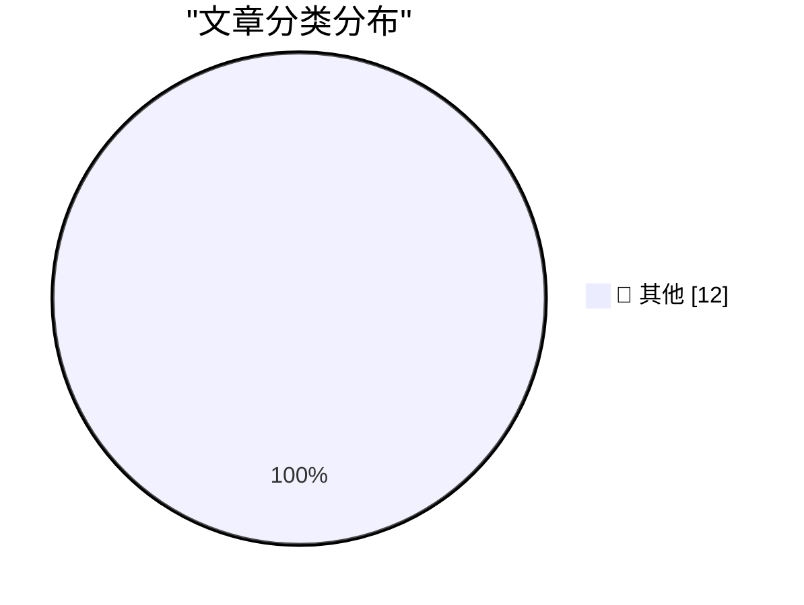

# 📰 AI 博客每日精选 — 2026-10-31

> 来自 Karpathy 推荐的 92 个顶级技术博客，AI 精选 Top 12

## 🏆 今日必读

🥇 **API credits benefit for eligible ChatGPT subscriptions**

[API credits benefit for eligible ChatGPT subscriptions](https://simonwillison.net/2026/Oct/29/api-credits/) — simonwillison.net · 21 小时前 · 📝 其他

> API credits benefit for eligible ChatGPT subscriptions

🥈 **Rejoice, leap seconds are dead!**

[Rejoice, leap seconds are dead!](https://www.jeffgeerling.com/blog/2026/rejoice-the-utc-leap-second-is-dead/) — jeffgeerling.com · 6 小时前 · 📝 其他

> Rejoice, leap seconds are dead!

🥉 **Elegance and intelligence are anticorrelated**

[Elegance and intelligence are anticorrelated](https://seangoedecke.com/elegance-and-intelligence-are-anticorrelated/) — seangoedecke.com · 20 小时前 · 📝 其他

> Elegance and intelligence are anticorrelated

---

## 📊 数据概览

| 扫描源 | 抓取文章 | 时间范围 | 精选 |
|:---:|:---:|:---:|:---:|
| 84/92 | 2565 篇 → 12 篇 | 24h | **12 篇** |

### 分类分布

---

## 📝 其他

### 1. API credits benefit for eligible ChatGPT subscriptions

[API credits benefit for eligible ChatGPT subscriptions](https://simonwillison.net/2026/Oct/29/api-credits/) — **simonwillison.net** · 21 小时前 · ⭐ 15/30

> API credits benefit for eligible ChatGPT subscriptions

---

### 2. Rejoice, leap seconds are dead!

[Rejoice, leap seconds are dead!](https://www.jeffgeerling.com/blog/2026/rejoice-the-utc-leap-second-is-dead/) — **jeffgeerling.com** · 6 小时前 · ⭐ 15/30

> Rejoice, leap seconds are dead!

---

### 3. Elegance and intelligence are anticorrelated

[Elegance and intelligence are anticorrelated](https://seangoedecke.com/elegance-and-intelligence-are-anticorrelated/) — **seangoedecke.com** · 20 小时前 · ⭐ 15/30

> Elegance and intelligence are anticorrelated

---

### 4. The Only Good Easter Eggs Are Whole-Assed Easter Eggs

[The Only Good Easter Eggs Are Whole-Assed Easter Eggs](https://unsung.aresluna.org/apples-ipod-recreation/) — **daringfireball.net** · 2 小时前 · ⭐ 15/30

> The Only Good Easter Eggs Are Whole-Assed Easter Eggs

---

### 5. GM to Pay $220 Million After Betraying Their Own Drivers’ Privacy

[GM to Pay $220 Million After Betraying Their Own Drivers’ Privacy](https://www.reuters.com/business/autos-transportation/gm-pay-220-million-settle-allegations-it-violated-consumers-privacy-2026-10-29/) — **daringfireball.net** · 3 小时前 · ⭐ 15/30

> GM to Pay $220 Million After Betraying Their Own Drivers’ Privacy

---

### 6. Patrick Stewart Dies at 86

[Patrick Stewart Dies at 86](https://www.hollywoodreporter.com/movies/movie-news/patrick-stewart-dead-star-trek-x-men-1236742932/) — **daringfireball.net** · 3 小时前 · ⭐ 15/30

> Patrick Stewart Dies at 86

---

### 7. Apple Drops App Store Commission by a Whopping 4 Percentage Points in Taiwan

[Apple Drops App Store Commission by a Whopping 4 Percentage Points in Taiwan](https://developer.apple.com/news/?id=w9mxlhek) — **daringfireball.net** · 23 小时前 · ⭐ 15/30

> Apple Drops App Store Commission by a Whopping 4 Percentage Points in Taiwan

---

### 8. Book Review: The God of Small Things by Arundhati Roy ★★☆☆☆

[Book Review: The God of Small Things by Arundhati Roy ★★☆☆☆](https://shkspr.mobi/blog/2026/10/book-review-the-god-of-small-things-by-arundhati-roy/) — **shkspr.mobi** · 8 小时前 · ⭐ 15/30

> Book Review: The God of Small Things by Arundhati Roy ★★☆☆☆

---

### 9. Signing and Attestations Across Package Registries

[Signing and Attestations Across Package Registries](https://nesbitt.io/2026/10/30/signing-and-attestations-across-package-registries.html) — **nesbitt.io** · 10 小时前 · ⭐ 15/30

> Signing and Attestations Across Package Registries

---

### 10. Robert Caro – The master biographer reflects at 91

[Robert Caro – The master biographer reflects at 91](https://www.dwarkesh.com/p/robert-caro) — **dwarkesh.com** · 3 小时前 · ⭐ 15/30

> Robert Caro – The master biographer reflects at 91

---

### 11. This Week on The Analog Antiquarian

[This Week on The Analog Antiquarian](https://www.filfre.net/2026/10/this-week-on-the-analog-antiquarian/) — **filfre.net** · 3 小时前 · ⭐ 15/30

> This Week on The Analog Antiquarian

---

### 12. When Federico Faggin left Intel

[When Federico Faggin left Intel](https://dfarq.homeip.net/when-federico-faggin-left-intel/?utm_source=rss&#038;utm_medium=rss&#038;utm_campaign=when-federico-faggin-left-intel) — **dfarq.homeip.net** · 9 小时前 · ⭐ 15/30

> When Federico Faggin left Intel

---

*生成于 2026-10-31 04:38 (Asia/Shanghai) | 扫描 84 源 → 获取 2565 篇 → 精选 12 篇*
*基于 [Hacker News Popularity Contest 2025](https://refactoringenglish.com/tools/hn-popularity/) RSS 源列表，由 [Andrej Karpathy](https://x.com/karpathy) 推荐*
*由「懂点儿AI」制作，欢迎关注同名微信公众号获取更多 AI 实用技巧 💡*
