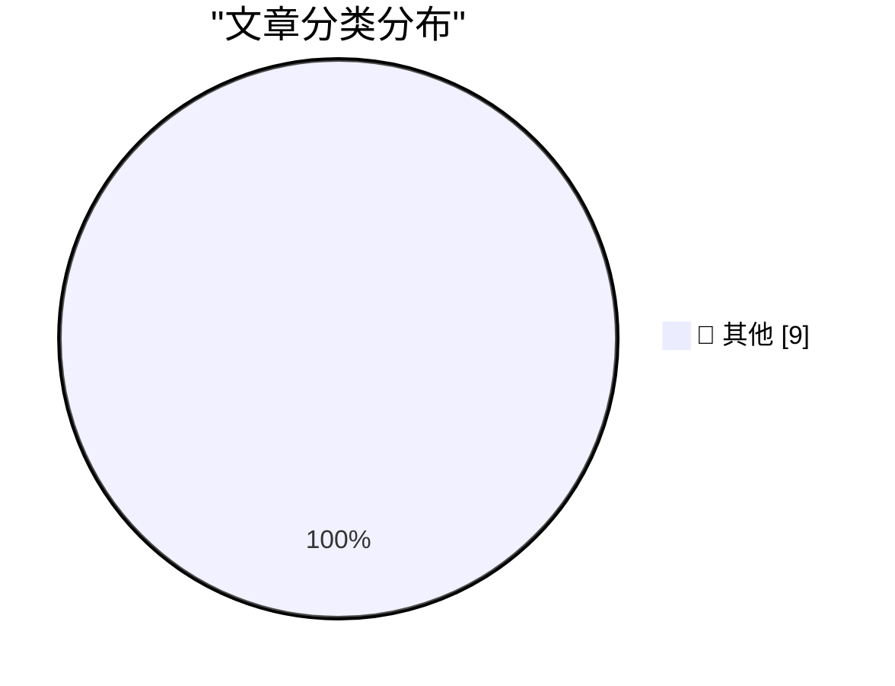

# 📰 AI 博客每日精选 — 2026-11-02

> 来自 Karpathy 推荐的 92 个顶级技术博客，AI 精选 Top 9

## 🏆 今日必读

🥇 **Quoting Kyle Kingsbury**

[Quoting Kyle Kingsbury](https://simonwillison.net/2026/Nov/1/kyle-kingsbury/) — simonwillison.net · 3 小时前 · 📝 其他

> Quoting Kyle Kingsbury

🥈 **How We Took Over ChatGPT Accounts**

[How We Took Over ChatGPT Accounts](https://simonwillison.net/2026/Oct/31/how-we-took-over-chatgpt-accounts/) — simonwillison.net · 21 小时前 · 📝 其他

> How We Took Over ChatGPT Accounts

🥉 **datasette-llm 0.1a9**

[datasette-llm 0.1a9](https://simonwillison.net/2026/Oct/31/datasette-llm/) — simonwillison.net · 22 小时前 · 📝 其他

> datasette-llm 0.1a9

---

## 📊 数据概览

| 扫描源 | 抓取文章 | 时间范围 | 精选 |
|:---:|:---:|:---:|:---:|
| 84/92 | 2576 篇 → 9 篇 | 24h | **9 篇** |

### 分类分布

---

## 📝 其他

### 1. Quoting Kyle Kingsbury

[Quoting Kyle Kingsbury](https://simonwillison.net/2026/Nov/1/kyle-kingsbury/) — **simonwillison.net** · 3 小时前 · ⭐ 15/30

> Quoting Kyle Kingsbury

---

### 2. How We Took Over ChatGPT Accounts

[How We Took Over ChatGPT Accounts](https://simonwillison.net/2026/Oct/31/how-we-took-over-chatgpt-accounts/) — **simonwillison.net** · 21 小时前 · ⭐ 15/30

> How We Took Over ChatGPT Accounts

---

### 3. datasette-llm 0.1a9

[datasette-llm 0.1a9](https://simonwillison.net/2026/Oct/31/datasette-llm/) — **simonwillison.net** · 22 小时前 · ⭐ 15/30

> datasette-llm 0.1a9

---

### 4. Fast and slow ways to improve your reputation

[Fast and slow ways to improve your reputation](https://seangoedecke.com/how-to-get-assigned-interesting-work/) — **seangoedecke.com** · 20 小时前 · ⭐ 15/30

> Fast and slow ways to improve your reputation

---

### 5. WorkOS: Let Agents Sign Up for Your App Without a Browser

[WorkOS: Let Agents Sign Up for Your App Without a Browser](https://workos.com/auth-md?utm_source=daringfireball&amp;utm_medium=newsletter&amp;utm_campaign=q42026) — **daringfireball.net** · 2 分钟前 · ⭐ 15/30

> WorkOS: Let Agents Sign Up for Your App Without a Browser

---

### 6. 10 Years on Mastodon

[10 Years on Mastodon](https://shkspr.mobi/blog/2026/11/10-years-on-mastodon/) — **shkspr.mobi** · 7 小时前 · ⭐ 15/30

> 10 Years on Mastodon

---

### 7. A Mastodon bot powered by iOS Shortcuts

[A Mastodon bot powered by iOS Shortcuts](https://evanhahn.com/mastodon-bot-with-ios-shortcuts/) — **evanhahn.com** · 9 小时前 · ⭐ 15/30

> A Mastodon bot powered by iOS Shortcuts

---

### 8. IBM PC/XT drives stuck in the bay? How to free them

[IBM PC/XT drives stuck in the bay? How to free them](https://dfarq.homeip.net/ibm-pc-xt-drives-stuck-in-the-bay-how-to-free-them/?utm_source=rss&#038;utm_medium=rss&#038;utm_campaign=ibm-pc-xt-drives-stuck-in-the-bay-how-to-free-them) — **dfarq.homeip.net** · 8 小时前 · ⭐ 15/30

> IBM PC/XT drives stuck in the bay? How to free them

---

### 9. Weekly Update 528: Reading AI-generated Code & the Economics of Solar

[Weekly Update 528: Reading AI-generated Code & the Economics of Solar](https://www.troyhunt.com/weekly-update-528/) — **troyhunt.com** · 12 小时前 · ⭐ 15/30

> Weekly Update 528: Reading AI-generated Code & the Economics of Solar

---

*生成于 2026-11-02 04:25 (Asia/Shanghai) | 扫描 84 源 → 获取 2576 篇 → 精选 9 篇*
*基于 [Hacker News Popularity Contest 2025](https://refactoringenglish.com/tools/hn-popularity/) RSS 源列表，由 [Andrej Karpathy](https://x.com/karpathy) 推荐*
*由「懂点儿AI」制作，欢迎关注同名微信公众号获取更多 AI 实用技巧 💡*
