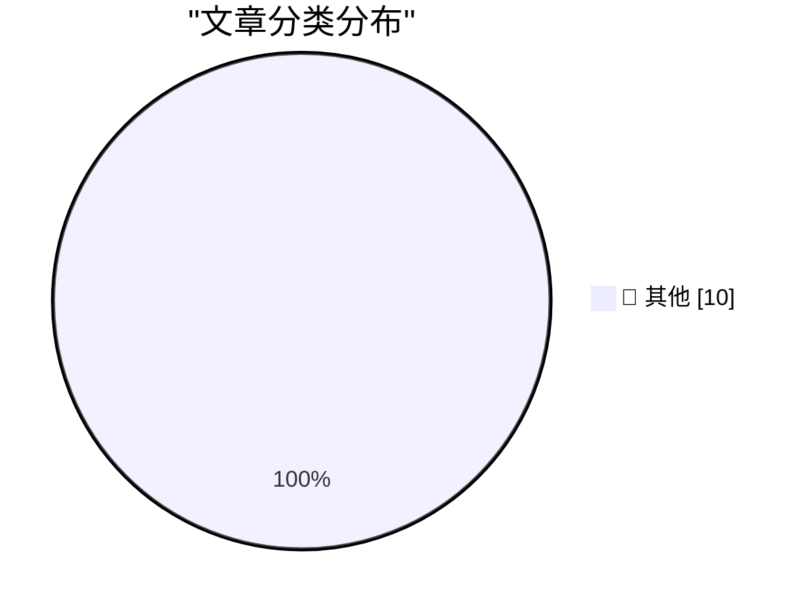

# 📰 AI 博客每日精选 — 2026-11-03

> 来自 Karpathy 推荐的 92 个顶级技术博客，AI 精选 Top 10

## 🏆 今日必读

🥇 **The U.S. Census Bureau and “Super Intelligence”**

[The U.S. Census Bureau and “Super Intelligence”](https://simonwillison.net/2026/Nov/2/census-bureau-super-intelligence/) — simonwillison.net · 9 小时前 · 📝 其他

> The U.S. Census Bureau and “Super Intelligence”

🥈 **LLMs are not superhuman at reading and writing neural network weights**

[LLMs are not superhuman at reading and writing neural network weights](https://seangoedecke.com/llms-are-not-superhuman-at-reading-and-writing-neural-network-weights/) — seangoedecke.com · -36 分钟前 · 📝 其他

> LLMs are not superhuman at reading and writing neural network weights

🥉 **Audience capture**

[Audience capture](https://seangoedecke.com/audience-capture/) — seangoedecke.com · -36 分钟前 · 📝 其他

> Audience capture

---

## 📊 数据概览

| 扫描源 | 抓取文章 | 时间范围 | 精选 |
|:---:|:---:|:---:|:---:|
| 84/92 | 2576 篇 → 10 篇 | 24h | **10 篇** |

### 分类分布

---

## 📝 其他

### 1. The U.S. Census Bureau and “Super Intelligence”

[The U.S. Census Bureau and “Super Intelligence”](https://simonwillison.net/2026/Nov/2/census-bureau-super-intelligence/) — **simonwillison.net** · 9 小时前 · ⭐ 15/30

> The U.S. Census Bureau and “Super Intelligence”

---

### 2. LLMs are not superhuman at reading and writing neural network weights

[LLMs are not superhuman at reading and writing neural network weights](https://seangoedecke.com/llms-are-not-superhuman-at-reading-and-writing-neural-network-weights/) — **seangoedecke.com** · -36 分钟前 · ⭐ 15/30

> LLMs are not superhuman at reading and writing neural network weights

---

### 3. Audience capture

[Audience capture](https://seangoedecke.com/audience-capture/) — **seangoedecke.com** · -36 分钟前 · ⭐ 15/30

> Audience capture

---

### 4. Reliably aligning LLMs is impossible in principle

[Reliably aligning LLMs is impossible in principle](https://seangoedecke.com/alignment-is-impossible/) — **seangoedecke.com** · 23 小时前 · ⭐ 15/30

> Reliably aligning LLMs is impossible in principle

---

### 5. [Sponsor] OurCal

[[Sponsor] OurCal](https://ourcal.com/?utm_source=daringfireball&amp;utm_medium=sponsorship&amp;utm_content=rssitem) — **daringfireball.net** · 40 分钟前 · ⭐ 15/30

> [Sponsor] OurCal

---

### 6. Pluralistic: Autodoxing (02 Nov 2026)

[Pluralistic: Autodoxing (02 Nov 2026)](https://pluralistic.net/2026/11/02/agony-verification/) — **pluralistic.net** · 15 小时前 · ⭐ 15/30

> Pluralistic: Autodoxing (02 Nov 2026)

---

### 7. Lorem Ipsum Dot Gov Dot UK

[Lorem Ipsum Dot Gov Dot UK](https://shkspr.mobi/blog/2026/11/lorem-ipsum-dot-gov-dot-uk/) — **shkspr.mobi** · 10 小时前 · ⭐ 15/30

> Lorem Ipsum Dot Gov Dot UK

---

### 8. Sneaking into the auditorium for the Windows 2000 launch rehearsal

[Sneaking into the auditorium for the Windows 2000 launch rehearsal](https://devblogs.microsoft.com/oldnewthing/20261102-00/?p=112818/) — **devblogs.microsoft.com/oldnewthing** · 8 小时前 · ⭐ 15/30

> Sneaking into the auditorium for the Windows 2000 launch rehearsal

---

### 9. Making peace with the projective plane

[Making peace with the projective plane](https://www.johndcook.com/blog/2026/11/02/projective-plane/) — **johndcook.com** · 8 小时前 · ⭐ 15/30

> Making peace with the projective plane

---

### 10. Etoys.com and its rapid rise and fall

[Etoys.com and its rapid rise and fall](https://dfarq.homeip.net/etoys-com-and-its-rapid-rise-and-fall/?utm_source=rss&#038;utm_medium=rss&#038;utm_campaign=etoys-com-and-its-rapid-rise-and-fall) — **dfarq.homeip.net** · 11 小时前 · ⭐ 15/30

> Etoys.com and its rapid rise and fall

---

*生成于 2026-11-03 07:24 (Asia/Shanghai) | 扫描 84 源 → 获取 2576 篇 → 精选 10 篇*
*基于 [Hacker News Popularity Contest 2025](https://refactoringenglish.com/tools/hn-popularity/) RSS 源列表，由 [Andrej Karpathy](https://x.com/karpathy) 推荐*
*由「懂点儿AI」制作，欢迎关注同名微信公众号获取更多 AI 实用技巧 💡*
