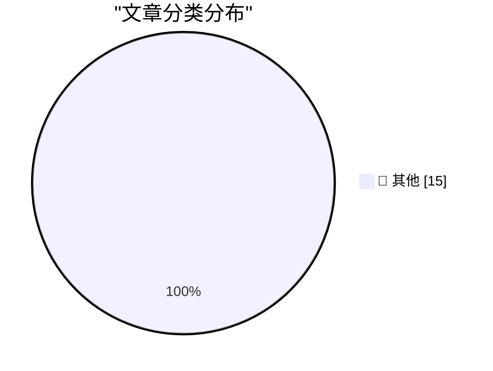

# 📰 AI 博客每日精选 — 2026-11-04

> 来自 Karpathy 推荐的 92 个顶级技术博客，AI 精选 Top 15

## 🏆 今日必读

🥇 **Qwen 3.8 27B on my laptop can interpret model weights, too**

[Qwen 3.8 27B on my laptop can interpret model weights, too](https://simonwillison.net/2026/Nov/3/qwen-can-interpret-model-weights/) — simonwillison.net · 5 小时前 · 📝 其他

> Qwen 3.8 27B on my laptop can interpret model weights, too

🥈 **I discovered a sound that leaks your exact location (and it's everywhere) - YouTube**

[I discovered a sound that leaks your exact location (and it's everywhere) - YouTube](https://simonwillison.net/2026/Nov/3/a-sound-that-leaks-your-exact-location/) — simonwillison.net · 16 小时前 · 📝 其他

> I discovered a sound that leaks your exact location (and it's everywhere) - YouTube

🥉 **October sponsors-only newsletter**

[October sponsors-only newsletter](https://simonwillison.net/2026/Nov/3/october-newsletter/) — simonwillison.net · 16 小时前 · 📝 其他

> October sponsors-only newsletter

---

## 📊 数据概览

| 扫描源 | 抓取文章 | 时间范围 | 精选 |
|:---:|:---:|:---:|:---:|
| 84/92 | 2577 篇 → 29 篇 | 24h | **15 篇** |

### 分类分布

---

## 📝 其他

### 1. Qwen 3.8 27B on my laptop can interpret model weights, too

[Qwen 3.8 27B on my laptop can interpret model weights, too](https://simonwillison.net/2026/Nov/3/qwen-can-interpret-model-weights/) — **simonwillison.net** · 5 小时前 · ⭐ 15/30

> Qwen 3.8 27B on my laptop can interpret model weights, too

---

### 2. I discovered a sound that leaks your exact location (and it's everywhere) - YouTube

[I discovered a sound that leaks your exact location (and it's everywhere) - YouTube](https://simonwillison.net/2026/Nov/3/a-sound-that-leaks-your-exact-location/) — **simonwillison.net** · 16 小时前 · ⭐ 15/30

> I discovered a sound that leaks your exact location (and it's everywhere) - YouTube

---

### 3. October sponsors-only newsletter

[October sponsors-only newsletter](https://simonwillison.net/2026/Nov/3/october-newsletter/) — **simonwillison.net** · 16 小时前 · ⭐ 15/30

> October sponsors-only newsletter

---

### 4. llm 0.37

[llm 0.37](https://simonwillison.net/2026/Nov/2/llm/) — **simonwillison.net** · 21 小时前 · ⭐ 15/30

> llm 0.37

---

### 5. LLMs are not superhuman at reading and writing neural network weights

[LLMs are not superhuman at reading and writing neural network weights](https://seangoedecke.com/llms-are-not-superhuman-at-reading-and-writing-neural-network-weights/) — **seangoedecke.com** · 21 小时前 · ⭐ 15/30

> LLMs are not superhuman at reading and writing neural network weights

---

### 6. Audience capture

[Audience capture](https://seangoedecke.com/audience-capture/) — **seangoedecke.com** · 21 小时前 · ⭐ 15/30

> Audience capture

---

### 7. Tech Firms Dismantle Botnet That Turned 1.3M TV Boxes Into Proxies

[Tech Firms Dismantle Botnet That Turned 1.3M TV Boxes Into Proxies](https://krebsonsecurity.com/2026/11/tech-firms-dismantle-botnet-that-turned-1-3m-tv-boxes-into-proxies/) — **krebsonsecurity.com** · 19 小时前 · ⭐ 15/30

> Tech Firms Dismantle Botnet That Turned 1.3M TV Boxes Into Proxies

---

### 8. Safari 27.3 Beta Adds Vertical Tabs and Adaptive Dark Mode

[Safari 27.3 Beta Adds Vertical Tabs and Adaptive Dark Mode](https://www.macrumors.com/2026/11/03/ios-27-3-safari/) — **daringfireball.net** · 2 小时前 · ⭐ 15/30

> Safari 27.3 Beta Adds Vertical Tabs and Adaptive Dark Mode

---

### 9. The New York Times (et al.) Sues Brave for Copyright Infringement, Selling Scraped Content to AI Companies for Model Training

[The New York Times (et al.) Sues Brave for Copyright Infringement, Selling Scraped Content to AI Companies for Model Training](https://www.theverge.com/tech/1024588/brave-lawsuit-ai-scraping-new-york-times) — **daringfireball.net** · 5 小时前 · ⭐ 15/30

> The New York Times (et al.) Sues Brave for Copyright Infringement, Selling Scraped Content to AI Companies for Model Training

---

### 10. Steve Jobs on His Final Quarterly Analyst Call: ‘We Think the Open Versus Closed Argument Is Just a Smokescreen’

[Steve Jobs on His Final Quarterly Analyst Call: ‘We Think the Open Versus Closed Argument Is Just a Smokescreen’](https://www.macworld.com/article/208438/jobs_transcript.html) — **daringfireball.net** · 5 小时前 · ⭐ 15/30

> Steve Jobs on His Final Quarterly Analyst Call: ‘We Think the Open Versus Closed Argument Is Just a Smokescreen’

---

### 11. Chance Miller Reviews the New A20 Pro iPad Mini

[Chance Miller Reviews the New A20 Pro iPad Mini](https://9to5mac.com/2026/11/03/new-ipad-mini-a20-pro-review/) — **daringfireball.net** · 6 小时前 · ⭐ 15/30

> Chance Miller Reviews the New A20 Pro iPad Mini

---

### 12. Apple’s Analyst Calls Have Been Scripted for Decades

[Apple’s Analyst Calls Have Been Scripted for Decades](https://9to5mac.com/2026/11/03/apple-ceo-john-ternus-criticized-for-scripted-approach-to-first-earnings-call/) — **daringfireball.net** · 7 小时前 · ⭐ 15/30

> Apple’s Analyst Calls Have Been Scripted for Decades

---

### 13. Apple’s New iPhone Release Schedule Seems to Pay Off

[Apple’s New iPhone Release Schedule Seems to Pay Off](https://x.com/asymco/status/2117379158087278697) — **daringfireball.net** · 7 小时前 · ⭐ 15/30

> Apple’s New iPhone Release Schedule Seems to Pay Off

---

### 14. Apple Announces Record $114.5B Fourth-Quarter Results

[Apple Announces Record $114.5B Fourth-Quarter Results](https://sixcolors.com/post/2026/11/apple-announces-record-114-5b-fourth-quarter-results/) — **daringfireball.net** · 21 小时前 · ⭐ 15/30

> Apple Announces Record $114.5B Fourth-Quarter Results

---

### 15. [Sponsor] OurCal

[[Sponsor] OurCal](https://ourcal.com/?utm_source=daringfireball&amp;utm_medium=sponsorship&amp;utm_content=rssitem) — **daringfireball.net** · 22 小时前 · ⭐ 15/30

> [Sponsor] OurCal

---

*生成于 2026-11-04 05:40 (Asia/Shanghai) | 扫描 84 源 → 获取 2577 篇 → 精选 15 篇*
*基于 [Hacker News Popularity Contest 2025](https://refactoringenglish.com/tools/hn-popularity/) RSS 源列表，由 [Andrej Karpathy](https://x.com/karpathy) 推荐*
*由「懂点儿AI」制作，欢迎关注同名微信公众号获取更多 AI 实用技巧 💡*
