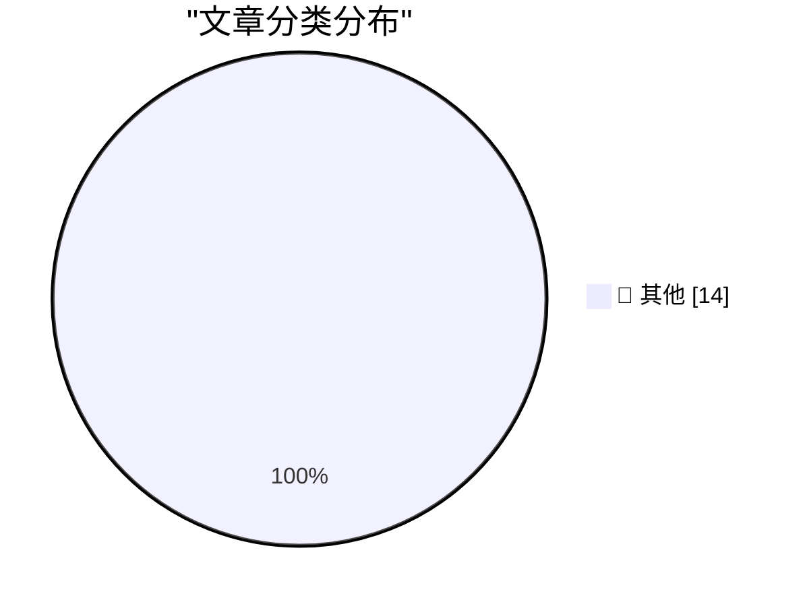

# 📰 AI 博客每日精选 — 2026-11-05

> 来自 Karpathy 推荐的 92 个顶级技术博客，AI 精选 Top 14

## 🏆 今日必读

🥇 **datasette-llm 0.1a10**

[datasette-llm 0.1a10](https://simonwillison.net/2026/Nov/4/datasette-llm/) — simonwillison.net · 6 小时前 · 📝 其他

> datasette-llm 0.1a10

🥈 **datasette-apps 0.3a0**

[datasette-apps 0.3a0](https://simonwillison.net/2026/Nov/4/datasette-apps/) — simonwillison.net · 21 小时前 · 📝 其他

> datasette-apps 0.3a0

🥉 **datasette-agent 0.5a0**

[datasette-agent 0.5a0](https://simonwillison.net/2026/Nov/3/datasette-agent/) — simonwillison.net · 22 小时前 · 📝 其他

> datasette-agent 0.5a0

---

## 📊 数据概览

| 扫描源 | 抓取文章 | 时间范围 | 精选 |
|:---:|:---:|:---:|:---:|
| 83/92 | 2552 篇 → 14 篇 | 24h | **14 篇** |

### 分类分布

---

## 📝 其他

### 1. datasette-llm 0.1a10

[datasette-llm 0.1a10](https://simonwillison.net/2026/Nov/4/datasette-llm/) — **simonwillison.net** · 6 小时前 · ⭐ 15/30

> datasette-llm 0.1a10

---

### 2. datasette-apps 0.3a0

[datasette-apps 0.3a0](https://simonwillison.net/2026/Nov/4/datasette-apps/) — **simonwillison.net** · 21 小时前 · ⭐ 15/30

> datasette-apps 0.3a0

---

### 3. datasette-agent 0.5a0

[datasette-agent 0.5a0](https://simonwillison.net/2026/Nov/3/datasette-agent/) — **simonwillison.net** · 22 小时前 · ⭐ 15/30

> datasette-agent 0.5a0

---

### 4. This Election Will Not Look Surprising in History

[This Election Will Not Look Surprising in History](https://apple.news/Afq6SKrYkTcCEHrCEQmxm5A?web_embed_link=aHR0cHM6Ly9uZXdzLWFzc2V0cy5hcHBsZS5jb20vZW1iZWRzLzY2ZDQzYzg0LTMyMWYtNGQ0Ny05Mzk4LWE3NjE3NDgwZWE2Yi9pbmRleC5odG1sI2NvbnRleHQ9TU9EQUwmc3RpY2t5PWZhbHNlJmVmZmVjdD1ub25lJmxpZ2h0X2JnX2NvbG9yPWU5ZWNmMiZkYXJrX2JnX2NvbG9yPTJkM2Q1NCZzY29wZT11cyZvcmlnaW49c2hhcnJvdyZsaXZlYWN0aXZpdGllcz10cnVlJm5mZl9jaWQ9NTZjMjQ1OTQtNDIxNC00NDM0LTlhNTgtNWE1YTIxM2ZkMTBi) — **daringfireball.net** · 6 小时前 · ⭐ 15/30

> This Election Will Not Look Surprising in History

---

### 5. ‘Political Reckoning Shatters Trump’s Grip on Washington’

[‘Political Reckoning Shatters Trump’s Grip on Washington’](https://www.wsj.com/politics/elections/a-political-reckoning-shatters-trumps-grip-on-washington-bd3c7705?st=xABDit) — **daringfireball.net** · 6 小时前 · ⭐ 15/30

> ‘Political Reckoning Shatters Trump’s Grip on Washington’

---

### 6. Apple Begins Opening Siri AI to Developers

[Apple Begins Opening Siri AI to Developers](https://developer.apple.com/news/?id=gdk2umrf) — **daringfireball.net** · 21 小时前 · ⭐ 15/30

> Apple Begins Opening Siri AI to Developers

---

### 7. iPad Mini (A20 Pro) Review Roundup

[iPad Mini (A20 Pro) Review Roundup](https://www.techmeme.com/261103/p15#a261103p15) — **daringfireball.net** · 22 小时前 · ⭐ 15/30

> iPad Mini (A20 Pro) Review Roundup

---

### 8. MKBHD on the New A20 Pro iPad Mini

[MKBHD on the New A20 Pro iPad Mini](https://www.youtube.com/watch?v=g6Die8gVFn0) — **daringfireball.net** · 22 小时前 · ⭐ 15/30

> MKBHD on the New A20 Pro iPad Mini

---

### 9. Goodhart's Law, but We Already Spent All Our Money

[Goodhart's Law, but We Already Spent All Our Money](https://idiallo.com/blog/we-spent-all-our-money-goodharts-law) — **idiallo.com** · 13 小时前 · ⭐ 15/30

> Goodhart's Law, but We Already Spent All Our Money

---

### 10. Pluralistic: The AI fatfinger economy has come for my receipts app (04 Nov 2026)

[Pluralistic: The AI fatfinger economy has come for my receipts app (04 Nov 2026)](https://pluralistic.net/2026/11/04/genius-scan-is-neither/) — **pluralistic.net** · 10 小时前 · ⭐ 15/30

> Pluralistic: The AI fatfinger economy has come for my receipts app (04 Nov 2026)

---

### 11. Book Review: Practice by Rosalind Brown ★★★★☆

[Book Review: Practice by Rosalind Brown ★★★★☆](https://shkspr.mobi/blog/2026/11/book-review-practice-by-rosalind-brown/) — **shkspr.mobi** · 9 小时前 · ⭐ 15/30

> Book Review: Practice by Rosalind Brown ★★★★☆

---

### 12. This Week in Source Control: 4 November 2026

[This Week in Source Control: 4 November 2026](https://nesbitt.io/2026/11/04/this-week-in-source-control.html) — **nesbitt.io** · 11 小时前 · ⭐ 15/30

> This Week in Source Control: 4 November 2026

---

### 13. “It Gives Great Demo”

[“It Gives Great Demo”](https://blog.jim-nielsen.com/2026/it-gives-great-demo/) — **blog.jim-nielsen.com** · 2 小时前 · ⭐ 15/30

> “It Gives Great Demo”

---

### 14. The first Compaq computer

[The first Compaq computer](https://dfarq.homeip.net/first-compaq-computer/?utm_source=rss&#038;utm_medium=rss&#038;utm_campaign=first-compaq-computer) — **dfarq.homeip.net** · 9 小时前 · ⭐ 15/30

> The first Compaq computer

---

*生成于 2026-11-05 05:48 (Asia/Shanghai) | 扫描 83 源 → 获取 2552 篇 → 精选 14 篇*
*基于 [Hacker News Popularity Contest 2025](https://refactoringenglish.com/tools/hn-popularity/) RSS 源列表，由 [Andrej Karpathy](https://x.com/karpathy) 推荐*
*由「懂点儿AI」制作，欢迎关注同名微信公众号获取更多 AI 实用技巧 💡*
