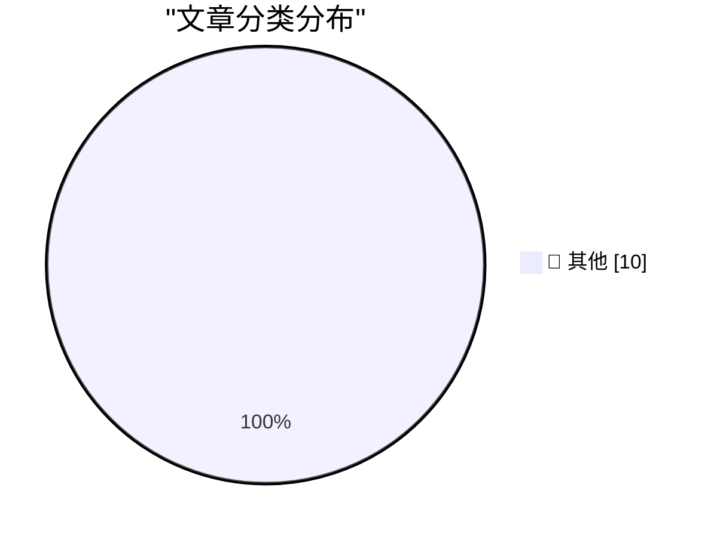

# 📰 AI 博客每日精选 — 2026-11-06

> 来自 Karpathy 推荐的 92 个顶级技术博客，AI 精选 Top 10

## 🏆 今日必读

🥇 **Quoting Paul Ford**

[Quoting Paul Ford](https://simonwillison.net/2026/Nov/5/paul-ford/) — simonwillison.net · 4 小时前 · 📝 其他

> Quoting Paul Ford

🥈 **Want to Rent an Internet Address at the White House?**

[Want to Rent an Internet Address at the White House?](https://krebsonsecurity.com/2026/11/want-to-rent-an-internet-address-at-the-white-house/) — krebsonsecurity.com · 17 小时前 · 📝 其他

> Want to Rent an Internet Address at the White House?

🥉 **Salon Ceases Publication**

[Salon Ceases Publication](https://www.salon.com/2026/11/05/goodbye-from-salon/) — daringfireball.net · 23 分钟前 · 📝 其他

> Salon Ceases Publication

---

## 📊 数据概览

| 扫描源 | 抓取文章 | 时间范围 | 精选 |
|:---:|:---:|:---:|:---:|
| 83/92 | 2568 篇 → 10 篇 | 24h | **10 篇** |

### 分类分布

---

## 📝 其他

### 1. Quoting Paul Ford

[Quoting Paul Ford](https://simonwillison.net/2026/Nov/5/paul-ford/) — **simonwillison.net** · 4 小时前 · ⭐ 15/30

> Quoting Paul Ford

---

### 2. Want to Rent an Internet Address at the White House?

[Want to Rent an Internet Address at the White House?](https://krebsonsecurity.com/2026/11/want-to-rent-an-internet-address-at-the-white-house/) — **krebsonsecurity.com** · 17 小时前 · ⭐ 15/30

> Want to Rent an Internet Address at the White House?

---

### 3. Salon Ceases Publication

[Salon Ceases Publication](https://www.salon.com/2026/11/05/goodbye-from-salon/) — **daringfireball.net** · 23 分钟前 · ⭐ 15/30

> Salon Ceases Publication

---

### 4. Meta Releases Mac Version of Edits

[Meta Releases Mac Version of Edits](https://edits.instagram.com/blog/edits-desktop-video-editor/) — **daringfireball.net** · 1 小时前 · ⭐ 15/30

> Meta Releases Mac Version of Edits

---

### 5. It's unbreakable in theory

[It's unbreakable in theory](https://idiallo.com/byte-size/unbreakable-in-theory) — **idiallo.com** · 1 小时前 · ⭐ 15/30

> It's unbreakable in theory

---

### 6. Pluralistic: Without CDA 230, Facebook will own the internet forever (05 Nov 2026)

[Pluralistic: Without CDA 230, Facebook will own the internet forever (05 Nov 2026)](https://pluralistic.net/2026/11/05/see-you-in-court/) — **pluralistic.net** · 13 小时前 · ⭐ 15/30

> Pluralistic: Without CDA 230, Facebook will own the internet forever (05 Nov 2026)

---

### 7. Gadget Review: Tozo NC9 Pro Bluetooth Headphones ★★★★⯪

[Gadget Review: Tozo NC9 Pro Bluetooth Headphones ★★★★⯪](https://shkspr.mobi/blog/2026/11/gadget-review-tozo-nc9-pro-bluetooth-headphones/) — **shkspr.mobi** · 9 小时前 · ⭐ 15/30

> Gadget Review: Tozo NC9 Pro Bluetooth Headphones ★★★★⯪

---

### 8. The benchmark where AIs have to lie to win

[The benchmark where AIs have to lie to win](https://www.dwarkesh.com/p/clocktower) — **dwarkesh.com** · 48 分钟前 · ⭐ 15/30

> The benchmark where AIs have to lie to win

---

### 9. Micron Computers’ rise and fall

[Micron Computers’ rise and fall](https://dfarq.homeip.net/micron-computers-rise-and-fall/?utm_source=rss&#038;utm_medium=rss&#038;utm_campaign=micron-computers-rise-and-fall) — **dfarq.homeip.net** · 9 小时前 · ⭐ 15/30

> Micron Computers’ rise and fall

---

### 10. How to install an app on your Commodore 64

[How to install an app on your Commodore 64](https://anildash.com/2026/10/08/install-an-app-commodore-64/) — **anildash.com** · 22 小时前 · ⭐ 15/30

> How to install an app on your Commodore 64

---

*生成于 2026-11-06 05:54 (Asia/Shanghai) | 扫描 83 源 → 获取 2568 篇 → 精选 10 篇*
*基于 [Hacker News Popularity Contest 2025](https://refactoringenglish.com/tools/hn-popularity/) RSS 源列表，由 [Andrej Karpathy](https://x.com/karpathy) 推荐*
*由「懂点儿AI」制作，欢迎关注同名微信公众号获取更多 AI 实用技巧 💡*
