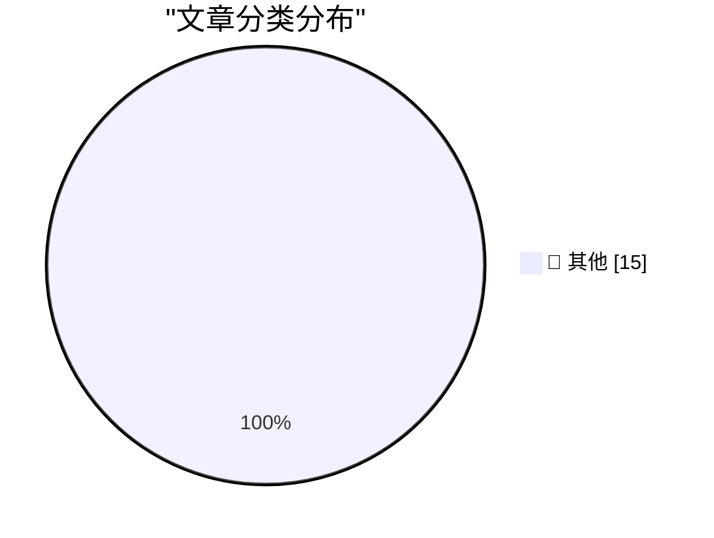

# 📰 AI 博客每日精选 — 2026-11-07

> 来自 Karpathy 推荐的 92 个顶级技术博客，AI 精选 Top 15

## 🏆 今日必读

🥇 **Quoting Nilay Patel**

[Quoting Nilay Patel](https://simonwillison.net/2026/Nov/6/nilay-patel/) — simonwillison.net · 4 小时前 · 📝 其他

> Quoting Nilay Patel

🥈 **A database is a store for global variables**

[A database is a store for global variables](https://seangoedecke.com/a-database-is-a-store-for-global-variables/) — seangoedecke.com · 21 小时前 · 📝 其他

> A database is a store for global variables

🥉 **★ Touch and Glow**

[★ Touch and Glow](https://daringfireball.net/2026/11/touch_and_glow) — daringfireball.net · 1 小时前 · 📝 其他

> ★ Touch and Glow

---

## 📊 数据概览

| 扫描源 | 抓取文章 | 时间范围 | 精选 |
|:---:|:---:|:---:|:---:|
| 82/92 | 2544 篇 → 15 篇 | 24h | **15 篇** |

### 分类分布

---

## 📝 其他

### 1. Quoting Nilay Patel

[Quoting Nilay Patel](https://simonwillison.net/2026/Nov/6/nilay-patel/) — **simonwillison.net** · 4 小时前 · ⭐ 15/30

> Quoting Nilay Patel

---

### 2. A database is a store for global variables

[A database is a store for global variables](https://seangoedecke.com/a-database-is-a-store-for-global-variables/) — **seangoedecke.com** · 21 小时前 · ⭐ 15/30

> A database is a store for global variables

---

### 3. ★ Touch and Glow

[★ Touch and Glow](https://daringfireball.net/2026/11/touch_and_glow) — **daringfireball.net** · 1 小时前 · ⭐ 15/30

> ★ Touch and Glow

---

### 4. Apple Support: ‘About the Illuminated Apple Logo on MacBook Pro With PROLED XDR Display’

[Apple Support: ‘About the Illuminated Apple Logo on MacBook Pro With PROLED XDR Display’](https://support.apple.com/en-us/149248) — **daringfireball.net** · 6 小时前 · ⭐ 15/30

> Apple Support: ‘About the Illuminated Apple Logo on MacBook Pro With PROLED XDR Display’

---

### 5. The President is Coping Well

[The President is Coping Well](https://www.wsj.com/politics/policy/trump-signs-proclamation-he-says-will-protect-oval-office-from-major-changes-93f3285b) — **daringfireball.net** · 6 小时前 · ⭐ 15/30

> The President is Coping Well

---

### 6. Salon Ceases Publication

[Salon Ceases Publication](https://www.salon.com/2026/11/05/goodbye-from-salon/) — **daringfireball.net** · 23 小时前 · ⭐ 15/30

> Salon Ceases Publication

---

### 7. Writing English is Solved

[Writing English is Solved](https://idiallo.com/byte-size/english-is-solved) — **idiallo.com** · 13 小时前 · ⭐ 15/30

> Writing English is Solved

---

### 8. A video game which caused real world violence

[A video game which caused real world violence](https://shkspr.mobi/blog/2026/11/a-video-game-which-caused-real-world-violence/) — **shkspr.mobi** · 8 小时前 · ⭐ 15/30

> A video game which caused real world violence

---

### 9. Static site generators are weird

[Static site generators are weird](https://evanhahn.com/static-site-generators-are-weird/) — **evanhahn.com** · 4 小时前 · ⭐ 15/30

> Static site generators are weird

---

### 10. Weekend at Bernie’s II

[Weekend at Bernie’s II](https://nesbitt.io/2026/11/06/weekend-at-bernies-ii.html) — **nesbitt.io** · 11 小时前 · ⭐ 15/30

> Weekend at Bernie’s II

---

### 11. How Do Building Codes Affect the Price of Housing?

[How Do Building Codes Affect the Price of Housing?](https://www.construction-physics.com/p/how-do-building-codes-affect-the) — **construction-physics.com** · 8 小时前 · ⭐ 15/30

> How Do Building Codes Affect the Price of Housing?

---

### 12. Premium: Fault Lines

[Premium: Fault Lines](https://www.wheresyoured.at/premium-fault-lines/) — **wheresyoured.at** · 4 小时前 · ⭐ 15/30

> Premium: Fault Lines

---

### 13. Deus Ex

[Deus Ex](https://www.filfre.net/2026/11/deus-ex/) — **filfre.net** · 5 小时前 · ⭐ 15/30

> Deus Ex

---

### 14. What happened to Transmeta, the last big dotcom IPO

[What happened to Transmeta, the last big dotcom IPO](https://dfarq.homeip.net/what-happened-to-transmeta-the-last-big-dotcom-ipo/?utm_source=rss&#038;utm_medium=rss&#038;utm_campaign=what-happened-to-transmeta-the-last-big-dotcom-ipo) — **dfarq.homeip.net** · 9 小时前 · ⭐ 15/30

> What happened to Transmeta, the last big dotcom IPO

---

### 15. How to install an app on your Commodore 64

[How to install an app on your Commodore 64](https://anildash.com/2026/10/08/install-an-app-commodore-64/) — **anildash.com** · 18 小时前 · ⭐ 15/30

> How to install an app on your Commodore 64

---

*生成于 2026-11-07 05:26 (Asia/Shanghai) | 扫描 82 源 → 获取 2544 篇 → 精选 15 篇*
*基于 [Hacker News Popularity Contest 2025](https://refactoringenglish.com/tools/hn-popularity/) RSS 源列表，由 [Andrej Karpathy](https://x.com/karpathy) 推荐*
*由「懂点儿AI」制作，欢迎关注同名微信公众号获取更多 AI 实用技巧 💡*
