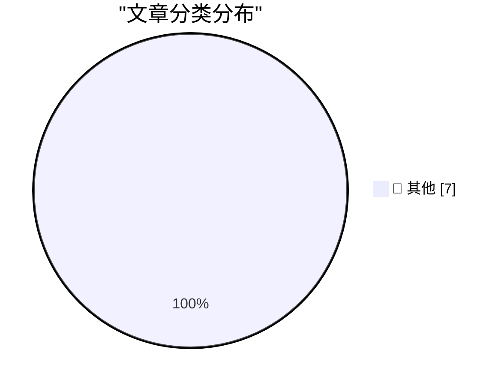

# 📰 AI 博客每日精选 — 2026-11-08

> 来自 Karpathy 推荐的 92 个顶级技术博客，AI 精选 Top 7

## 🏆 今日必读

🥇 **Working with designers**

[Working with designers](https://seangoedecke.com/working-with-designers/) — seangoedecke.com · 20 小时前 · 📝 其他

> Working with designers

🥈 **Pluralistic: JS Tan and Clarissa Redwine's "Against Tech Oligarchy" (07 Nov 2026)**

[Pluralistic: JS Tan and Clarissa Redwine's "Against Tech Oligarchy" (07 Nov 2026)](https://pluralistic.net/2026/11/07/aeiou-but-sometimes-why/) — pluralistic.net · 7 小时前 · 📝 其他

> Pluralistic: JS Tan and Clarissa Redwine's "Against Tech Oligarchy" (07 Nov 2026)

🥉 **Book Review: When the Dust Settles - Stories of Love, Loss and Hope from an Expert in Disaster by Lucy Easthope ★★★★★**

[Book Review: When the Dust Settles - Stories of Love, Loss and Hope from an Expert in Disaster by Lucy Easthope ★★★★★](https://shkspr.mobi/blog/2026/11/book-review-when-the-dust-settles-stories-of-love-loss-and-hope-from-an-expert-in-disaster-by-lucy-easthope/) — shkspr.mobi · 7 小时前 · 📝 其他

> Book Review: When the Dust Settles - Stories of Love, Loss and Hope from an Expert in Disaster by Lucy Easthope ★★★★★

---

## 📊 数据概览

| 扫描源 | 抓取文章 | 时间范围 | 精选 |
|:---:|:---:|:---:|:---:|
| 82/92 | 2545 篇 → 7 篇 | 24h | **7 篇** |

### 分类分布

---

## 📝 其他

### 1. Working with designers

[Working with designers](https://seangoedecke.com/working-with-designers/) — **seangoedecke.com** · 20 小时前 · ⭐ 15/30

> Working with designers

---

### 2. Pluralistic: JS Tan and Clarissa Redwine's "Against Tech Oligarchy" (07 Nov 2026)

[Pluralistic: JS Tan and Clarissa Redwine's "Against Tech Oligarchy" (07 Nov 2026)](https://pluralistic.net/2026/11/07/aeiou-but-sometimes-why/) — **pluralistic.net** · 7 小时前 · ⭐ 15/30

> Pluralistic: JS Tan and Clarissa Redwine's "Against Tech Oligarchy" (07 Nov 2026)

---

### 3. Book Review: When the Dust Settles - Stories of Love, Loss and Hope from an Expert in Disaster by Lucy Easthope ★★★★★

[Book Review: When the Dust Settles - Stories of Love, Loss and Hope from an Expert in Disaster by Lucy Easthope ★★★★★](https://shkspr.mobi/blog/2026/11/book-review-when-the-dust-settles-stories-of-love-loss-and-hope-from-an-expert-in-disaster-by-lucy-easthope/) — **shkspr.mobi** · 7 小时前 · ⭐ 15/30

> Book Review: When the Dust Settles - Stories of Love, Loss and Hope from an Expert in Disaster by Lucy Easthope ★★★★★

---

### 4. This Week in Package Management: 7 November 2026

[This Week in Package Management: 7 November 2026](https://nesbitt.io/2026/11/07/this-week-in-package-management.html) — **nesbitt.io** · 10 小时前 · ⭐ 15/30

> This Week in Package Management: 7 November 2026

---

### 5. Reading List 11/7/2026

[Reading List 11/7/2026](https://www.construction-physics.com/p/reading-list-1172026) — **construction-physics.com** · 6 小时前 · ⭐ 15/30

> Reading List 11/7/2026

---

### 6. Marx diesel freight train set 9613

[Marx diesel freight train set 9613](https://dfarq.homeip.net/marx-diesel-freight-train-set-9613/?utm_source=rss&#038;utm_medium=rss&#038;utm_campaign=marx-diesel-freight-train-set-9613) — **dfarq.homeip.net** · 8 小时前 · ⭐ 15/30

> Marx diesel freight train set 9613

---

### 7. Upgrade diary: HP Elitedesk 800 G4

[Upgrade diary: HP Elitedesk 800 G4](https://dfarq.homeip.net/upgrade-diary-hp-elitedesk-800-g4/?utm_source=rss&#038;utm_medium=rss&#038;utm_campaign=upgrade-diary-hp-elitedesk-800-g4) — **dfarq.homeip.net** · 8 小时前 · ⭐ 15/30

> Upgrade diary: HP Elitedesk 800 G4

---

*生成于 2026-11-08 04:07 (Asia/Shanghai) | 扫描 82 源 → 获取 2545 篇 → 精选 7 篇*
*基于 [Hacker News Popularity Contest 2025](https://refactoringenglish.com/tools/hn-popularity/) RSS 源列表，由 [Andrej Karpathy](https://x.com/karpathy) 推荐*
*由「懂点儿AI」制作，欢迎关注同名微信公众号获取更多 AI 实用技巧 💡*
