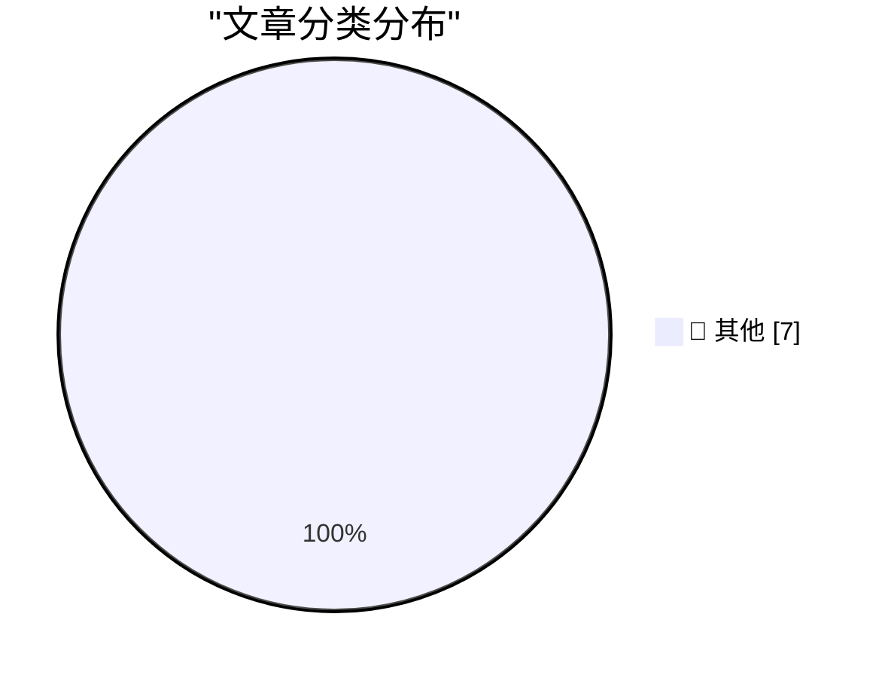

# 📰 AI 博客每日精选 — 2026-11-09

> 来自 Karpathy 推荐的 92 个顶级技术博客，AI 精选 Top 7

## 🏆 今日必读

🥇 **datasette #3046: Don't serve link: rel=next HTTP headers to Firefox for HTML pages**

[datasette #3046: Don't serve link: rel=next HTTP headers to Firefox for HTML pages](https://simonwillison.net/2026/Nov/7/link-rel-next/) — simonwillison.net · 20 小时前 · 📝 其他

> datasette #3046: Don't serve link: rel=next HTTP headers to Firefox for HTML pages

🥈 **LLMs are terrible at designing AI systems**

[LLMs are terrible at designing AI systems](https://seangoedecke.com/llms-are-terrible-at-designing-ai-systems/) — seangoedecke.com · 20 小时前 · 📝 其他

> LLMs are terrible at designing AI systems

🥉 **Yours Truly on Full Stack Creator, Talking About the New MacBook Pros With PROLED XDR Displays**

[Yours Truly on Full Stack Creator, Talking About the New MacBook Pros With PROLED XDR Displays](https://www.youtube.com/watch?v=f2GZtWuUPl0) — daringfireball.net · 23 小时前 · 📝 其他

> Yours Truly on Full Stack Creator, Talking About the New MacBook Pros With PROLED XDR Displays

---

## 📊 数据概览

| 扫描源 | 抓取文章 | 时间范围 | 精选 |
|:---:|:---:|:---:|:---:|
| 82/92 | 2545 篇 → 7 篇 | 24h | **7 篇** |

### 分类分布

---

## 📝 其他

### 1. datasette #3046: Don't serve link: rel=next HTTP headers to Firefox for HTML pages

[datasette #3046: Don't serve link: rel=next HTTP headers to Firefox for HTML pages](https://simonwillison.net/2026/Nov/7/link-rel-next/) — **simonwillison.net** · 20 小时前 · ⭐ 15/30

> datasette #3046: Don't serve link: rel=next HTTP headers to Firefox for HTML pages

---

### 2. LLMs are terrible at designing AI systems

[LLMs are terrible at designing AI systems](https://seangoedecke.com/llms-are-terrible-at-designing-ai-systems/) — **seangoedecke.com** · 20 小时前 · ⭐ 15/30

> LLMs are terrible at designing AI systems

---

### 3. Yours Truly on Full Stack Creator, Talking About the New MacBook Pros With PROLED XDR Displays

[Yours Truly on Full Stack Creator, Talking About the New MacBook Pros With PROLED XDR Displays](https://www.youtube.com/watch?v=f2GZtWuUPl0) — **daringfireball.net** · 23 小时前 · ⭐ 15/30

> Yours Truly on Full Stack Creator, Talking About the New MacBook Pros With PROLED XDR Displays

---

### 4. Some thoughts on restaurant menu QR codes

[Some thoughts on restaurant menu QR codes](https://shkspr.mobi/blog/2026/11/some-thoughts-on-restaurant-menu-qr-codes/) — **shkspr.mobi** · 7 小时前 · ⭐ 15/30

> Some thoughts on restaurant menu QR codes

---

### 5. Reverse engineering a vintage diode-transistor logic chip

[Reverse engineering a vintage diode-transistor logic chip](http://www.righto.com/feeds/7533579802505281921/comments/default) — **righto.com** · 4 小时前 · ⭐ 15/30

> Reverse engineering a vintage diode-transistor logic chip

---

### 6. The problem with Micron MT 4264 RAM

[The problem with Micron MT 4264 RAM](https://dfarq.homeip.net/the-problem-with-micron-mt-4264-ram/?utm_source=rss&#038;utm_medium=rss&#038;utm_campaign=the-problem-with-micron-mt-4264-ram) — **dfarq.homeip.net** · 8 小时前 · ⭐ 15/30

> The problem with Micron MT 4264 RAM

---

### 7. Is AI crashing?

[Is AI crashing?](https://dfarq.homeip.net/is-ai-crashing/?utm_source=rss&#038;utm_medium=rss&#038;utm_campaign=is-ai-crashing) — **dfarq.homeip.net** · 8 小时前 · ⭐ 15/30

> Is AI crashing?

---

*生成于 2026-11-09 04:21 (Asia/Shanghai) | 扫描 82 源 → 获取 2545 篇 → 精选 7 篇*
*基于 [Hacker News Popularity Contest 2025](https://refactoringenglish.com/tools/hn-popularity/) RSS 源列表，由 [Andrej Karpathy](https://x.com/karpathy) 推荐*
*由「懂点儿AI」制作，欢迎关注同名微信公众号获取更多 AI 实用技巧 💡*
