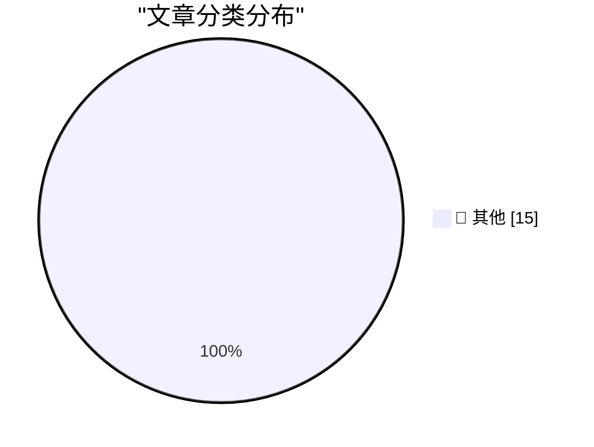

# 📰 AI 博客每日精选 — 2026-11-10

> 来自 Karpathy 推荐的 92 个顶级技术博客，AI 精选 Top 15

## 🏆 今日必读

🥇 **Locating the source of a mysterious beep with Claude**

[Locating the source of a mysterious beep with Claude](https://simonwillison.net/2026/Nov/9/mysterious-beeps/) — simonwillison.net · 9 分钟前 · 📝 其他

> Locating the source of a mysterious beep with Claude

🥈 **The Web Is More Than Enough, by Paul Ford**

[The Web Is More Than Enough, by Paul Ford](https://simonwillison.net/2026/Nov/9/hn-50421091/) — simonwillison.net · 19 小时前 · 📝 其他

> The Web Is More Than Enough, by Paul Ford

🥉 **Hide your slop PR descriptions behind 

**

[Hide your slop PR descriptions behind 

](https://simonwillison.net/2026/Nov/9/details-summary/) — simonwillison.net · 19 小时前 · 📝 其他

> Hide your slop PR descriptions behind 

---

## 📊 数据概览

| 扫描源 | 抓取文章 | 时间范围 | 精选 |
|:---:|:---:|:---:|:---:|
| 83/92 | 2571 篇 → 16 篇 | 24h | **15 篇** |

### 分类分布

---

## 📝 其他

### 1. Locating the source of a mysterious beep with Claude

[Locating the source of a mysterious beep with Claude](https://simonwillison.net/2026/Nov/9/mysterious-beeps/) — **simonwillison.net** · 9 分钟前 · ⭐ 15/30

> Locating the source of a mysterious beep with Claude

---

### 2. The Web Is More Than Enough, by Paul Ford

[The Web Is More Than Enough, by Paul Ford](https://simonwillison.net/2026/Nov/9/hn-50421091/) — **simonwillison.net** · 19 小时前 · ⭐ 15/30

> The Web Is More Than Enough, by Paul Ford

---

### 3. Hide your slop PR descriptions behind 

[Hide your slop PR descriptions behind 

](https://simonwillison.net/2026/Nov/9/details-summary/) — **simonwillison.net** · 19 小时前 · ⭐ 15/30

> Hide your slop PR descriptions behind 

---

### 4. Bloomberg Was Onto Megaspeed’s Game a Year Ago

[Bloomberg Was Onto Megaspeed’s Game a Year Ago](https://www.bloomberg.com/news/features/2025-12-22/nvidia-partner-megaspeed-draws-china-chip-smuggling-concerns-in-us) — **daringfireball.net** · 20 分钟前 · ⭐ 15/30

> Bloomberg Was Onto Megaspeed’s Game a Year Ago

---

### 5. Short-Seller Culper Research Published Information on Jensen Huang’s Affair Back in May

[Short-Seller Culper Research Published Information on Jensen Huang’s Affair Back in May](https://culperresearch.com/wp-content/uploads/2026/05/Culper_NVDA_5-13-2026.pdf) — **daringfireball.net** · 3 小时前 · ⭐ 15/30

> Short-Seller Culper Research Published Information on Jensen Huang’s Affair Back in May

---

### 6. Tesla Brain Drain

[Tesla Brain Drain](https://electrek.co/2026/11/09/tesla-deep-bench-gone-musk-admits-talent-shortage/) — **daringfireball.net** · 3 小时前 · ⭐ 15/30

> Tesla Brain Drain

---

### 7. Rubio Warned Officials About Nvidia Chief’s Entanglement With Chinese Spy - the New York Times

[Rubio Warned Officials About Nvidia Chief’s Entanglement With Chinese Spy - the New York Times](https://www.nytimes.com/2026/11/08/us/politics/rubio-nvidia-ceo-chinese-spy.html?unlocked_article_code=1.PFE.dLW7.D8C1YUYhNooj) — **daringfireball.net** · 6 小时前 · ⭐ 15/30

> Rubio Warned Officials About Nvidia Chief’s Entanglement With Chinese Spy - the New York Times

---

### 8. Pluralistic: America cannot undo Trumpism (09 Nov 2026)

[Pluralistic: America cannot undo Trumpism (09 Nov 2026)](https://pluralistic.net/2026/11/09/brunch-is-canceled-forever/) — **pluralistic.net** · 15 小时前 · ⭐ 15/30

> Pluralistic: America cannot undo Trumpism (09 Nov 2026)

---

### 9. Blunt Banhammer Blocks Basic Bots Ballistically

[Blunt Banhammer Blocks Basic Bots Ballistically](https://shkspr.mobi/blog/2026/11/blunt-banhammer-blocks-basic-bots-ballistically/) — **shkspr.mobi** · 11 小时前 · ⭐ 15/30

> Blunt Banhammer Blocks Basic Bots Ballistically

---

### 10. Steiner Systems

[Steiner Systems](https://www.johndcook.com/blog/2026/11/09/steiner-systems/) — **johndcook.com** · 7 小时前 · ⭐ 15/30

> Steiner Systems

---

### 11. Finite hyperbolic planes

[Finite hyperbolic planes](https://www.johndcook.com/blog/2026/11/09/finite-hyperbolic-planes/) — **johndcook.com** · 9 小时前 · ⭐ 15/30

> Finite hyperbolic planes

---

### 12. Finite Affine Planes

[Finite Affine Planes](https://www.johndcook.com/blog/2026/11/09/finite-affine-planes/) — **johndcook.com** · 9 小时前 · ⭐ 15/30

> Finite Affine Planes

---

### 13. Introducing Ninety

[Introducing Ninety](https://nesbitt.io/2026/11/09/introducing-ninety.html) — **nesbitt.io** · 12 小时前 · ⭐ 15/30

> Introducing Ninety

---

### 14. Yak-Shaving Overload

[Yak-Shaving Overload](https://feed.tedium.co/link/15204/17518143/yak-shaving-ai-mental-health-effects) — **tedium.co** · 21 小时前 · ⭐ 15/30

> Yak-Shaving Overload

---

### 15. Radio Shack index

[Radio Shack index](https://dfarq.homeip.net/radio-shack-index/?utm_source=rss&#038;utm_medium=rss&#038;utm_campaign=radio-shack-index) — **dfarq.homeip.net** · 11 小时前 · ⭐ 15/30

> Radio Shack index

---

*生成于 2026-11-10 08:06 (Asia/Shanghai) | 扫描 83 源 → 获取 2571 篇 → 精选 15 篇*
*基于 [Hacker News Popularity Contest 2025](https://refactoringenglish.com/tools/hn-popularity/) RSS 源列表，由 [Andrej Karpathy](https://x.com/karpathy) 推荐*
*由「懂点儿AI」制作，欢迎关注同名微信公众号获取更多 AI 实用技巧 💡*
