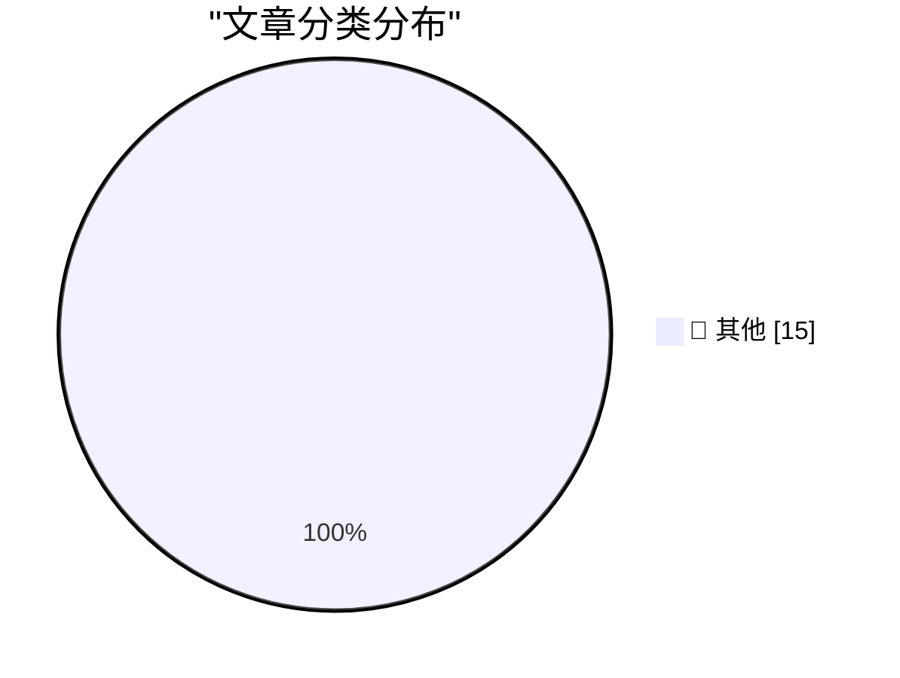

# 📰 AI 博客每日精选 — 2026-11-12

> 来自 Karpathy 推荐的 92 个顶级技术博客，AI 精选 Top 15

## 🏆 今日必读

🥇 **Gemini Decisions API**

[Gemini Decisions API](https://simonwillison.net/2026/Nov/11/gemini-decisions-api/) — simonwillison.net · 32 分钟前 · 📝 其他

> Gemini Decisions API

🥈 **aws-emulator**

[aws-emulator](https://simonwillison.net/2026/Nov/11/aws-emulator/) — simonwillison.net · 1 小时前 · 📝 其他

> aws-emulator

🥉 **Browse tools.simonwillison.net by tag**

[Browse tools.simonwillison.net by tag](https://simonwillison.net/2026/Nov/11/tools-tags/) — simonwillison.net · 3 小时前 · 📝 其他

> Browse tools.simonwillison.net by tag

---

## 📊 数据概览

| 扫描源 | 抓取文章 | 时间范围 | 精选 |
|:---:|:---:|:---:|:---:|
| 82/92 | 2536 篇 → 18 篇 | 24h | **15 篇** |

### 分类分布

---

## 📝 其他

### 1. Gemini Decisions API

[Gemini Decisions API](https://simonwillison.net/2026/Nov/11/gemini-decisions-api/) — **simonwillison.net** · 32 分钟前 · ⭐ 15/30

> Gemini Decisions API

---

### 2. aws-emulator

[aws-emulator](https://simonwillison.net/2026/Nov/11/aws-emulator/) — **simonwillison.net** · 1 小时前 · ⭐ 15/30

> aws-emulator

---

### 3. Browse tools.simonwillison.net by tag

[Browse tools.simonwillison.net by tag](https://simonwillison.net/2026/Nov/11/tools-tags/) — **simonwillison.net** · 3 小时前 · ⭐ 15/30

> Browse tools.simonwillison.net by tag

---

### 4. llm 0.37.2

[llm 0.37.2](https://simonwillison.net/2026/Nov/11/llm/) — **simonwillison.net** · 5 小时前 · ⭐ 15/30

> llm 0.37.2

---

### 5. Anthropic's IPO roadshow video

[Anthropic's IPO roadshow video](https://simonwillison.net/2026/Nov/11/anthropic-ipo-roadshow/) — **simonwillison.net** · 7 小时前 · ⭐ 15/30

> Anthropic's IPO roadshow video

---

### 6. Glue work is still harmful in the age of AI

[Glue work is still harmful in the age of AI](https://seangoedecke.com/glue-work-is-still-harmful-in-the-age-of-ai/) — **seangoedecke.com** · 22 小时前 · ⭐ 15/30

> Glue work is still harmful in the age of AI

---

### 7. Who Runs the Ransomware Group Qilin?

[Who Runs the Ransomware Group Qilin?](https://krebsonsecurity.com/2026/11/who-runs-the-ransomware-group-qilin/) — **krebsonsecurity.com** · 4 小时前 · ⭐ 15/30

> Who Runs the Ransomware Group Qilin?

---

### 8. Apple Shutters Their Longstanding ‘Apple Support Community’

[Apple Shutters Their Longstanding ‘Apple Support Community’](https://sixcolors.com/link/2026/11/ding-dong-the-apple-support-community-is-dead/) — **daringfireball.net** · 3 小时前 · ⭐ 15/30

> Apple Shutters Their Longstanding ‘Apple Support Community’

---

### 9. Austin Mann’s iPhone Duo Review

[Austin Mann’s iPhone Duo Review](https://www.austinmann.com/trek/iphone-duo) — **daringfireball.net** · 3 小时前 · ⭐ 15/30

> Austin Mann’s iPhone Duo Review

---

### 10. Quinn Nelson: ‘The iPhone Duo Doesn’t Feel Like an iPhone’

[Quinn Nelson: ‘The iPhone Duo Doesn’t Feel Like an iPhone’](https://www.youtube.com/watch?v=cxjdVVVryC4) — **daringfireball.net** · 3 小时前 · ⭐ 15/30

> Quinn Nelson: ‘The iPhone Duo Doesn’t Feel Like an iPhone’

---

### 11. ‘Dangerous or Unusual’

[‘Dangerous or Unusual’](https://www.nytimes.com/interactive/2026/11/10/us/supreme-court-guns-misquote.html?unlocked_article_code=1.PlE.-Nhp.CaLpsgMqdWf3) — **daringfireball.net** · 4 小时前 · ⭐ 15/30

> ‘Dangerous or Unusual’

---

### 12. HowTo: Fix Eufy HomeBase 2 Storage Full Issues

[HowTo: Fix Eufy HomeBase 2 Storage Full Issues](https://shkspr.mobi/blog/2026/11/howto-fix-eufy-homebase-2-storage-full-issues/) — **shkspr.mobi** · 10 小时前 · ⭐ 15/30

> HowTo: Fix Eufy HomeBase 2 Storage Full Issues

---

### 13. 20 years of blogging

[20 years of blogging](https://www.gilesthomas.com/2026/11/20-years-of-blogging) — **gilesthomas.com** · 23 小时前 · ⭐ 15/30

> 20 years of blogging

---

### 14. Why Am I So Tired If AI Is Doing All the Work?

[Why Am I So Tired If AI Is Doing All the Work?](https://terriblesoftware.org/2026/11/11/why-am-i-so-tired-if-ai-is-doing-all-the-work/) — **terriblesoftware.org** · 4 小时前 · ⭐ 15/30

> Why Am I So Tired If AI Is Doing All the Work?

---

### 15. This Week in Source Control: 11 November 2026

[This Week in Source Control: 11 November 2026](https://nesbitt.io/2026/11/11/this-week-in-source-control.html) — **nesbitt.io** · 12 小时前 · ⭐ 15/30

> This Week in Source Control: 11 November 2026

---

*生成于 2026-11-12 06:35 (Asia/Shanghai) | 扫描 82 源 → 获取 2536 篇 → 精选 15 篇*
*基于 [Hacker News Popularity Contest 2025](https://refactoringenglish.com/tools/hn-popularity/) RSS 源列表，由 [Andrej Karpathy](https://x.com/karpathy) 推荐*
*由「懂点儿AI」制作，欢迎关注同名微信公众号获取更多 AI 实用技巧 💡*
