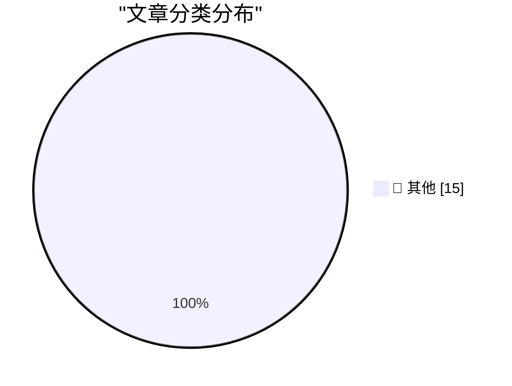

# 📰 AI 博客每日精选 — 2026-11-15

> 来自 Karpathy 推荐的 92 个顶级技术博客，AI 精选 Top 15

## 🏆 今日必读

🥇 **datasette-cluster-map 0.19**

[datasette-cluster-map 0.19](https://simonwillison.net/2026/Nov/13/datasette-cluster-map/) — simonwillison.net · 21 小时前 · 📝 其他

> datasette-cluster-map 0.19

🥈 **datasette-leaflet 0.3**

[datasette-leaflet 0.3](https://simonwillison.net/2026/Nov/13/datasette-leaflet/) — simonwillison.net · 22 小时前 · 📝 其他

> datasette-leaflet 0.3

🥉 **Ops needs friction**

[Ops needs friction](https://www.jeffgeerling.com/blog/2026/ops-needs-friction/) — jeffgeerling.com · 4 小时前 · 📝 其他

> Ops needs friction

---

## 📊 数据概览

| 扫描源 | 抓取文章 | 时间范围 | 精选 |
|:---:|:---:|:---:|:---:|
| 83/92 | 2572 篇 → 15 篇 | 24h | **15 篇** |

### 分类分布

---

## 📝 其他

### 1. datasette-cluster-map 0.19

[datasette-cluster-map 0.19](https://simonwillison.net/2026/Nov/13/datasette-cluster-map/) — **simonwillison.net** · 21 小时前 · ⭐ 15/30

> datasette-cluster-map 0.19

---

### 2. datasette-leaflet 0.3

[datasette-leaflet 0.3](https://simonwillison.net/2026/Nov/13/datasette-leaflet/) — **simonwillison.net** · 22 小时前 · ⭐ 15/30

> datasette-leaflet 0.3

---

### 3. Ops needs friction

[Ops needs friction](https://www.jeffgeerling.com/blog/2026/ops-needs-friction/) — **jeffgeerling.com** · 4 小时前 · ⭐ 15/30

> Ops needs friction

---

### 4. How to find meaning in large tech companies

[How to find meaning in large tech companies](https://seangoedecke.com/how-to-find-meaning-in-large-tech-companies/) — **seangoedecke.com** · 20 小时前 · ⭐ 15/30

> How to find meaning in large tech companies

---

### 5. Joanna Stern Reviews the HomeView

[Joanna Stern Reviews the HomeView](https://www.youtube.com/watch?v=yVTcVtLn2o4) — **daringfireball.net** · 2 小时前 · ⭐ 15/30

> Joanna Stern Reviews the HomeView

---

### 6. Jason Snell’s HomeView Review

[Jason Snell’s HomeView Review](https://sixcolors.com/post/2026/11/homeview-review-a-late-arrival-with-promise-but-still-showing-some-seams/) — **daringfireball.net** · 2 小时前 · ⭐ 15/30

> Jason Snell’s HomeView Review

---

### 7. Patrick McGee on Johny Srouji and Nvidia

[Patrick McGee on Johny Srouji and Nvidia](https://x.com/patrickmcgee_/status/2120799867140550999) — **daringfireball.net** · 2 小时前 · ⭐ 15/30

> Patrick McGee on Johny Srouji and Nvidia

---

### 8. Microsoft Says Cloud Outage Was ‘Not Related to Cyber or AI / Agents’

[Microsoft Says Cloud Outage Was ‘Not Related to Cyber or AI / Agents’](https://x.com/microsoft/status/2121282013600907325) — **daringfireball.net** · 4 小时前 · ⭐ 15/30

> Microsoft Says Cloud Outage Was ‘Not Related to Cyber or AI / Agents’

---

### 9. Theatre Review: FrankenTacit ★★☆☆☆

[Theatre Review: FrankenTacit ★★☆☆☆](https://shkspr.mobi/blog/2026/11/theatre-review-frankentacit/) — **shkspr.mobi** · 7 小时前 · ⭐ 15/30

> Theatre Review: FrankenTacit ★★☆☆☆

---

### 10. The longest polynomial level set

[The longest polynomial level set](https://www.johndcook.com/blog/2026/11/14/erdos-lemniscate/) — **johndcook.com** · 4 小时前 · ⭐ 15/30

> The longest polynomial level set

---

### 11. Peeking inside the bash rabbit hole

[Peeking inside the bash rabbit hole](https://www.johndcook.com/blog/2026/11/14/bash-rabbit-hole/) — **johndcook.com** · 7 小时前 · ⭐ 15/30

> Peeking inside the bash rabbit hole

---

### 12. This Week in Package Management: 14 November 2026

[This Week in Package Management: 14 November 2026](https://nesbitt.io/2026/11/14/this-week-in-package-management.html) — **nesbitt.io** · 10 小时前 · ⭐ 15/30

> This Week in Package Management: 14 November 2026

---

### 13. Reading List 11/14/2026

[Reading List 11/14/2026](https://www.construction-physics.com/p/reading-list-11142026) — **construction-physics.com** · 4 小时前 · ⭐ 15/30

> Reading List 11/14/2026

---

### 14. Vintage computer power centers

[Vintage computer power centers](https://dfarq.homeip.net/vintage-computer-power-centers/?utm_source=rss&#038;utm_medium=rss&#038;utm_campaign=vintage-computer-power-centers) — **dfarq.homeip.net** · 8 小时前 · ⭐ 15/30

> Vintage computer power centers

---

### 15. Of Course People Hate Data Centres

[Of Course People Hate Data Centres](https://hugotunius.se/2026/11/14/of-course-people-hate-data-centres.html) — **hugotunius.se** · 20 小时前 · ⭐ 15/30

> Of Course People Hate Data Centres

---

*生成于 2026-11-15 04:33 (Asia/Shanghai) | 扫描 83 源 → 获取 2572 篇 → 精选 15 篇*
*基于 [Hacker News Popularity Contest 2025](https://refactoringenglish.com/tools/hn-popularity/) RSS 源列表，由 [Andrej Karpathy](https://x.com/karpathy) 推荐*
*由「懂点儿AI」制作，欢迎关注同名微信公众号获取更多 AI 实用技巧 💡*
