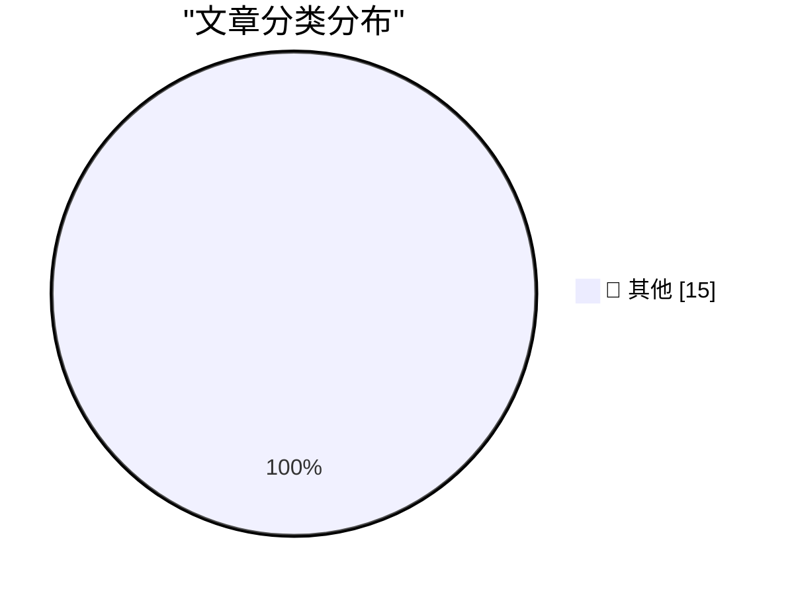

# 📰 AI 博客每日精选 — 2026-11-17

> 来自 Karpathy 推荐的 92 个顶级技术博客，AI 精选 Top 15

## 🏆 今日必读

🥇 **‘Meet the Anthropic Researcher Behind Silicon Valley’s “Consensual Non-Consent” Orgies’**

[‘Meet the Anthropic Researcher Behind Silicon Valley’s “Consensual Non-Consent” Orgies’](https://freebeacon.com/america/horrifying-meet-the-anthropic-researcher-behind-silicon-valleys-consensual-non-consent-orgies/) — daringfireball.net · 16 分钟前 · 📝 其他

> ‘Meet the Anthropic Researcher Behind Silicon Valley’s “Consensual Non-Consent” Orgies’

🥈 **[Sponsor] Ivy: The To-do List That Ends**

[[Sponsor] Ivy: The To-do List That Ends](https://apps.apple.com/app/apple-store/id6747921058?pt=1363339&amp;ct=Daring-Fireball-Post&amp;mt=8) — daringfireball.net · 50 分钟前 · 📝 其他

> [Sponsor] Ivy: The To-do List That Ends

🥉 **Developers Continue to Optimize iPhone Apps for the Duo**

[Developers Continue to Optimize iPhone Apps for the Duo](https://x.com/arinwaichulis/status/2122397676767522942) — daringfireball.net · 59 分钟前 · 📝 其他

> Developers Continue to Optimize iPhone Apps for the Duo

---

## 📊 数据概览

| 扫描源 | 抓取文章 | 时间范围 | 精选 |
|:---:|:---:|:---:|:---:|
| 80/92 | 2417 篇 → 18 篇 | 24h | **15 篇** |

### 分类分布

---

## 📝 其他

### 1. ‘Meet the Anthropic Researcher Behind Silicon Valley’s “Consensual Non-Consent” Orgies’

[‘Meet the Anthropic Researcher Behind Silicon Valley’s “Consensual Non-Consent” Orgies’](https://freebeacon.com/america/horrifying-meet-the-anthropic-researcher-behind-silicon-valleys-consensual-non-consent-orgies/) — **daringfireball.net** · 16 分钟前 · ⭐ 15/30

> ‘Meet the Anthropic Researcher Behind Silicon Valley’s “Consensual Non-Consent” Orgies’

---

### 2. [Sponsor] Ivy: The To-do List That Ends

[[Sponsor] Ivy: The To-do List That Ends](https://apps.apple.com/app/apple-store/id6747921058?pt=1363339&amp;ct=Daring-Fireball-Post&amp;mt=8) — **daringfireball.net** · 50 分钟前 · ⭐ 15/30

> [Sponsor] Ivy: The To-do List That Ends

---

### 3. Developers Continue to Optimize iPhone Apps for the Duo

[Developers Continue to Optimize iPhone Apps for the Duo](https://x.com/arinwaichulis/status/2122397676767522942) — **daringfireball.net** · 59 分钟前 · ⭐ 15/30

> Developers Continue to Optimize iPhone Apps for the Duo

---

### 4. Irish Goodbye / French Leave / Leave the English Way

[Irish Goodbye / French Leave / Leave the English Way](https://terriblemaps.co.uk/leaving-a-party-without-saying-goodbye/) — **daringfireball.net** · 1 小时前 · ⭐ 15/30

> Irish Goodbye / French Leave / Leave the English Way

---

### 5. MacOS Golden Gate 27.3b2 Includes New Privacy Controls for Full Disk Access (and More)

[MacOS Golden Gate 27.3b2 Includes New Privacy Controls for Full Disk Access (and More)](https://9to5mac.com/2026/11/16/macos-27-3-includes-new-privacy-controls-for-full-disk-access-and-more/) — **daringfireball.net** · 3 小时前 · ⭐ 15/30

> MacOS Golden Gate 27.3b2 Includes New Privacy Controls for Full Disk Access (and More)

---

### 6. ‘Unlock With Front Camera’ — New Feature for iPhone Duo in iOS 27.3 Beta 2

[‘Unlock With Front Camera’ — New Feature for iPhone Duo in iOS 27.3 Beta 2](https://www.macrumors.com/2026/11/16/iphone-duo-face-unlock/) — **daringfireball.net** · 4 小时前 · ⭐ 15/30

> ‘Unlock With Front Camera’ — New Feature for iPhone Duo in iOS 27.3 Beta 2

---

### 7. Ben Thompson on Nvidia

[Ben Thompson on Nvidia](https://stratechery.com/2026/obituaries/) — **daringfireball.net** · 5 小时前 · ⭐ 15/30

> Ben Thompson on Nvidia

---

### 8. WSJ: ‘Nvidia’s Days as an Open Checkbook for the AI Economy Are Numbered’

[WSJ: ‘Nvidia’s Days as an Open Checkbook for the AI Economy Are Numbered’](https://www.wsj.com/tech/ai/nvidias-days-as-an-open-checkbook-for-the-ai-economy-are-numbered-90c7b388) — **daringfireball.net** · 6 小时前 · ⭐ 15/30

> WSJ: ‘Nvidia’s Days as an Open Checkbook for the AI Economy Are Numbered’

---

### 9. Oprah Gives Everyone in Her Audience a ‘Duo iPhone’

[Oprah Gives Everyone in Her Audience a ‘Duo iPhone’](https://youtu.be/j0Rsv1U3Q7A) — **daringfireball.net** · 8 小时前 · ⭐ 15/30

> Oprah Gives Everyone in Her Audience a ‘Duo iPhone’

---

### 10. Robert Pattinson Is the Next James Bond

[Robert Pattinson Is the Next James Bond](https://variety.com/2026/film/global/robert-pattinson-new-james-bond-007-1236946655/) — **daringfireball.net** · 8 小时前 · ⭐ 15/30

> Robert Pattinson Is the Next James Bond

---

### 11. People will lose their jobs over GTA 6

[People will lose their jobs over GTA 6](https://idiallo.com/blog/losing-your-job-over-a-video-game) — **idiallo.com** · 23 小时前 · ⭐ 15/30

> People will lose their jobs over GTA 6

---

### 12. Gig Review: ABBA Voyage ★★★★☆

[Gig Review: ABBA Voyage ★★★★☆](https://shkspr.mobi/blog/2026/11/gig-review-abba-voyage/) — **shkspr.mobi** · 11 小时前 · ⭐ 15/30

> Gig Review: ABBA Voyage ★★★★☆

---

### 13. Taxis and hash functions

[Taxis and hash functions](https://www.johndcook.com/blog/2026/11/16/taxis-and-hash-functions/) — **johndcook.com** · 9 小时前 · ⭐ 15/30

> Taxis and hash functions

---

### 14. Orbital footnote

[Orbital footnote](https://www.johndcook.com/blog/2026/11/15/orbital-footnote/) — **johndcook.com** · 21 小时前 · ⭐ 15/30

> Orbital footnote

---

### 15. Here's how anyone can easily use private, open weight models

[Here's how anyone can easily use private, open weight models](https://micahflee.com/heres-how-anyone-can-easily-use-private-open-weight-models/) — **micahflee.com** · 7 小时前 · ⭐ 15/30

> Here's how anyone can easily use private, open weight models

---

*生成于 2026-11-17 08:08 (Asia/Shanghai) | 扫描 80 源 → 获取 2417 篇 → 精选 15 篇*
*基于 [Hacker News Popularity Contest 2025](https://refactoringenglish.com/tools/hn-popularity/) RSS 源列表，由 [Andrej Karpathy](https://x.com/karpathy) 推荐*
*由「懂点儿AI」制作，欢迎关注同名微信公众号获取更多 AI 实用技巧 💡*
