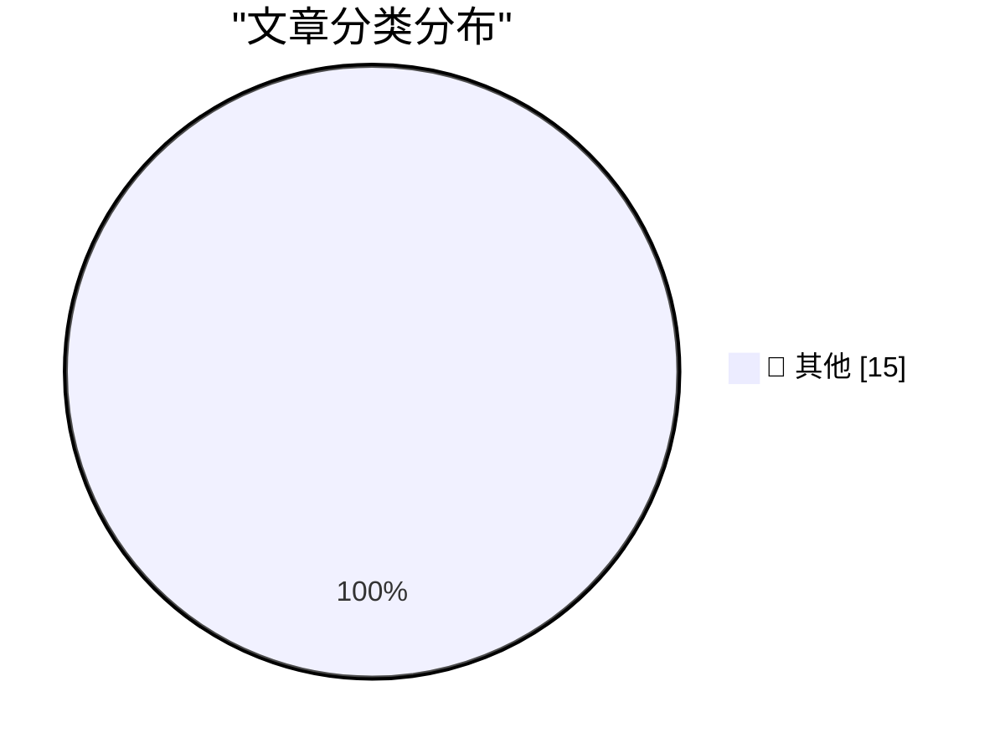

# 📰 AI 博客每日精选 — 2026-11-18

> 来自 Karpathy 推荐的 92 个顶级技术博客，AI 精选 Top 15

## 🏆 今日必读

🥇 **External sandboxes for coding agents**

[External sandboxes for coding agents](https://simonwillison.net/2026/Nov/17/external-sandboxes-for-coding-agents/) — simonwillison.net · 34 分钟前 · 📝 其他

> External sandboxes for coding agents

🥈 **GPT‑6.2 Astra and GPT‑6.2 Sol**

[GPT‑6.2 Astra and GPT‑6.2 Sol](https://simonwillison.net/2026/Nov/17/gpt62-astra-and-sol/) — simonwillison.net · 47 分钟前 · 📝 其他

> GPT‑6.2 Astra and GPT‑6.2 Sol

🥉 **Running the full server-side Datasette Python app in the browser with service workers and Pyodide**

[Running the full server-side Datasette Python app in the browser with service workers and Pyodide](https://simonwillison.net/2026/Nov/17/datasette-lite/) — simonwillison.net · 6 小时前 · 📝 其他

> Running the full server-side Datasette Python app in the browser with service workers and Pyodide

---

## 📊 数据概览

| 扫描源 | 抓取文章 | 时间范围 | 精选 |
|:---:|:---:|:---:|:---:|
| 83/92 | 2572 篇 → 15 篇 | 24h | **15 篇** |

### 分类分布

---

## 📝 其他

### 1. External sandboxes for coding agents

[External sandboxes for coding agents](https://simonwillison.net/2026/Nov/17/external-sandboxes-for-coding-agents/) — **simonwillison.net** · 34 分钟前 · ⭐ 15/30

> External sandboxes for coding agents

---

### 2. GPT‑6.2 Astra and GPT‑6.2 Sol

[GPT‑6.2 Astra and GPT‑6.2 Sol](https://simonwillison.net/2026/Nov/17/gpt62-astra-and-sol/) — **simonwillison.net** · 47 分钟前 · ⭐ 15/30

> GPT‑6.2 Astra and GPT‑6.2 Sol

---

### 3. Running the full server-side Datasette Python app in the browser with service workers and Pyodide

[Running the full server-side Datasette Python app in the browser with service workers and Pyodide](https://simonwillison.net/2026/Nov/17/datasette-lite/) — **simonwillison.net** · 6 小时前 · ⭐ 15/30

> Running the full server-side Datasette Python app in the browser with service workers and Pyodide

---

### 4. Quoting Go Proverbs

[Quoting Go Proverbs](https://simonwillison.net/2026/Nov/17/go-proverbs/) — **simonwillison.net** · 17 小时前 · ⭐ 15/30

> Quoting Go Proverbs

---

### 5. llm 0.37.3

[llm 0.37.3](https://simonwillison.net/2026/Nov/16/llm/) — **simonwillison.net** · 23 小时前 · ⭐ 15/30

> llm 0.37.3

---

### 6. SetShot 1.0 (and a Personal Tale of Defaults System Spelunking)

[SetShot 1.0 (and a Personal Tale of Defaults System Spelunking)](https://tidbits.com/2026/11/13/setshot-1-0-tracks-even-more-macos-settings/) — **daringfireball.net** · 4 小时前 · ⭐ 15/30

> SetShot 1.0 (and a Personal Tale of Defaults System Spelunking)

---

### 7. Apple’s Cloud Services Are Having a Bad Day, Including Their Status Page

[Apple’s Cloud Services Are Having a Bad Day, Including Their Status Page](https://www.macrumors.com/2026/11/17/apple-accounts-experiencing-issues/) — **daringfireball.net** · 5 小时前 · ⭐ 15/30

> Apple’s Cloud Services Are Having a Bad Day, Including Their Status Page

---

### 8. Apple Support Document on the New ‘Full Disk Access’ and ‘System & App Protection Override’ Settings in MacOS 27.3 Beta 2

[Apple Support Document on the New ‘Full Disk Access’ and ‘System & App Protection Override’ Settings in MacOS 27.3 Beta 2](https://support.apple.com/en-us/149699) — **daringfireball.net** · 21 小时前 · ⭐ 15/30

> Apple Support Document on the New ‘Full Disk Access’ and ‘System & App Protection Override’ Settings in MacOS 27.3 Beta 2

---

### 9. ‘Meet the Anthropic Researcher Behind Silicon Valley’s “Consensual Non-Consent” Orgies’

[‘Meet the Anthropic Researcher Behind Silicon Valley’s “Consensual Non-Consent” Orgies’](https://freebeacon.com/america/horrifying-meet-the-anthropic-researcher-behind-silicon-valleys-consensual-non-consent-orgies/) — **daringfireball.net** · 23 小时前 · ⭐ 15/30

> ‘Meet the Anthropic Researcher Behind Silicon Valley’s “Consensual Non-Consent” Orgies’

---

### 10. Pluralistic: Remembrance of proteins past (17 Nov 2026)

[Pluralistic: Remembrance of proteins past (17 Nov 2026)](https://pluralistic.net/2026/11/17/mississippi-gosh-darn/) — **pluralistic.net** · 10 小时前 · ⭐ 15/30

> Pluralistic: Remembrance of proteins past (17 Nov 2026)

---

### 11. HomeAssistant - shrink a HAOS qcow2 filesystem

[HomeAssistant - shrink a HAOS qcow2 filesystem](https://shkspr.mobi/blog/2026/11/homeassistant-shrink-a-haos-qcow2-filesystem/) — **shkspr.mobi** · 10 小时前 · ⭐ 15/30

> HomeAssistant - shrink a HAOS qcow2 filesystem

---

### 12. How can I ask a second program to show a dialog box as if it were shown by my first program?

[How can I ask a second program to show a dialog box as if it were shown by my first program?](https://devblogs.microsoft.com/oldnewthing/20261116-01/?p=112863/) — **devblogs.microsoft.com/oldnewthing** · 17 小时前 · ⭐ 15/30

> How can I ask a second program to show a dialog box as if it were shown by my first program?

---

### 13. The NVIDIA Bubble

[The NVIDIA Bubble](https://www.wheresyoured.at/the-nvidia-bubble/) — **wheresyoured.at** · 7 小时前 · ⭐ 15/30

> The NVIDIA Bubble

---

### 14. Paul Brainerd, creator of desktop publishing

[Paul Brainerd, creator of desktop publishing](https://dfarq.homeip.net/paul-brainerd-creator-of-desktop-publishing/?utm_source=rss&#038;utm_medium=rss&#038;utm_campaign=paul-brainerd-creator-of-desktop-publishing) — **dfarq.homeip.net** · 11 小时前 · ⭐ 15/30

> Paul Brainerd, creator of desktop publishing

---

### 15. Beyond Linux: A Journey Through the Open Source Ecosystem

[Beyond Linux: A Journey Through the Open Source Ecosystem](https://it-notes.dragas.net/2026/11/17/beyond-linux-a-journey-through-the-open-source-ecosystem/) — **it-notes.dragas.net** · 14 小时前 · ⭐ 15/30

> Beyond Linux: A Journey Through the Open Source Ecosystem

---

*生成于 2026-11-18 07:26 (Asia/Shanghai) | 扫描 83 源 → 获取 2572 篇 → 精选 15 篇*
*基于 [Hacker News Popularity Contest 2025](https://refactoringenglish.com/tools/hn-popularity/) RSS 源列表，由 [Andrej Karpathy](https://x.com/karpathy) 推荐*
*由「懂点儿AI」制作，欢迎关注同名微信公众号获取更多 AI 实用技巧 💡*
