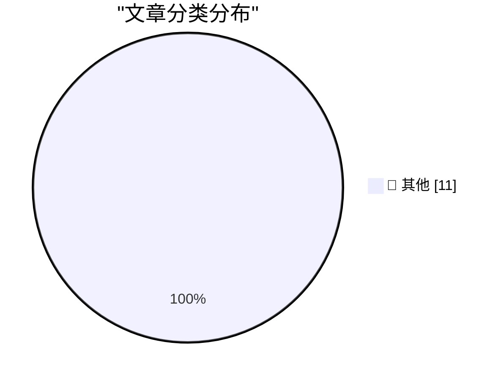

# 📰 AI 博客每日精选 — 2026-11-19

> 来自 Karpathy 推荐的 92 个顶级技术博客，AI 精选 Top 11

## 🏆 今日必读

🥇 **Quoting Daniel Stenberg**

[Quoting Daniel Stenberg](https://simonwillison.net/2026/Nov/18/daniel-stenberg/) — simonwillison.net · 6 小时前 · 📝 其他

> Quoting Daniel Stenberg

🥈 **The PSF end-of-year fundraiser**

[The PSF end-of-year fundraiser](https://simonwillison.net/2026/Nov/18/psf-end-of-year-fundraiser/) — simonwillison.net · 8 小时前 · 📝 其他

> The PSF end-of-year fundraiser

🥉 **Attackers Used Optimizely to A/B Test Malware on Top Websites**

[Attackers Used Optimizely to A/B Test Malware on Top Websites](https://krebsonsecurity.com/2026/11/attackers-used-optimizely-to-a-b-test-malware-on-top-websites/) — krebsonsecurity.com · 20 小时前 · 📝 其他

> Attackers Used Optimizely to A/B Test Malware on Top Websites

---

## 📊 数据概览

| 扫描源 | 抓取文章 | 时间范围 | 精选 |
|:---:|:---:|:---:|:---:|
| 83/92 | 2573 篇 → 11 篇 | 24h | **11 篇** |

### 分类分布

---

## 📝 其他

### 1. Quoting Daniel Stenberg

[Quoting Daniel Stenberg](https://simonwillison.net/2026/Nov/18/daniel-stenberg/) — **simonwillison.net** · 6 小时前 · ⭐ 15/30

> Quoting Daniel Stenberg

---

### 2. The PSF end-of-year fundraiser

[The PSF end-of-year fundraiser](https://simonwillison.net/2026/Nov/18/psf-end-of-year-fundraiser/) — **simonwillison.net** · 8 小时前 · ⭐ 15/30

> The PSF end-of-year fundraiser

---

### 3. Attackers Used Optimizely to A/B Test Malware on Top Websites

[Attackers Used Optimizely to A/B Test Malware on Top Websites](https://krebsonsecurity.com/2026/11/attackers-used-optimizely-to-a-b-test-malware-on-top-websites/) — **krebsonsecurity.com** · 20 小时前 · ⭐ 15/30

> Attackers Used Optimizely to A/B Test Malware on Top Websites

---

### 4. ★ The 50-Yard Line

[★ The 50-Yard Line](https://daringfireball.net/2026/11/the_50-yard_line) — **daringfireball.net** · 2 小时前 · ⭐ 15/30

> ★ The 50-Yard Line

---

### 5. Jensen Huang Tweets

[Jensen Huang Tweets](https://x.com/JensenHuang/status/2122726005219737649) — **daringfireball.net** · 7 小时前 · ⭐ 15/30

> Jensen Huang Tweets

---

### 6. Pluralistic: Enshittifiers groom us for scammers (18 Nov 2026)

[Pluralistic: Enshittifiers groom us for scammers (18 Nov 2026)](https://pluralistic.net/2026/11/18/malice-v-incompetence/) — **pluralistic.net** · 14 小时前 · ⭐ 15/30

> Pluralistic: Enshittifiers groom us for scammers (18 Nov 2026)

---

### 7. Once More Unto The Breach - Another Year In Review

[Once More Unto The Breach - Another Year In Review](https://shkspr.mobi/blog/2026/11/once-more-unto-the-breach-another-year-in-review/) — **shkspr.mobi** · 10 小时前 · ⭐ 15/30

> Once More Unto The Breach - Another Year In Review

---

### 8. "No way to prevent this" say users of only language where this regularly happens

["No way to prevent this" say users of only language where this regularly happens](https://xeiaso.net/shitposts/no-way-to-prevent-this/memory-safety/CVE-2026-123633/) — **xeiaso.net** · 22 小时前 · ⭐ 15/30

> "No way to prevent this" say users of only language where this regularly happens

---

### 9. Are vibe-coded games making me a substance dualist?

[Are vibe-coded games making me a substance dualist?](https://rakhim.exotext.com/are-vibe-coded-games-making-me-a-substance-dualist) — **rakhim.exotext.com** · 22 小时前 · ⭐ 15/30

> Are vibe-coded games making me a substance dualist?

---

### 10. This Week in Source Control: 18 November 2026

[This Week in Source Control: 18 November 2026](https://nesbitt.io/2026/11/18/this-week-in-source-control.html) — **nesbitt.io** · 12 小时前 · ⭐ 15/30

> This Week in Source Control: 18 November 2026

---

### 11. Push button telephones introduced November 18, 1963

[Push button telephones introduced November 18, 1963](https://dfarq.homeip.net/push-button-telephones-introduced-november-18-1963/?utm_source=rss&#038;utm_medium=rss&#038;utm_campaign=push-button-telephones-introduced-november-18-1963) — **dfarq.homeip.net** · 10 小时前 · ⭐ 15/30

> Push button telephones introduced November 18, 1963

---

*生成于 2026-11-19 06:54 (Asia/Shanghai) | 扫描 83 源 → 获取 2573 篇 → 精选 11 篇*
*基于 [Hacker News Popularity Contest 2025](https://refactoringenglish.com/tools/hn-popularity/) RSS 源列表，由 [Andrej Karpathy](https://x.com/karpathy) 推荐*
*由「懂点儿AI」制作，欢迎关注同名微信公众号获取更多 AI 实用技巧 💡*
