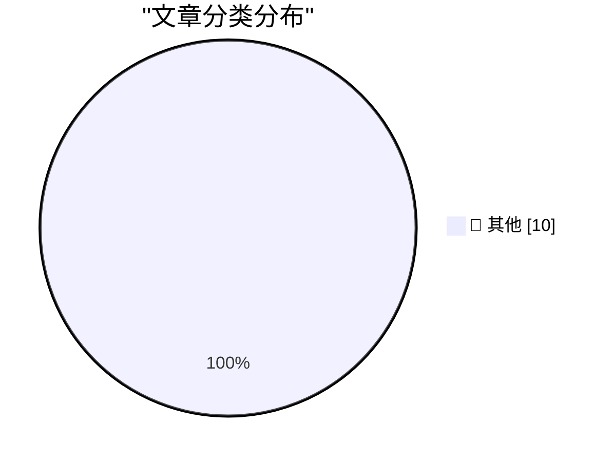

# 📰 AI 博客每日精选 — 2026-11-21

> 来自 Karpathy 推荐的 92 个顶级技术博客，AI 精选 Top 10

## 🏆 今日必读

🥇 **Quoting Ravi Vakil**

[Quoting Ravi Vakil](https://simonwillison.net/2026/Nov/20/ravi-vakil/) — simonwillison.net · 3 小时前 · 📝 其他

> Quoting Ravi Vakil

🥈 **Quoting Levent Alpöge**

[Quoting Levent Alpöge](https://simonwillison.net/2026/Nov/20/levent-alpoge/) — simonwillison.net · 6 小时前 · 📝 其他

> Quoting Levent Alpöge

🥉 **Token fraud is here and it’s BAD (YouTube)**

[Token fraud is here and it’s BAD (YouTube)](https://simonwillison.net/2026/Nov/20/token-fraud-is-here-and-its-bad/) — simonwillison.net · 19 小时前 · 📝 其他

> Token fraud is here and it’s BAD (YouTube)

---

## 📊 数据概览

| 扫描源 | 抓取文章 | 时间范围 | 精选 |
|:---:|:---:|:---:|:---:|
| 82/92 | 2548 篇 → 10 篇 | 24h | **10 篇** |

### 分类分布

---

## 📝 其他

### 1. Quoting Ravi Vakil

[Quoting Ravi Vakil](https://simonwillison.net/2026/Nov/20/ravi-vakil/) — **simonwillison.net** · 3 小时前 · ⭐ 15/30

> Quoting Ravi Vakil

---

### 2. Quoting Levent Alpöge

[Quoting Levent Alpöge](https://simonwillison.net/2026/Nov/20/levent-alpoge/) — **simonwillison.net** · 6 小时前 · ⭐ 15/30

> Quoting Levent Alpöge

---

### 3. Token fraud is here and it’s BAD (YouTube)

[Token fraud is here and it’s BAD (YouTube)](https://simonwillison.net/2026/Nov/20/token-fraud-is-here-and-its-bad/) — **simonwillison.net** · 19 小时前 · ⭐ 15/30

> Token fraud is here and it’s BAD (YouTube)

---

### 4. Another company I've never heard of lost my Data

[Another company I've never heard of lost my Data](https://idiallo.com/byte-size/another-company-lost-my-data-and-free-credit-monitoring) — **idiallo.com** · 23 小时前 · ⭐ 15/30

> Another company I've never heard of lost my Data

---

### 5. Pluralistic: Lisa Hanawalt's "I Can't Stop Thinking About Horses and Sex" (20 Nov 2026)

[Pluralistic: Lisa Hanawalt's "I Can't Stop Thinking About Horses and Sex" (20 Nov 2026)](https://pluralistic.net/2026/11/20/intrusive-horse-thoughts/) — **pluralistic.net** · 11 小时前 · ⭐ 15/30

> Pluralistic: Lisa Hanawalt's "I Can't Stop Thinking About Horses and Sex" (20 Nov 2026)

---

### 6. Connect a USB Zigbee Device to HAOS

[Connect a USB Zigbee Device to HAOS](https://shkspr.mobi/blog/2026/11/connect-a-usb-zigbee-device-to-haos/) — **shkspr.mobi** · 10 小时前 · ⭐ 15/30

> Connect a USB Zigbee Device to HAOS

---

### 7. Premium: Bursting Bubbles

[Premium: Bursting Bubbles](https://www.wheresyoured.at/premium-bursting-bubbles/) — **wheresyoured.at** · 5 小时前 · ⭐ 15/30

> Premium: Bursting Bubbles

---

### 8. Diablo II

[Diablo II](https://www.filfre.net/2026/11/diablo-ii/) — **filfre.net** · 5 小时前 · ⭐ 15/30

> Diablo II

---

### 9. Why Johnny Can’t Patch

[Why Johnny Can’t Patch](https://dfarq.homeip.net/why-johnny-cant-patch-2/?utm_source=rss&#038;utm_medium=rss&#038;utm_campaign=why-johnny-cant-patch-2) — **dfarq.homeip.net** · 27 分钟前 · ⭐ 15/30

> Why Johnny Can’t Patch

---

### 10. Max Headroom incident of Nov 22, 1987

[Max Headroom incident of Nov 22, 1987](https://dfarq.homeip.net/max-headroom-incident-of-nov-22-1987-3/?utm_source=rss&#038;utm_medium=rss&#038;utm_campaign=max-headroom-incident-of-nov-22-1987-3) — **dfarq.homeip.net** · 10 小时前 · ⭐ 15/30

> Max Headroom incident of Nov 22, 1987

---

*生成于 2026-11-21 06:35 (Asia/Shanghai) | 扫描 82 源 → 获取 2548 篇 → 精选 10 篇*
*基于 [Hacker News Popularity Contest 2025](https://refactoringenglish.com/tools/hn-popularity/) RSS 源列表，由 [Andrej Karpathy](https://x.com/karpathy) 推荐*
*由「懂点儿AI」制作，欢迎关注同名微信公众号获取更多 AI 实用技巧 💡*
