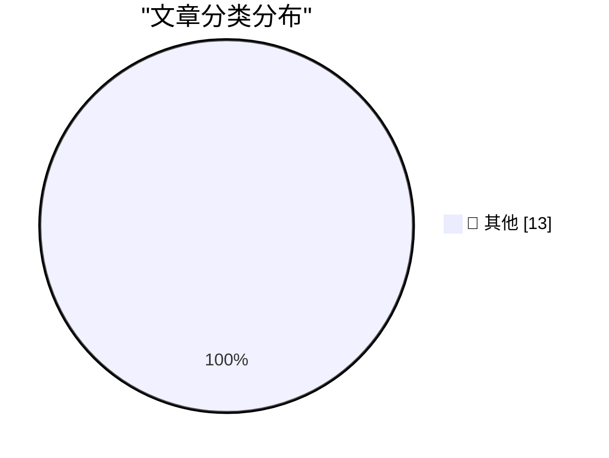

# 📰 AI 博客每日精选 — 2026-11-22

> 来自 Karpathy 推荐的 92 个顶级技术博客，AI 精选 Top 13

## 🏆 今日必读

🥇 **Why output caching doesn't work**

[Why output caching doesn't work](https://seangoedecke.com/why-output-caching-doesnt-work/) — seangoedecke.com · 21 小时前 · 📝 其他

> Why output caching doesn't work

🥈 **CTO of ‘RansomwareHelp’ Indicted for Wire Fraud**

[CTO of ‘RansomwareHelp’ Indicted for Wire Fraud](https://krebsonsecurity.com/2026/11/cto-of-ransomwarehelp-indicted-for-wire-fraud/) — krebsonsecurity.com · 20 小时前 · 📝 其他

> CTO of ‘RansomwareHelp’ Indicted for Wire Fraud

🥉 **★ A Week With the New Privacy Controls in MacOS 27.3 Beta 2**

[★ A Week With the New Privacy Controls in MacOS 27.3 Beta 2](https://daringfireball.net/2026/11/a_week_with_the_new_privacy_controls_in_macos_273) — daringfireball.net · 1 小时前 · 📝 其他

> ★ A Week With the New Privacy Controls in MacOS 27.3 Beta 2

---

## 📊 数据概览

| 扫描源 | 抓取文章 | 时间范围 | 精选 |
|:---:|:---:|:---:|:---:|
| 82/92 | 2548 篇 → 13 篇 | 24h | **13 篇** |

### 分类分布

---

## 📝 其他

### 1. Why output caching doesn't work

[Why output caching doesn't work](https://seangoedecke.com/why-output-caching-doesnt-work/) — **seangoedecke.com** · 21 小时前 · ⭐ 15/30

> Why output caching doesn't work

---

### 2. CTO of ‘RansomwareHelp’ Indicted for Wire Fraud

[CTO of ‘RansomwareHelp’ Indicted for Wire Fraud](https://krebsonsecurity.com/2026/11/cto-of-ransomwarehelp-indicted-for-wire-fraud/) — **krebsonsecurity.com** · 20 小时前 · ⭐ 15/30

> CTO of ‘RansomwareHelp’ Indicted for Wire Fraud

---

### 3. ★ A Week With the New Privacy Controls in MacOS 27.3 Beta 2

[★ A Week With the New Privacy Controls in MacOS 27.3 Beta 2](https://daringfireball.net/2026/11/a_week_with_the_new_privacy_controls_in_macos_273) — **daringfireball.net** · 1 小时前 · ⭐ 15/30

> ★ A Week With the New Privacy Controls in MacOS 27.3 Beta 2

---

### 4. The U.S. — Utterly Predictably — Has Lost Measles Elimination Status Under Trump and RFK Jr.

[The U.S. — Utterly Predictably — Has Lost Measles Elimination Status Under Trump and RFK Jr.](https://www.wsj.com/health/measles-is-back-it-will-take-years-to-eliminate-it-again-9971736e?st=GKiu3E) — **daringfireball.net** · 3 小时前 · ⭐ 15/30

> The U.S. — Utterly Predictably — Has Lost Measles Elimination Status Under Trump and RFK Jr.

---

### 5. Apple Documents Extra Apple Intelligence Usage Limits Per iCloud+ Paid Tier

[Apple Documents Extra Apple Intelligence Usage Limits Per iCloud+ Paid Tier](https://support.apple.com/en-us/127901) — **daringfireball.net** · 3 小时前 · ⭐ 15/30

> Apple Documents Extra Apple Intelligence Usage Limits Per iCloud+ Paid Tier

---

### 6. The Talk Show: ‘A Whoopsie Treason’

[The Talk Show: ‘A Whoopsie Treason’](https://daringfireball.net/thetalkshow/2026/11/20/ep-457) — **daringfireball.net** · 22 小时前 · ⭐ 15/30

> The Talk Show: ‘A Whoopsie Treason’

---

### 7. Relicensing to CC BY-SA and making it visible in Schema metadata

[Relicensing to CC BY-SA and making it visible in Schema metadata](https://shkspr.mobi/blog/2026/11/relicensing-to-cc-by-sa-and-making-it-visible-in-schema-metadata/) — **shkspr.mobi** · 8 小时前 · ⭐ 15/30

> Relicensing to CC BY-SA and making it visible in Schema metadata

---

### 8. What is the Generalized Riemann Hypothesis?

[What is the Generalized Riemann Hypothesis?](https://www.johndcook.com/blog/2026/11/20/grh/) — **johndcook.com** · 17 小时前 · ⭐ 15/30

> What is the Generalized Riemann Hypothesis?

---

### 9. This Week in Package Management: 21 November 2026

[This Week in Package Management: 21 November 2026](https://nesbitt.io/2026/11/21/this-week-in-package-management.html) — **nesbitt.io** · 11 小时前 · ⭐ 15/30

> This Week in Package Management: 21 November 2026

---

### 10. Reading List 11/21/2026

[Reading List 11/21/2026](https://www.construction-physics.com/p/reading-list-11212026) — **construction-physics.com** · 8 小时前 · ⭐ 15/30

> Reading List 11/21/2026

---

### 11. What three-bolt mount means on a garbage disposal

[What three-bolt mount means on a garbage disposal](https://dfarq.homeip.net/what-three-bolt-mount-means-on-a-garbage-disposal/?utm_source=rss&#038;utm_medium=rss&#038;utm_campaign=what-three-bolt-mount-means-on-a-garbage-disposal) — **dfarq.homeip.net** · 9 小时前 · ⭐ 15/30

> What three-bolt mount means on a garbage disposal

---

### 12. Why Johnny Can’t Patch

[Why Johnny Can’t Patch](https://dfarq.homeip.net/why-johnny-cant-patch-2/?utm_source=rss&#038;utm_medium=rss&#038;utm_campaign=why-johnny-cant-patch-2) — **dfarq.homeip.net** · 23 小时前 · ⭐ 15/30

> Why Johnny Can’t Patch

---

### 13. Linear scan register allocation in Datalog

[Linear scan register allocation in Datalog](https://bernsteinbear.com/blog/lsra-datalog/?utm_source=rss) — **bernsteinbear.com** · 21 小时前 · ⭐ 15/30

> Linear scan register allocation in Datalog

---

*生成于 2026-11-22 05:33 (Asia/Shanghai) | 扫描 82 源 → 获取 2548 篇 → 精选 13 篇*
*基于 [Hacker News Popularity Contest 2025](https://refactoringenglish.com/tools/hn-popularity/) RSS 源列表，由 [Andrej Karpathy](https://x.com/karpathy) 推荐*
*由「懂点儿AI」制作，欢迎关注同名微信公众号获取更多 AI 实用技巧 💡*
