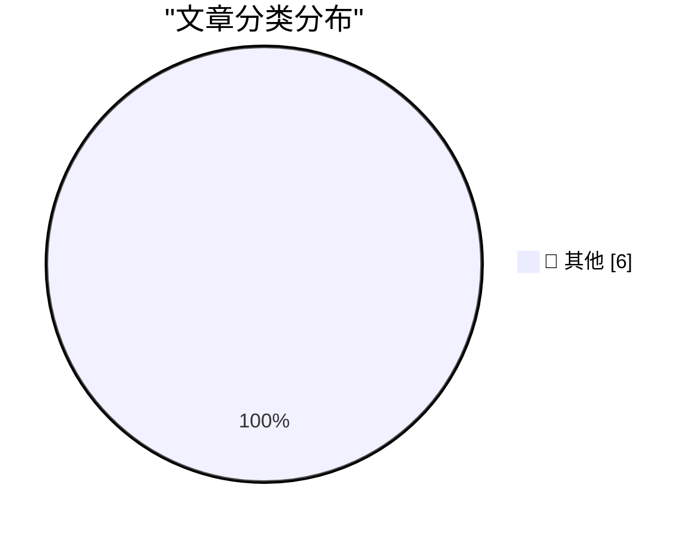

# 📰 AI 博客每日精选 — 2026-11-23

> 来自 Karpathy 推荐的 92 个顶级技术博客，AI 精选 Top 6

## 🏆 今日必读

🥇 **Muru**

[Muru](https://simonwillison.net/2026/Nov/21/muru/) — simonwillison.net · 21 小时前 · 📝 其他

> Muru

🥈 **To code well, avoid blunders**

[To code well, avoid blunders](https://seangoedecke.com/to-code-well-avoid-blunders/) — seangoedecke.com · 21 小时前 · 📝 其他

> To code well, avoid blunders

🥉 **I don't enjoy being pampered**

[I don't enjoy being pampered](https://shkspr.mobi/blog/2026/11/i-dont-enjoy-being-pampered/) — shkspr.mobi · 9 小时前 · 📝 其他

> I don't enjoy being pampered

---

## 📊 数据概览

| 扫描源 | 抓取文章 | 时间范围 | 精选 |
|:---:|:---:|:---:|:---:|
| 81/92 | 2474 篇 → 6 篇 | 24h | **6 篇** |

### 分类分布

---

## 📝 其他

### 1. Muru

[Muru](https://simonwillison.net/2026/Nov/21/muru/) — **simonwillison.net** · 21 小时前 · ⭐ 15/30

> Muru

---

### 2. To code well, avoid blunders

[To code well, avoid blunders](https://seangoedecke.com/to-code-well-avoid-blunders/) — **seangoedecke.com** · 21 小时前 · ⭐ 15/30

> To code well, avoid blunders

---

### 3. I don't enjoy being pampered

[I don't enjoy being pampered](https://shkspr.mobi/blog/2026/11/i-dont-enjoy-being-pampered/) — **shkspr.mobi** · 9 小时前 · ⭐ 15/30

> I don't enjoy being pampered

---

### 4. Mouse for Tandy 1000

[Mouse for Tandy 1000](https://dfarq.homeip.net/mouse-for-tandy-1000/?utm_source=rss&#038;utm_medium=rss&#038;utm_campaign=mouse-for-tandy-1000) — **dfarq.homeip.net** · 9 小时前 · ⭐ 15/30

> Mouse for Tandy 1000

---

### 5. Notes on the discrete Fourier transform (DFT)

[Notes on the discrete Fourier transform (DFT)](https://eli.thegreenplace.net/2026/notes-on-the-discrete-fourier-transform-dft/) — **eli.thegreenplace.net** · 23 小时前 · ⭐ 15/30

> Notes on the discrete Fourier transform (DFT)

---

### 6. Weekly Update 531: Optimizely. Script Dependencies & Third Parties

[Weekly Update 531: Optimizely. Script Dependencies & Third Parties](https://www.troyhunt.com/weekly-update-531/) — **troyhunt.com** · 16 小时前 · ⭐ 15/30

> Weekly Update 531: Optimizely. Script Dependencies & Third Parties

---

*生成于 2026-11-23 05:39 (Asia/Shanghai) | 扫描 81 源 → 获取 2474 篇 → 精选 6 篇*
*基于 [Hacker News Popularity Contest 2025](https://refactoringenglish.com/tools/hn-popularity/) RSS 源列表，由 [Andrej Karpathy](https://x.com/karpathy) 推荐*
*由「懂点儿AI」制作，欢迎关注同名微信公众号获取更多 AI 实用技巧 💡*
