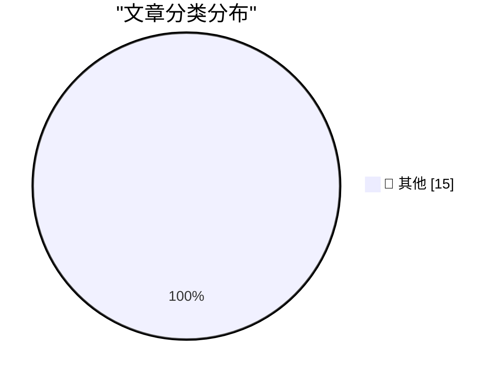

# 📰 AI 博客每日精选 — 2026-11-24

> 来自 Karpathy 推荐的 92 个顶级技术博客，AI 精选 Top 15

## 🏆 今日必读

🥇 **GLM-5.4: Toward Generalized Coding with Our First Loop Transformer**

[GLM-5.4: Toward Generalized Coding with Our First Loop Transformer](https://simonwillison.net/2026/Nov/23/glm-54/) — simonwillison.net · 3 小时前 · 📝 其他

> GLM-5.4: Toward Generalized Coding with Our First Loop Transformer

🥈 **Ladybird's first alpha release**

[Ladybird's first alpha release](https://simonwillison.net/2026/Nov/23/ladybird/) — simonwillison.net · 5 小时前 · 📝 其他

> Ladybird's first alpha release

🥉 **[Sponsor] Finalist Daily Planner Meets iPhone Duo**

[[Sponsor] Finalist Daily Planner Meets iPhone Duo](https://www.finalist.works/iphone-duo-planner/?utm_source=df-nov-2026) — daringfireball.net · 2 小时前 · 📝 其他

> [Sponsor] Finalist Daily Planner Meets iPhone Duo

---

## 📊 数据概览

| 扫描源 | 抓取文章 | 时间范围 | 精选 |
|:---:|:---:|:---:|:---:|
| 81/92 | 2490 篇 → 16 篇 | 24h | **15 篇** |

### 分类分布

---

## 📝 其他

### 1. GLM-5.4: Toward Generalized Coding with Our First Loop Transformer

[GLM-5.4: Toward Generalized Coding with Our First Loop Transformer](https://simonwillison.net/2026/Nov/23/glm-54/) — **simonwillison.net** · 3 小时前 · ⭐ 15/30

> GLM-5.4: Toward Generalized Coding with Our First Loop Transformer

---

### 2. Ladybird's first alpha release

[Ladybird's first alpha release](https://simonwillison.net/2026/Nov/23/ladybird/) — **simonwillison.net** · 5 小时前 · ⭐ 15/30

> Ladybird's first alpha release

---

### 3. [Sponsor] Finalist Daily Planner Meets iPhone Duo

[[Sponsor] Finalist Daily Planner Meets iPhone Duo](https://www.finalist.works/iphone-duo-planner/?utm_source=df-nov-2026) — **daringfireball.net** · 2 小时前 · ⭐ 15/30

> [Sponsor] Finalist Daily Planner Meets iPhone Duo

---

### 4. Jensen Huang Returns to Work

[Jensen Huang Returns to Work](https://www.businessinsider.com/jensen-huang-returns-to-nvidia-hq-im-terribly-sorry-2026-11) — **daringfireball.net** · 2 小时前 · ⭐ 15/30

> Jensen Huang Returns to Work

---

### 5. Donald Trump on Jensen Huang’s Reinstatement at Nvidia

[Donald Trump on Jensen Huang’s Reinstatement at Nvidia](https://truthsocial.com/@realDonaldTrump/posts/117666713950631493) — **daringfireball.net** · 9 小时前 · ⭐ 15/30

> Donald Trump on Jensen Huang’s Reinstatement at Nvidia

---

### 6. Semafor: ‘Hours Before Huang’s Reinstatement, Trump Called Nvidia’s Board to Argue for His Return’

[Semafor: ‘Hours Before Huang’s Reinstatement, Trump Called Nvidia’s Board to Argue for His Return’](https://www.semafor.com/article/11/23/2026/jensen-huang-reinstated-as-nvidia-ceo) — **daringfireball.net** · 10 小时前 · ⭐ 15/30

> Semafor: ‘Hours Before Huang’s Reinstatement, Trump Called Nvidia’s Board to Argue for His Return’

---

### 7. Government Regulation and Demand

[Government Regulation and Demand](https://stratechery.com/2026/obituaries/) — **daringfireball.net** · 11 小时前 · ⭐ 15/30

> Government Regulation and Demand

---

### 8. Elon Musk Claims to Be Unfamiliar With MAGA

[Elon Musk Claims to Be Unfamiliar With MAGA](https://www.usatoday.com/story/opinion/columnist/2026/11/19/musk-maga-trump-republicans-billionaires/92855121007/) — **daringfireball.net** · 11 小时前 · ⭐ 15/30

> Elon Musk Claims to Be Unfamiliar With MAGA

---

### 9. Nvidia Board Reinstates Jensen Huang

[Nvidia Board Reinstates Jensen Huang](https://nvidianews.nvidia.com/news/nvidia-board-reinstates-jensen-huang-as-president-ceo-and-board-director) — **daringfireball.net** · 12 小时前 · ⭐ 15/30

> Nvidia Board Reinstates Jensen Huang

---

### 10. Pluralistic: The Debt Trap (23 Nov 2026)

[Pluralistic: The Debt Trap (23 Nov 2026)](https://pluralistic.net/2026/11/23/grasshoppers-v-ants/) — **pluralistic.net** · 13 小时前 · ⭐ 15/30

> Pluralistic: The Debt Trap (23 Nov 2026)

---

### 11. Gadget Review: Cheap Zigbee Environmental Sensors ★★★☆☆

[Gadget Review: Cheap Zigbee Environmental Sensors ★★★☆☆](https://shkspr.mobi/blog/2026/11/gadget-review-cheap-zigbee-environmental-sensors/) — **shkspr.mobi** · 14 小时前 · ⭐ 15/30

> Gadget Review: Cheap Zigbee Environmental Sensors ★★★☆☆

---

### 12. Finite Projective Spaces

[Finite Projective Spaces](https://www.johndcook.com/blog/2026/11/23/finite-projective-spaces/) — **johndcook.com** · 3 小时前 · ⭐ 15/30

> Finite Projective Spaces

---

### 13. Two generators suffice

[Two generators suffice](https://www.johndcook.com/blog/2026/11/23/two-generators-suffice/) — **johndcook.com** · 9 小时前 · ⭐ 15/30

> Two generators suffice

---

### 14. Gravity on an oblate planet

[Gravity on an oblate planet](https://www.johndcook.com/blog/2026/11/23/oblate-spheroid-gravity/) — **johndcook.com** · 16 小时前 · ⭐ 15/30

> Gravity on an oblate planet

---

### 15. Why the Atari Jaguar is so expensive

[Why the Atari Jaguar is so expensive](https://dfarq.homeip.net/why-the-atari-jaguar-is-so-expensive/?utm_source=rss&#038;utm_medium=rss&#038;utm_campaign=why-the-atari-jaguar-is-so-expensive) — **dfarq.homeip.net** · 14 小时前 · ⭐ 15/30

> Why the Atari Jaguar is so expensive

---

*生成于 2026-11-24 10:51 (Asia/Shanghai) | 扫描 81 源 → 获取 2490 篇 → 精选 15 篇*
*基于 [Hacker News Popularity Contest 2025](https://refactoringenglish.com/tools/hn-popularity/) RSS 源列表，由 [Andrej Karpathy](https://x.com/karpathy) 推荐*
*由「懂点儿AI」制作，欢迎关注同名微信公众号获取更多 AI 实用技巧 💡*
