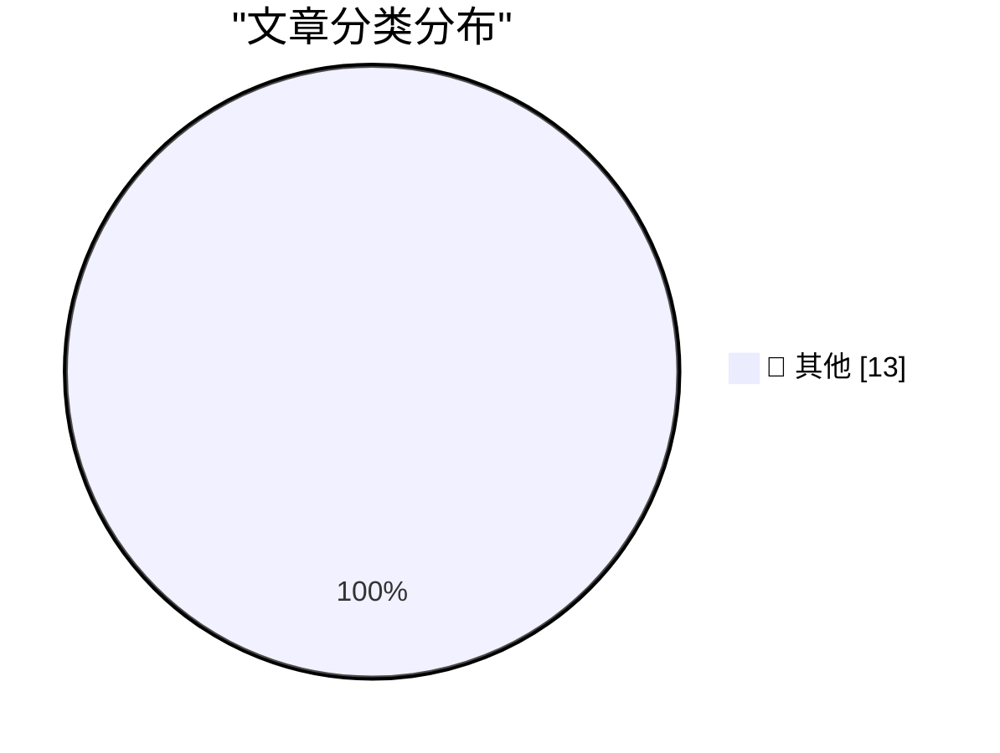

# 📰 AI 博客每日精选 — 2026-11-26

> 来自 Karpathy 推荐的 92 个顶级技术博客，AI 精选 Top 13

## 🏆 今日必读

🥇 **Quoting Scott Aaronson**

[Quoting Scott Aaronson](https://simonwillison.net/2026/Nov/25/scott-aaronson/) — simonwillison.net · 41 分钟前 · 📝 其他

> Quoting Scott Aaronson

🥈 **Ansible Fails waiting for privilege escalation on Ubuntu 26**

[Ansible Fails waiting for privilege escalation on Ubuntu 26](https://www.jeffgeerling.com/blog/2026/ansible-fails-become-ubuntu2604/) — jeffgeerling.com · 2 小时前 · 📝 其他

> Ansible Fails waiting for privilege escalation on Ubuntu 26

🥉 **1Password’s Backend Systems Were Compromised, Revealing Only Customer Account Metadata**

[1Password’s Backend Systems Were Compromised, Revealing Only Customer Account Metadata](https://1password.com/blog/update-on-nov-2026-security-incident) — daringfireball.net · 1 小时前 · 📝 其他

> 1Password’s Backend Systems Were Compromised, Revealing Only Customer Account Metadata

---

## 📊 数据概览

| 扫描源 | 抓取文章 | 时间范围 | 精选 |
|:---:|:---:|:---:|:---:|
| 82/92 | 2502 篇 → 13 篇 | 24h | **13 篇** |

### 分类分布

---

## 📝 其他

### 1. Quoting Scott Aaronson

[Quoting Scott Aaronson](https://simonwillison.net/2026/Nov/25/scott-aaronson/) — **simonwillison.net** · 41 分钟前 · ⭐ 15/30

> Quoting Scott Aaronson

---

### 2. Ansible Fails waiting for privilege escalation on Ubuntu 26

[Ansible Fails waiting for privilege escalation on Ubuntu 26](https://www.jeffgeerling.com/blog/2026/ansible-fails-become-ubuntu2604/) — **jeffgeerling.com** · 2 小时前 · ⭐ 15/30

> Ansible Fails waiting for privilege escalation on Ubuntu 26

---

### 3. 1Password’s Backend Systems Were Compromised, Revealing Only Customer Account Metadata

[1Password’s Backend Systems Were Compromised, Revealing Only Customer Account Metadata](https://1password.com/blog/update-on-nov-2026-security-incident) — **daringfireball.net** · 1 小时前 · ⭐ 15/30

> 1Password’s Backend Systems Were Compromised, Revealing Only Customer Account Metadata

---

### 4. ‘Trump Wanted Jensen Huang Back. Now, the President Is Alone in Washington’

[‘Trump Wanted Jensen Huang Back. Now, the President Is Alone in Washington’](https://www.cnbc.com/2026/11/24/trump-jensen-huang-nvidia.html) — **daringfireball.net** · 1 小时前 · ⭐ 15/30

> ‘Trump Wanted Jensen Huang Back. Now, the President Is Alone in Washington’

---

### 5. ‘The Life of a Composer’

[‘The Life of a Composer’](https://composer.pablostanley.com/#1) — **daringfireball.net** · 7 小时前 · ⭐ 15/30

> ‘The Life of a Composer’

---

### 6. 20 Percent He Has Other Problems, Which This Margin Is Too Narrow to Contain

[20 Percent He Has Other Problems, Which This Margin Is Too Narrow to Contain](https://www.wsj.com/politics/policy/trump-says-he-protects-brilliant-ceos-like-elon-musk-and-jensen-huang-b977cfda?st=7ctVgP) — **daringfireball.net** · 7 小时前 · ⭐ 15/30

> 20 Percent He Has Other Problems, Which This Margin Is Too Narrow to Contain

---

### 7. Pluralistic: New York vs auto-enshittification (25 Nov 2026)

[Pluralistic: New York vs auto-enshittification (25 Nov 2026)](https://pluralistic.net/2026/11/25/empire-state-strikes-back/) — **pluralistic.net** · 10 小时前 · ⭐ 15/30

> Pluralistic: New York vs auto-enshittification (25 Nov 2026)

---

### 8. Book Review: Slow Gods by Claire North ★★★★⯪

[Book Review: Slow Gods by Claire North ★★★★⯪](https://shkspr.mobi/blog/2026/11/book-review-slow-gods-by-claire-north/) — **shkspr.mobi** · 11 小时前 · ⭐ 15/30

> Book Review: Slow Gods by Claire North ★★★★⯪

---

### 9. Covering a body with eight smaller copies of itself

[Covering a body with eight smaller copies of itself](https://www.johndcook.com/blog/2026/11/25/hadwiger-covering/) — **johndcook.com** · 9 小时前 · ⭐ 15/30

> Covering a body with eight smaller copies of itself

---

### 10. Polynomials and Planets

[Polynomials and Planets](https://www.johndcook.com/blog/2026/11/25/polynomials-and-planets/) — **johndcook.com** · 10 小时前 · ⭐ 15/30

> Polynomials and Planets

---

### 11. This Week in Source Control: 25 November 2026

[This Week in Source Control: 25 November 2026](https://nesbitt.io/2026/11/25/this-week-in-source-control.html) — **nesbitt.io** · 14 小时前 · ⭐ 15/30

> This Week in Source Control: 25 November 2026

---

### 12. Have You Tried Using Your Agent?

[Have You Tried Using Your Agent?](https://blog.jim-nielsen.com/2026/have-you-tried-your-agent/) — **blog.jim-nielsen.com** · 5 小时前 · ⭐ 15/30

> Have You Tried Using Your Agent?

---

### 13. How the Tandy 2000 doomed Tandy computers

[How the Tandy 2000 doomed Tandy computers](https://dfarq.homeip.net/how-the-tandy-2000-doomed-tandy-computers/?utm_source=rss&#038;utm_medium=rss&#038;utm_campaign=how-the-tandy-2000-doomed-tandy-computers) — **dfarq.homeip.net** · 12 小时前 · ⭐ 15/30

> How the Tandy 2000 doomed Tandy computers

---

*生成于 2026-11-26 08:08 (Asia/Shanghai) | 扫描 82 源 → 获取 2502 篇 → 精选 13 篇*
*基于 [Hacker News Popularity Contest 2025](https://refactoringenglish.com/tools/hn-popularity/) RSS 源列表，由 [Andrej Karpathy](https://x.com/karpathy) 推荐*
*由「懂点儿AI」制作，欢迎关注同名微信公众号获取更多 AI 实用技巧 💡*
